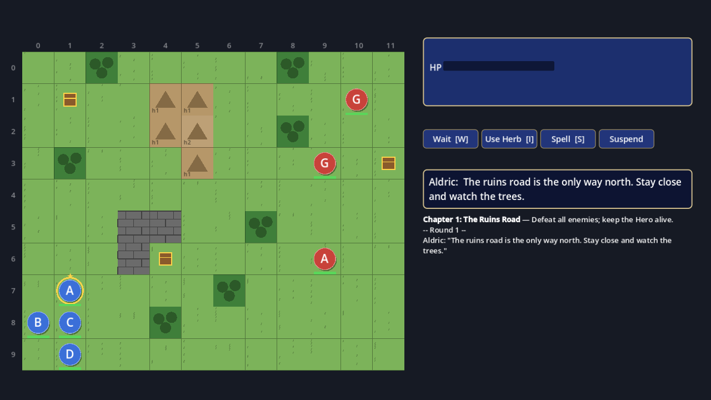

# ShiningForceTest — Project Banner

An original, single-player, isometric tactical RPG for desktop, built with Godot 4 and typed GDScript.

## Docs

| # | Doc | What it covers |
| --- | --- | --- |
| 01 | [App Design](doc/01-app-design.md) | Product vision, features, screens, scope, engineering overview |
| 02 | [Engineering Design](doc/02-eng-design.md) | Architecture, core features, interfaces, class definitions, data formats, testing |
| 03 | [Implementation Plan](doc/03-implementation-plan.md) | 12 steps, with tasks and validation for each |
| 04 | [Research & References](doc/04-research-and-references.md) | Genre reference analysis, IP guardrails, sources |

Start with the [doc index](doc/README.md).

## Run the game locally

**1. Install** (macOS, once):

```bash
brew install --cask godot        # Godot 4.7.2, the version pinned in .godot-version
```

On Windows or Linux, download Godot 4.7.2 from <https://godotengine.org/download/archive/> and use that binary as `godot`.

**2. Get the code:**

```bash
git clone https://github.com/yennanliu/ShiningForceTest.git
cd ShiningForceTest
```

**3. Play:**

```bash
godot --path .
```

A 1280×720 window opens on the title screen. Choose **New Game → Camp → Start battle**.

| In battle | Mouse | Keyboard / gamepad |
| --- | --- | --- |
| Move | Click a blue tile | Arrows / D-pad + Space / A |
| Attack | Click a red-outlined enemy (hover it for the forecast) | Cursor onto the enemy + Space / A |
| Wait (end turn) | Wait button | W / B |
| Use a herb / cast a spell | Use Herb / Spell buttons | I / X · S / Y |
| After the battle | Continue button | Enter / Start |

Win by defeating the enemies (chapter 3: the Goblin Chief). If Aldric (★) falls, you retreat to camp and keep your XP.

**No GPU? Play in the terminal instead:**

```bash
tools/docker.sh play                                   # needs Docker only
godot --headless --path . -s res://tools/play.gd       # or with Godot installed
```

## Setup

| You want to… | Command |
| --- | --- |
| **Play (2D, mouse)** | `brew install --cask godot`, then `godot --path .` (3-chapter vertical slice) |
| Play (text mode, no GPU) | `tools/docker.sh play` (or `godot --headless --path . -s res://tools/play.gd`) |
| Run the tests | `tools/docker.sh test` (or `tools/test.sh`) |
| Build the Linux app | `tools/docker.sh export` |
| Balance report (AI vs AI) | `godot --headless --path . -s res://tools/battle_sim.gd -- --runs=200` |
| Edit in the Godot editor | `godot --editor --path .` |
| Regenerate content / audio | `godot --headless --path . -s res://tools/make_content.gd` · `python3 tools/make_audio.py` |

The Godot version is pinned in `.godot-version`. Docker, CI and native runs all use it.


