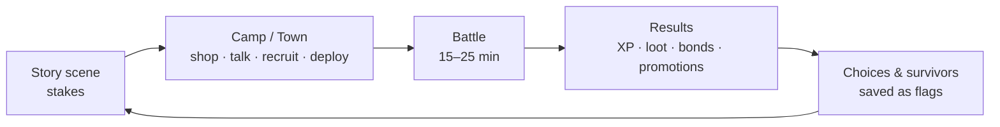
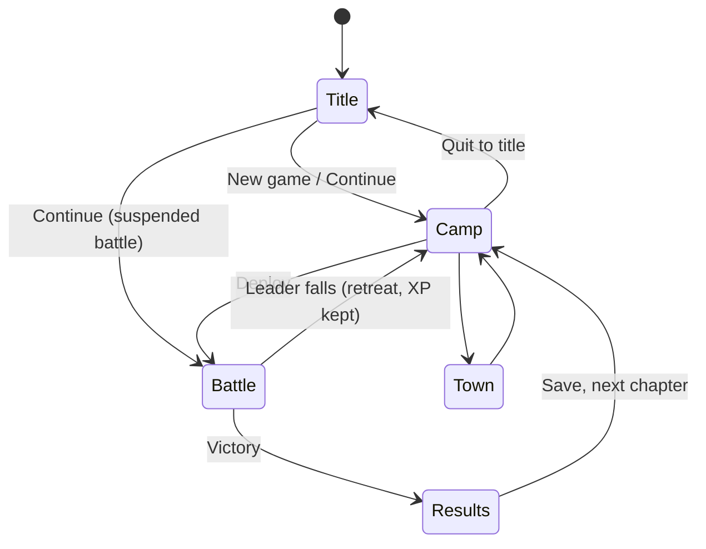
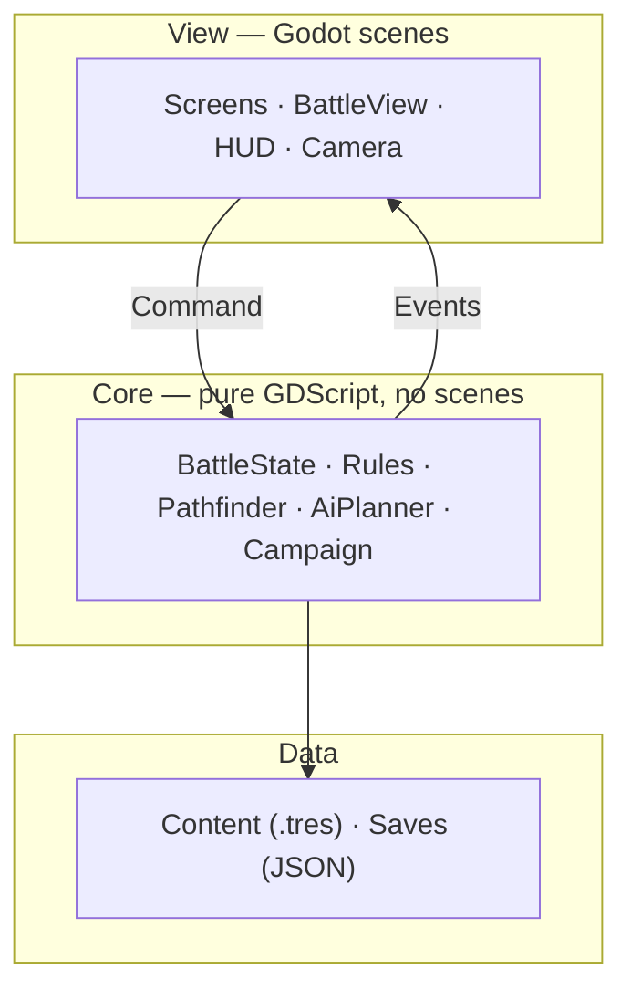
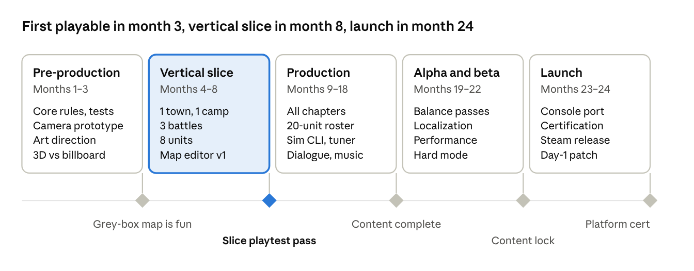

# 01 · App Design

Project Banner is an original, single-player tactical RPG for desktop. Players lead a party of 20 recruitable heroes through short, readable grid battles on 3D maps. Between fights they rest at a camp, where bonds between characters grow into combat bonuses. It runs offline on one machine, built with Godot 4 and typed GDScript.

| | |
| --- | --- |
| Status | Pre-production (docs only) |
| Platform | Desktop: macOS, Windows, Linux |
| Players | 1, local, offline |
| Engine / language | Godot 4.x · typed GDScript |
| Related | [02 Engineering Design](02-eng-design.md) · [03 Implementation Plan](03-implementation-plan.md) · [04 Research](04-research-and-references.md) |

**Contents:** [Part A: Product](#part-a--product) — [1 Vision](#1-vision) · [2 Pillars](#2-design-pillars) · [3 Core loop](#3-core-loop) · [4 Features](#4-features) · [5 Screens](#5-screens-and-controls) · [6 Scope](#6-scope-and-non-goals) · [7 Success](#7-success-metrics) — [Part B: Engineering](#part-b--engineering-overview) — [8 Constraints](#8-constraints) · [9 Stack](#9-tech-stack) · [10 Architecture](#10-architecture-at-a-glance) · [11 Decisions](#11-key-technical-decisions) · [12 Quality bar](#12-quality-bar) — [Part C: Delivery](#part-c--delivery) — [13 Roadmap](#13-roadmap-and-team) · [14 Risks](#14-risks) · [15 Open questions](#15-open-questions)

---

## Part A — Product

### 1. Vision

> *"Every turn is a small, readable decision. The party is the story."*

- **Player fantasy:** command a growing band of misfits in a war told from one side. Players watch individual units grow, promote, and fight better beside the friends they've made.
- **Target player:** fans of classic console tactics RPGs who want 15–25 minute battles and a story-driven campaign, without grinding or a 100-hour commitment.
- **Inspiration:** 1990s console tactics RPGs (see [04](04-research-and-references.md)). We borrow genre mechanics. We do not reuse any specific game's names, story, characters, art, music or maps.

### 2. Design pillars

Every feature must serve at least one pillar. If it serves none, we cut it.

| Pillar | Means | Example |
| --- | --- | --- |
| **Readable decisions** | Players see everything before they commit | Move/attack ranges, land effect, hit %, damage forecast |
| **Short, varied battles** | 15–25 min per map, each map with one twist | Escort, loot race, timed bridge, boss with phases |
| **The party is the story** | Units feel like people | Bonds, camp chats, promotions, mid-battle recruits |
| **Momentum** | No dead time | No world map, small towns, free full heal after battles, skippable animations |

### 3. Core loop

One chapter takes 60–90 minutes. The v1 campaign is about 12 chapters, roughly 15–20 hours.

### 4. Features

Priorities: **P0** = vertical slice (month 8), **P1** = v1 launch, **P2** = after launch, if ever.

| Area | Feature | Priority |
| --- | --- | --- |
| **Battle** | Square grid on 3D heightmap, terrain move cost + land effect | P0 |
| | Speed-based turn order with a visible turn bar | P0 |
| | Move + one action: Attack, Magic, Item, Equip, Wait | P0 |
| | Damage forecast (hit %, damage range, counter) | P0 |
| | Crits, counters, double attacks, weapon specials | P0 |
| | Rotating camera (4 angles), 3 zoom levels, wall fade | P0 |
| | Enemy AI with per-map behavior presets | P0 |
| | Map triggers: reinforcements, talk events, objective changes | P0 |
| | Battle speed and animation skip | P1 |
| | Suspend save mid-battle | P1 |
| | Hard mode | P1 |
| **Party** | Recruitable roster (8 in slice, 20 in v1), 12 deployed per battle | P0 |
| | XP, levels, per-class stat growth | P0 |
| | Promotion at level 20+ | P1 |
| | Bonds: 5 tiers, stat bonuses when bonded units fight together | P1 |
| **World** | Camp hub: party, storage, bond viewer, unit chats | P0 |
| | Small explorable towns with shops, NPCs and search spots | P0 |
| | Rare-ore weapon forging | P2 |
| **System** | 3 save slots + autosave | P0 |
| | Settings: volume, window mode, key rebinding | P1 |
| | Keyboard/mouse + gamepad | P0 / P1 |
| | Localization-ready text (English first) | P1 |
| | Save carryover into a sequel scenario | P2 |

### 5. Screens and controls

| Screen | Player does | Shows |
| --- | --- | --- |
| **Title** | New game, continue, settings, quit | Save slots with chapter and play time |
| **Camp** | Rearrange party, equip, storage, read chats, deploy | Roster, bond viewer, current objective |
| **Town** | Walk, talk, shop, search spots | Small 3D town, shop menus, dialogue box |
| **Battle** | Move cursor, choose action, confirm target, rotate camera | Map, ranges, turn bar, unit panel, forecast |
| **Results** | Review rewards, save | XP gained, level-ups, loot, bond changes |

| Action | Keyboard / mouse | Gamepad |
| --- | --- | --- |
| Move cursor | Arrows / mouse | D-pad / left stick |
| Confirm | Enter / left click | A |
| Cancel / back | Esc / right click | B |
| Rotate camera | Q / E | LB / RB |
| Zoom | Mouse wheel | Right stick |
| Menu | Tab | Start |

### 6. Scope and non-goals

**In scope (v1):** about 12 chapters, about 20 recruits, about 14 battle maps, 6 tilesets, English text, desktop builds.

**Out of scope (non-goals):**

- Multiplayer, online features, accounts, cloud saves, telemetry
- Mobile or web builds
- Procedural maps or a randomized campaign
- Voice acting
- Any name, character, story, map, art or music from an existing game

### 7. Success metrics

| Metric | Target | Measured by |
| --- | --- | --- |
| First-try clear rate per map (normal) | 70–85% | Playtest sessions |
| Average battle length | 15–25 min | Battle replay logs |
| "Battles are fun" rating (slice playtest) | ≥ 4 / 5 from 5 outside testers | Survey |
| Crash-free sessions | ≥ 99.5% | QA + beta reports |
| Save corruption | 0 reports | QA + beta reports |

---

## Part B — Engineering overview

> The full technical design is in [02 Engineering Design](02-eng-design.md). This part covers what a non-engineer needs to know.

### 8. Constraints

- **Local only.** No server, no network calls, no accounts. Everything the game needs ships in one app.
- **One player at a time.** No concurrency or sync problems to solve.
- **Desktop first.** Keyboard/mouse and gamepad. Min spec is an integrated GPU (Apple M1 / Intel Iris Xe class) with 8 GB RAM.
- **Small team.** 2–3 engineers. We favor boring, simple tech and few dependencies.

### 9. Tech stack

| Concern | Choice | Why |
| --- | --- | --- |
| Engine | Godot 4.x (pinned in `.godot-version`) | Free (MIT license); 3D, UI, audio, input and export are built in; small and fast to iterate |
| Language | Typed GDScript | Native to Godot, no build step, static types catch errors |
| Content | Godot Resources (`.tres`) | Typed, editable in the editor's inspector, readable git diffs |
| Saves | JSON in `user://saves/` | Readable, easy to version and migrate |
| Tests | Built-in headless runner (`tools/test.sh`, ~100 lines, no dependencies) | Runs the full rules core and whole battles without a window |
| Assets | Blender `.glb`, Aseprite `.png`, `.ogg` | Godot imports them natively |
| Repo / CI | Git, GitHub Actions | Every push runs the tests and produces a playable build |

### 10. Architecture at a glance

The rules (Core) are separate from the visuals (View). The View sends a **command** ("unit 3 attacks unit 7"). The Core checks it, updates the game, and returns a list of **events** ("hit for 12, unit 7 died") that the View animates. That gives us three things:

- **Testable:** whole battles run in tests with no window.
- **Reproducible:** a seed plus the list of commands replays any battle exactly, which makes bugs easy to reproduce.
- **Flexible:** art and UI can change without touching the rules.

### 11. Key technical decisions

| Decision | Chosen | Alternatives considered | Why |
| --- | --- | --- | --- |
| Engine | Godot 4 | Unity, Bevy, web (Three.js + Tauri) | Free, integrated editor for maps, simplest path to 3D desktop builds |
| Language | Typed GDScript | C#, Rust (Bevy), TypeScript | No build step, best editor integration. C# stays an option for hot spots |
| Rules/visual split | Command → events | Logic inside scene nodes | Testability and replays outweigh a little extra code |
| Randomness | One seeded RNG per battle | Global `randf()` | Deterministic battles, replays, no save-scumming rerolls |
| Content format | `.tres` Resources | JSON, spreadsheets, a database | Typed, editable in the editor, no loader code |
| Save format | Versioned JSON | Binary, SQLite | Readable, easy to migrate, small |

### 12. Quality bar

| Area | Target |
| --- | --- |
| Frame rate | 60 fps on min spec, 1080p |
| Load time | Title < 3 s, battle map < 2 s |
| AI turn | < 100 ms thinking per enemy unit |
| Saves | Atomic write (temp file + rename); old versions always load |
| Tests | Core coverage ≥ 80%; every map passes the AI-vs-AI soak test in CI |

---

## Part C — Delivery

### 13. Roadmap and team

| Phase | Months | Exit gate |
| --- | --- | --- |
| Pre-production | 1–3 | Grey-box battle is fun |
| Vertical slice | 4–8 | 5 outside testers finish 3 battles, rate ≥ 4/5, 60 fps |
| Production | 9–18 | Content complete |
| Alpha / beta | 19–22 | Content lock, crash-free ≥ 99.5% |
| Launch | 23–24 | Builds signed, store page live |

**Team (6–10):** 1 director/designer, 2 gameplay engineers, 1 tools engineer, 1–2 level designers, 1 writer, 2 artists, 1 UI/UX. Contractors: composer/sound and QA. Step-by-step engineering plan: [03](03-implementation-plan.md).

### 14. Risks

| Risk | Likelihood | Mitigation |
| --- | --- | --- |
| Content scope outgrows the team | High | Roster capped at 20; 6 shared tilesets; cut order: side maps → recruits → cutscenes |
| Battles too easy | High | AI soak tests, hard mode, clear-rate target checked each milestone |
| 3D camera hides units | Medium | Wall fade, top-down toggle, outlines on hidden units |
| 3D character art cost | Medium | Decide 3D vs. 2D billboards in month 1 with a prototype |
| Save breaks after patches | Medium | Versioned saves + a migration test for every past version |
| Too close to an existing IP | Medium | Guardrails in [04](04-research-and-references.md); legal review each milestone |

### 15. Open questions

- [ ] 3D rigged characters or 2D billboards on 3D maps? (Art lead, month 1)
- [ ] Final title and setting brief (Director + writer, month 3)
- [ ] Gamepad support at slice or at v1? (Leads, month 4)
- [ ] Console ports: in scope for v1 or after? (Leads, month 12)
