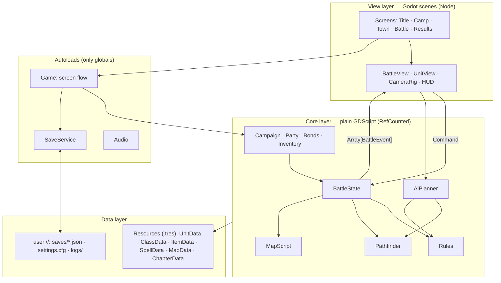
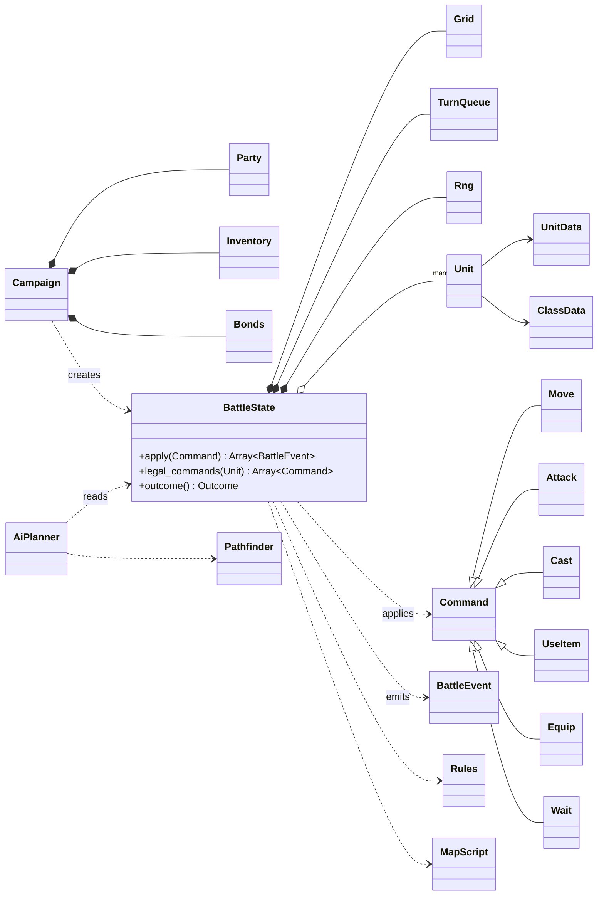
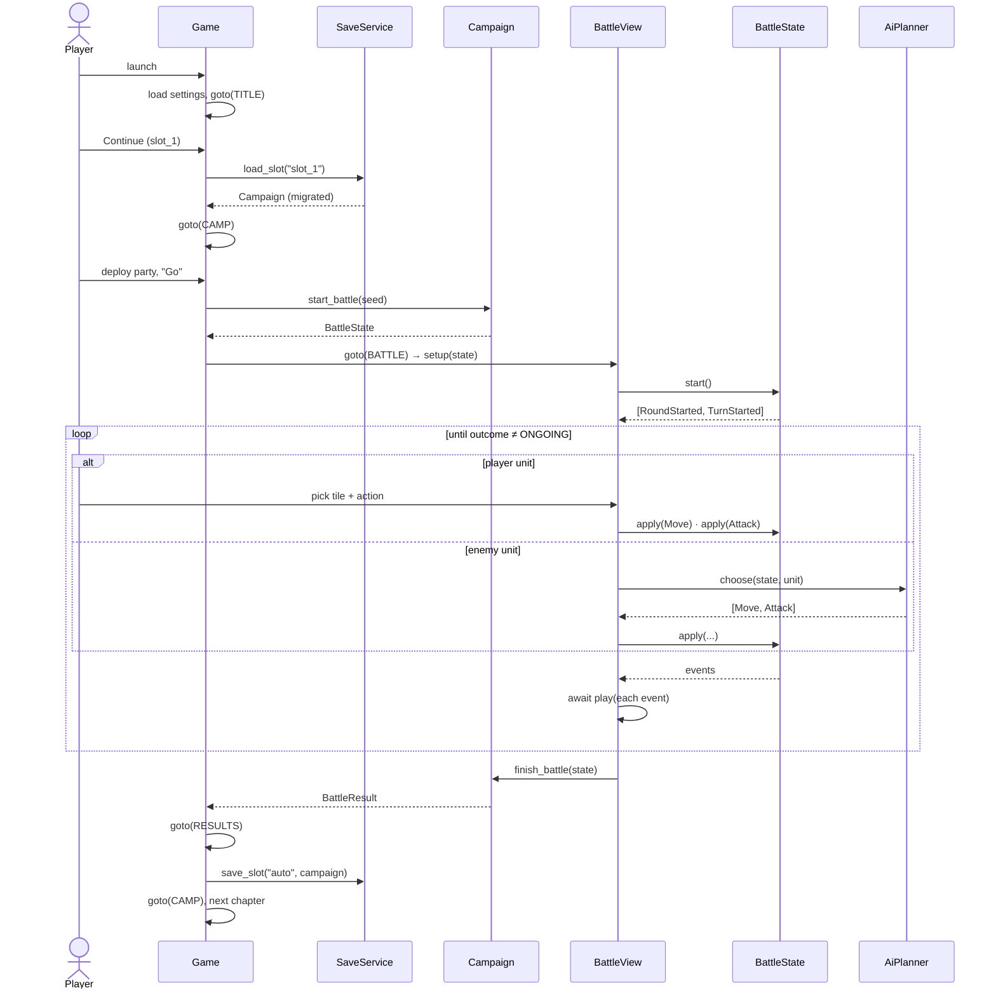

# 02 · Engineering Design

This doc defines how Project Banner is built. All game rules live in a pure-GDScript **core** with one entry point, `BattleState.apply(Command) -> Array[BattleEvent]`. Godot scenes only draw the game and take input, and content lives in typed Resources. Because the core is pure and the RNG is seeded, whole battles run headless in CI and any battle can be replayed from a seed plus its command list.

| | |
| --- | --- |
| Audience | Engineers |
| Prerequisite | [01 App Design](01-app-design.md) |
| Next | [03 Implementation Plan](03-implementation-plan.md) |

**Contents:** [1 Goals](#1-goals-and-non-goals) · [2 Architecture](#2-architecture) · [3 Project structure](#3-project-structure) · [4 Core features](#4-core-features) · [5 Class definitions](#5-class-definitions) · [6 Module interfaces](#6-module-interfaces) · [7 App I/O](#7-app-io) · [8 Data contracts](#8-data-contracts) · [9 End-to-end flow](#9-end-to-end-flow) · [10 Errors & invariants](#10-error-handling-and-invariants) · [11 Testing](#11-testing) · [12 Performance](#12-performance-budgets) · [13 Build & run](#13-build-run-and-ci)

---

## 1. Goals and non-goals

**Goals**

1. **One source of truth for rules.** The core decides everything; the view only shows it.
2. **Deterministic battles.** Same seed + same commands = same result, every time.
3. **Content without code.** Designers add units, items and maps as Resources.
4. **Fast feedback.** The full test suite runs headless in about a minute.

**Non-goals:** networking, multiplayer, mods/scripting API, ECS, custom engine work, runtime code generation.

---

## 2. Architecture



### Layer rules

| Rule | Enforced by |
| --- | --- |
| `core/` never references `Node`, `SceneTree`, `get_tree()`, `Input` or anything in `view/` | CI grep check (`tools/check_layers.sh`) |
| Battle state changes **only** through `BattleState.apply()` | Code review + fields are private by convention (`_units`) with read-only getters |
| The only randomness in a battle is `BattleState.rng` | CI grep: no `randf()`/`randi()` in `core/` outside `rng.gd` |
| `data/` holds no logic beyond simple getters | Code review |
| At most 3 autoloads: `Game`, `SaveService`, `Audio` | `project.godot` review |

---

## 3. Project structure

```
ShiningForceTest/
├── project.godot              # project config: window, autoloads, input map
├── .godot-version             # pinned engine version, e.g. 4.x.y-stable
├── export_presets.cfg         # macOS / Windows / Linux targets
├── .gitattributes             # Git LFS rules for assets/**
│
├── core/                      # RULES — pure GDScript, no Nodes, fully unit-tested
│   ├── battle/
│   │   ├── battle_state.gd    # BattleState: the battle aggregate, apply(cmd) -> events
│   │   ├── unit.gd            # Unit: runtime stats, hp/mp, position, items
│   │   ├── stats.gd           # Stats: value object (hp, mp, atk, def, agi, luk)
│   │   ├── grid.gd            # Grid: tiles, height, terrain, occupancy
│   │   ├── turn_queue.gd      # TurnQueue: initiative order per round
│   │   ├── commands.gd        # Command + Move / Attack / Cast / UseItem / Wait
│   │   ├── events.gd          # BattleEvent + all event types
│   │   ├── rules.gd           # Rules: formulas, forecast, outcome check
│   │   ├── map_script.gd      # MapScript: runs map triggers
│   │   └── rng.gd             # Rng: seeded wrapper, the only randomness
│   ├── path/pathfinder.gd     # Pathfinder: reachable tiles, paths, attack tiles
│   ├── ai/ai_planner.gd       # AiPlanner: picks the best plan for an enemy unit
│   └── campaign/
│       ├── campaign.gd        # Campaign: whole-game state + battle start/finish
│       ├── party.gd           # Party: roster, deployment, promotion
│       ├── inventory.gd       # Inventory: storage, gold
│       └── bonds.gd           # Bonds: pair points, tiers, bonuses
│
├── data/                      # CONTENT — no logic
│   ├── defs/                  # Resource schemas (section 5.1)
│   ├── units/ classes/ items/ spells/ terrain/ chapters/   # *.tres
│   ├── maps/                  # m01.tres (rules data) + m01.tscn (3D scene)
│   └── dialogue/              # *.json: id -> {speaker, text, portrait}
│
├── view/                      # PRESENTATION — scenes + scripts
│   ├── screens/               # title, camp, town, battle, results (.tscn + .gd)
│   ├── battle/                # battle_view.gd, unit_view, camera_rig, tile_highlight
│   │   └── hud/               # action_menu, unit_panel, forecast_panel, turn_bar
│   ├── dialogue/              # dialogue_box.tscn
│   └── common/                # theme.tres, fonts, shared widgets
│
├── autoload/                  # game.gd, save_service.gd, audio.gd
├── assets/                    # models/ textures/ audio/ fonts/  (Git LFS)
├── tests/
│   ├── core/                  # unit tests, one file per core class
│   ├── e2e/                   # headless battle + campaign runs
│   ├── golden/                # recorded replays + expected snapshots
│   └── fixtures/              # tiny maps, units, items for tests
├── tools/                     # check_layers.sh, battle_sim.gd, map painter plugin
├── .github/workflows/ci.yml   # test → export → smoke
└── doc/
```

---

## 4. Core features

Each feature below lists its rules and the classes that own it. Values marked *(tune)* are starting points.

### 4.1 Grid and terrain — `Grid`, `TerrainData`

- Square tiles addressed by `Vector2i`; each tile has `height: int` (0–8) and `terrain: TerrainData`.
- `TerrainData` holds `land_effect` (0.0 / 0.15 / 0.30) and `move_cost` per `MoveType` (`-1` = impassable).
- A step from tile A to B is legal if B is in bounds, passable for the unit's move type, `|h(B) − h(A)| ≤ unit.jump`, and B is not held by an enemy. Allies can be passed through but not stopped on.

| Terrain | Foot | Armored | Mounted | Flying | Aquatic | Land effect |
| --- | --- | --- | --- | --- | --- | --- |
| Plain | 1 | 1 | 1 | 1 | 3 | 0% |
| Forest | 2 | 3 | 3 | 1 | 3 | 15% |
| Hill | 2 | 3 | 2 | 1 | 3 | 30% |
| Sand | 2 | 2 | 3 | 1 | 3 | 0% |
| Shallow water | 3 | — | — | 1 | 1 | 0% |
| Deep water | — | — | — | 1 | 1 | 0% |
| Wall | — | — | — | — | — | 0% |

*(tune)* All costs.

### 4.2 Turn order — `TurnQueue`

- At the start of each round: `initiative = agi × rng.between(0.875, 1.125)` for every living unit, sorted high → low. Ties go to the player, then lower `id`.
- `next()` pops the next living unit. When the queue is empty, a new round starts, `round += 1`, and a `RoundStarted` event fires.
- Units that die are skipped. Units spawned mid-round join the next round.
- `peek(n)` feeds the turn bar in the HUD.

### 4.3 Movement and pathfinding — `Pathfinder`

- **Dijkstra** from the unit's tile, limited by `class.mov`, with edge cost `terrain.move_cost[move_type]`.
- Returns `Dictionary[Vector2i, int]` (tile → cost) plus a `came_from` map so `path_to` can rebuild the path.
- `attack_tiles(from, range)` = tiles at Manhattan distance `range.x..range.y`. Height does not block attacks *(tune)*.
- Turn structure: a unit may `Move` once, then must take exactly one ending action (`Attack`, `Cast`, `UseItem`, `Wait`). Moving is optional.

### 4.4 Combat resolution — `Rules`

For `Attack(attacker → target)`:

1. **Hit:** `hit% = clamp(90 + (atk.luk − tgt.agi / 2) − tgt.evade_bonus, 10, 99)`
2. **Damage:** `dmg = max(1, floor((atk.attack − tgt.defense × (1 + land)) × rng.between(0.9, 1.1) × crit_mult × bond_mult))`
3. **Crit:** chance `4% + bond crit bonus`, `crit_mult = 1.5`
4. **Weapon special:** chance per weapon (5–15%): extra hit, status, or drain
5. **Double attack:** `6%` (+ class bonus) for a second strike
6. **Counter:** if the target survives and the attacker is within the target's range: chance `8% + bond counter bonus`, resolved with the same steps

Every step appends events (`Attacked`, `Damaged`, `Died`, `XpGained`…). `Rules.forecast()` computes hit %, the damage range and counter possibility **without** rolling the RNG, for the HUD.

### 4.5 Magic and items — `Cast`, `UseItem`

- A spell has 1–4 levels; each level sets `mp_cost`, `power`, `range`, `area` (radius 0–2).
- Damage spells: `dmg = power × rng.between(0.9, 1.1) × (1 − resist[element])`. They skip `DEF` and land effect.
- Heal spells and items: `+amount` HP, capped at max.
- Each unit has 4 item slots. Equipping a weapon or ring does **not** end the turn. Using a consumable does.

### 4.6 XP, levels, promotion — `Rules`, `Party`

- `xp = clamp(round(base × (1 + (enemy_lv − my_lv) × 0.15)), 1, 49)`. Base = 10 per hit, 48 per kill, 10–25 per heal *(tune)*.
- 100 XP = 1 level. On level-up, each stat gains `floor(growth) + (1 if rng.chance(frac(growth)))`.
- **Promotion** (camp, level ≥ 20): class becomes `class.promotes_to[i]`, level → 1, stats kept, new growth table.

### 4.7 Bonds — `Bonds`

- Points per unordered pair `(a, b)`: +4 when both damage the same target in one round, +6 when one heals the other, +2 when attacking while adjacent *(tune)*.
- Tiers at `0 / 40 / 120 / 260 / 500` points → tier 0–4.
- **In combat:** the attacker uses the highest tier among adjacent allies. Each tier adds +2% hit, +1% crit, +2% counter, and ×(1 + 0.02 × tier) damage *(tune)*.
- **On death:** the fallen unit drops one tier with every partner, but its points stay so the tier can come back fast.

### 4.8 Map scripting — `MapScript`, `TriggerData`

Triggers are data, not code: `when` + `condition` → `actions`.

| `when` | Param | Example |
| --- | --- | --- |
| `ROUND_START` | round number | Round 5 → spawn reinforcements |
| `UNIT_ENTERS` | `Rect2i` area | Hero reaches bridge → objective changes |
| `UNIT_DIES` | unit tag | Boss dies → win |
| `HP_BELOW` | unit tag + % | Boss < 50% → says line, phase 2 |
| `TALK` | unit tag pair | Hero talks to NPC → recruit |

Actions: `SPAWN`, `SAY`, `SET_FLAG`, `SET_OBJECTIVE`, `RECRUIT`, `WIN`, `LOSE`. Each trigger fires once unless `repeat = true`. Triggers run inside `apply()`, so they are deterministic and replayable.

### 4.9 Enemy AI — `AiPlanner`

```
for each reachable tile t (including staying put):
    for each legal ending action a from t:
        score = w_dmg·expected_damage + w_kill·kill_chance + w_leader·threat_to_leader
              − w_risk·expected_damage_taken_next_round + w_land·land_effect(t)
              + profile_bias(a, t)
return argmax → [Move(t), a]
```

- The profile (`AGGRESSIVE`, `GUARD(area)`, `HOLD`, `HUNT_LEADER`, `HEALER`, `FLEE`) sets the weights and a bias.
- Expected values use `Rules.forecast()`, never the battle RNG. Ties are broken by a fixed order (lower tile index), so AI choices stay deterministic.
- Budget: < 100 ms per unit (§12). If too slow, prune to the top N tiles by distance to targets.

### 4.10 Victory and defeat — `Rules.check_outcome`

- **Win:** the map's objective is met (`ROUT`, `DEFEAT_BOSS`, `REACH_AREA`, `SURVIVE_ROUNDS`) or a `WIN` action fires.
- **Lose:** the leader dies, or a `LOSE` action fires (for example, an escort NPC dies).
- **On loss:** the party retreats to camp with XP and items kept (no game over).

### 4.11 Campaign — `Campaign`, `Party`, `Inventory`, `Bonds`

- `Campaign` is the root of all saved state: chapter, roster, inventory, gold, bonds, flags, play time.
- `start_battle()` **copies** the deployed units into a fresh `BattleState`, so a lost or abandoned battle never changes the roster.
- `finish_battle()` merges XP, levels, items, deaths (revived with a gold fee) and bond changes back into the roster, and returns a `BattleResult`.

### 4.12 Save and load — `SaveService`

- `Campaign.to_dict()` → JSON → `user://saves/<slot>.json.tmp` → rename. The rename is atomic, so a crash can't leave a half-written save.
- Every file has `"version": int`. On load, `MIGRATIONS[v]` runs for each `v` from the file's version up to `CURRENT_VERSION`.
- A **suspend** save stores `{map_id, seed, commands[]}`. Resuming rebuilds the battle by replaying the commands (deterministic, §2).

---

## 5. Class definitions

Signatures are the contract. Bodies are left out (`...`). All scripts use static types.

### 5.1 Data definitions (`data/defs/`, `extends Resource`)

```gdscript
# enums.gd — shared enums
class_name Enums
enum Faction { PLAYER, ENEMY, NEUTRAL }
enum MoveType { FOOT, ARMORED, MOUNTED, FLYING, AQUATIC }
enum WeaponType { SWORD, AXE, SPEAR, BOW, STAFF, NONE }
enum Element { NONE, FIRE, ICE, WIND, BOLT, HOLY, DARK }
enum AiProfile { AGGRESSIVE, GUARD, HOLD, HUNT_LEADER, HEALER, FLEE }
enum Objective { ROUT, DEFEAT_BOSS, REACH_AREA, SURVIVE_ROUNDS }
```

```gdscript
class_name Stats extends Resource
@export var hp: int
@export var mp: int
@export var atk: int
@export var def: int
@export var agi: int
@export var luk: int
func plus(o: Stats) -> Stats: ...
```

```gdscript
class_name ClassData extends Resource
@export var id: StringName
@export var display_name: String
@export var move_type: Enums.MoveType
@export var mov: int = 5
@export var jump: int = 2
@export var weapon_types: Array[Enums.WeaponType]
@export var growth: Stats                    # average gain per level (e.g. atk 2.4)
@export var spells: Array[SpellData]
@export var promotes_to: Array[ClassData]    # empty = cannot promote
```

```gdscript
class_name UnitData extends Resource
@export var id: StringName                   # stable id, used in saves and triggers
@export var display_name: String
@export var portrait: Texture2D
@export var model: PackedScene
@export var class_data: ClassData
@export var base_level: int = 1
@export var base_stats: Stats
@export var starting_items: Array[ItemData]
```

```gdscript
class_name ItemData extends Resource
enum Kind { WEAPON, RING, CONSUMABLE, KEY }
@export var id: StringName
@export var display_name: String
@export var kind: Kind
@export var weapon_type: Enums.WeaponType = Enums.WeaponType.NONE
@export var bonus: Stats                     # stat bonuses while equipped
@export var attack_range := Vector2i(1, 1)   # min, max
@export var special: SpecialData             # null = none
@export var heal_amount: int                 # consumables
@export var price: int
```

```gdscript
class_name SpecialData extends Resource
enum Effect { EXTRA_HIT, POISON, SLEEP, DRAIN }
@export var effect: Effect
@export_range(0.0, 1.0) var chance: float = 0.1
```

```gdscript
class_name SpellData extends Resource
@export var id: StringName
@export var display_name: String
@export var element: Enums.Element
@export var heals: bool = false
@export var levels: Array[SpellLevel]        # 1..4
```

```gdscript
class_name SpellLevel extends Resource
@export var mp_cost: int
@export var power: int
@export var spell_range := Vector2i(1, 2)
@export var area: int = 0                    # radius
```

```gdscript
class_name TerrainData extends Resource
@export var id: StringName
@export var land_effect: float = 0.0
@export var move_cost: Dictionary[Enums.MoveType, int]   # -1 = impassable
```

```gdscript
class_name MapData extends Resource
@export var id: StringName
@export var size: Vector2i
@export var heights: PackedByteArray         # size.x * size.y
@export var terrain_ids: PackedByteArray     # index into terrain_types
@export var terrain_types: Array[TerrainData]
@export var player_spawns: Array[Vector2i]
@export var enemies: Array[EnemySpawn]
@export var triggers: Array[TriggerData]
@export var objective: Enums.Objective
@export var objective_param: Variant         # boss tag, Rect2i, or round count
@export var scene: PackedScene               # the 3D map to draw
```

```gdscript
class_name EnemySpawn extends Resource
@export var unit: UnitData
@export var level: int
@export var at: Vector2i
@export var ai: Enums.AiProfile
@export var tag: StringName                  # referenced by triggers, e.g. &"boss"
@export var is_leader: bool = false
```

```gdscript
class_name TriggerData extends Resource
enum When { ROUND_START, UNIT_ENTERS, UNIT_DIES, HP_BELOW, TALK }
@export var when: When
@export var param: Variant
@export var actions: Array[TriggerAction]
@export var repeat: bool = false
```

```gdscript
class_name TriggerAction extends Resource
enum Kind { SPAWN, SAY, SET_FLAG, SET_OBJECTIVE, RECRUIT, WIN, LOSE }
@export var kind: Kind
@export var args: Dictionary                 # e.g. {"spawn": EnemySpawn} / {"line": &"ch1_boss_01"}
```

```gdscript
class_name ChapterData extends Resource
@export var id: StringName
@export var title: String
@export var intro_dialogue: StringName
@export var town_scene: PackedScene          # null = camp only
@export var battle: MapData
@export var recruits_on_start: Array[UnitData]
@export var reward_gold: int
@export var next: ChapterData                # null = campaign end
```

### 5.2 Battle runtime (`core/battle/`, `extends RefCounted`)

```gdscript
class_name Unit extends RefCounted
var id: int                                  # unique within a battle
var data: UnitData
var faction: Enums.Faction
var class_data: ClassData
var level: int
var xp: int
var base: Stats                              # stats without equipment
var hp: int
var mp: int
var pos: Vector2i
var items: Array[ItemData]                   # max 4
var weapon_slot: int = -1
var ring_slot: int = -1
var ai: Enums.AiProfile
var tag: StringName
var is_leader: bool

func is_alive() -> bool: ...
func stats() -> Stats: ...                   # base + equipped bonuses
func weapon() -> ItemData: ...
func attack_range() -> Vector2i: ...
func copy() -> Unit: ...
func to_dict() -> Dictionary: ...
static func from_dict(d: Dictionary) -> Unit: ...
```

```gdscript
class_name Grid extends RefCounted
func _init(map: MapData) -> void: ...
func in_bounds(t: Vector2i) -> bool: ...
func height(t: Vector2i) -> int: ...
func terrain(t: Vector2i) -> TerrainData: ...
func move_cost(t: Vector2i, mt: Enums.MoveType) -> int: ...   # -1 = impassable
func land_effect(t: Vector2i) -> float: ...
func neighbors(t: Vector2i) -> Array[Vector2i]: ...
func unit_at(t: Vector2i) -> Unit: ...       # null if empty
func place(u: Unit, t: Vector2i) -> void: ...
func vacate(t: Vector2i) -> void: ...
```

```gdscript
class_name Rng extends RefCounted
var seed: int
func _init(seed: int) -> void: ...
func between(lo: float, hi: float) -> float: ...
func chance(p: float) -> bool: ...
func pick(arr: Array) -> Variant: ...
```

```gdscript
class_name TurnQueue extends RefCounted
var round: int
func start_round(units: Array[Unit], rng: Rng) -> void: ...
func next() -> Unit: ...                     # null = round over
func peek(n: int) -> Array[Unit]: ...
```

```gdscript
class_name BattleState extends RefCounted
enum Outcome { ONGOING, WON, LOST }

var map: MapData
var grid: Grid
var rng: Rng
var queue: TurnQueue
var flags: Dictionary[StringName, Variant]
var history: Array[Command]                  # every applied command, for replay

func _init(map: MapData, party: Array[Unit], seed: int) -> void: ...
func start() -> Array[BattleEvent]: ...      # first RoundStarted + TurnStarted
func units() -> Array[Unit]: ...
func unit(id: int) -> Unit: ...
func current_actor() -> Unit: ...
func has_moved() -> bool: ...
func legal_commands(u: Unit) -> Array[Command]: ...
func apply(cmd: Command) -> Array[BattleEvent]: ...   # THE entry point
func outcome() -> Outcome: ...
static func replay(map: MapData, party: Array[Unit], seed: int, cmds: Array[Command]) -> BattleState: ...
```

### 5.3 Commands (`core/battle/commands.gd`)

```gdscript
class_name Command extends RefCounted
var unit_id: int
func is_valid(s: BattleState) -> bool: ...                       # pure check
func execute(s: BattleState, out: Array[BattleEvent]) -> void: ...  # mutates s
func ends_turn() -> bool: return true
func to_dict() -> Dictionary: ...
static func from_dict(d: Dictionary) -> Command: ...

class Move extends Command:
    var to: Vector2i
    func ends_turn() -> bool: return false
class Attack extends Command:
    var target_id: int
class Cast extends Command:
    var spell_id: StringName
    var level: int
    var at: Vector2i
class UseItem extends Command:
    var slot: int
    var target_id: int
class Equip extends Command:
    var slot: int
    func ends_turn() -> bool: return false
class Wait extends Command:
    pass
```

### 5.4 Events (`core/battle/events.gd`)

```gdscript
class_name BattleEvent extends RefCounted
func to_dict() -> Dictionary: ...            # for logs and golden tests
```

| Event | Fields | View reaction |
| --- | --- | --- |
| `RoundStarted` | `round` | Turn bar refresh |
| `TurnStarted` | `unit_id` | Camera pans to the unit, HUD opens if it's a player unit |
| `Moved` | `unit_id, path: Array[Vector2i]` | Walk along the path |
| `Attacked` | `attacker_id, target_id, hit: bool, crit: bool, special: StringName` | Attack animation, "Miss" / "Critical!" |
| `Damaged` | `unit_id, amount, hp_after` | Number pop, HP bar |
| `Healed` | `unit_id, amount, hp_after` | Green number |
| `MpSpent` | `unit_id, amount, mp_after` | MP bar |
| `StatusChanged` | `unit_id, status, on: bool` | Status icon |
| `Died` | `unit_id` | Fade out |
| `XpGained` | `unit_id, amount` | XP bar |
| `LeveledUp` | `unit_id, new_level, gains: Stats` | Level-up panel |
| `BondChanged` | `a_id, b_id, tier` | Heart icon |
| `ItemUsed` / `Equipped` | `unit_id, item_id` | Item icon / unit panel |
| `Spawned` | `unit_id` | Unit appears, camera pans |
| `Said` | `speaker: StringName, line_id: StringName` | Dialogue box (waits for input) |
| `ObjectiveChanged` | `objective, param` | Banner |
| `TurnEnded` | `unit_id` | — |
| `BattleEnded` | `outcome` | Victory / defeat banner → Results |

### 5.5 Rules, pathfinding, AI, scripting (`core/`)

```gdscript
class_name Rules
static func hit_chance(s: BattleState, a: Unit, t: Unit) -> float: ...
static func damage_range(s: BattleState, a: Unit, t: Unit) -> Vector2i: ...
static func forecast(s: BattleState, a: Unit, t: Unit) -> Forecast: ...    # no RNG
static func resolve_attack(s: BattleState, a: Unit, t: Unit, out: Array[BattleEvent]) -> void: ...
static func resolve_spell(s: BattleState, a: Unit, spell: SpellData, lv: int, at: Vector2i, out: Array[BattleEvent]) -> void: ...
static func xp_for(actor: Unit, target: Unit, kind: StringName) -> int: ...
static func check_outcome(s: BattleState) -> BattleState.Outcome: ...

class Forecast:
    var hit: float
    var dmg: Vector2i          # min, max
    var crit: float
    var counter: bool
```

```gdscript
class_name Pathfinder
static func reachable(g: Grid, u: Unit) -> Dictionary[Vector2i, int]: ...
static func path_to(g: Grid, u: Unit, to: Vector2i) -> Array[Vector2i]: ...  # empty = unreachable
static func attack_tiles(g: Grid, from: Vector2i, reach: Vector2i) -> Array[Vector2i]: ...
```

```gdscript
class_name AiPlanner
static func choose(s: BattleState, u: Unit) -> Array[Command]: ...   # e.g. [Move, Attack] or [Wait]
static func score(s: BattleState, u: Unit, at: Vector2i, action: Command) -> float: ...
```

```gdscript
class_name MapScript
static func on_round_start(s: BattleState, out: Array[BattleEvent]) -> void: ...
static func on_moved(s: BattleState, u: Unit, out: Array[BattleEvent]) -> void: ...
static func on_died(s: BattleState, u: Unit, out: Array[BattleEvent]) -> void: ...
static func on_damaged(s: BattleState, u: Unit, out: Array[BattleEvent]) -> void: ...
```

### 5.6 Campaign (`core/campaign/`)

```gdscript
class_name Campaign extends RefCounted
var chapter: ChapterData
var party: Party
var inventory: Inventory
var bonds: Bonds
var flags: Dictionary[StringName, Variant]
var play_seconds: int

static func new_game(first: ChapterData) -> Campaign: ...
func start_battle(seed: int) -> BattleState: ...         # copies deployed units
func finish_battle(s: BattleState) -> BattleResult: ...  # merges results back
func advance_chapter() -> void: ...
func to_dict() -> Dictionary: ...
static func from_dict(d: Dictionary) -> Campaign: ...
```

```gdscript
class_name Party extends RefCounted
const MAX_DEPLOY := 12
var roster: Array[Unit]
var deployed: Array[int]                     # indices into roster; the leader is always deployed
func recruit(data: UnitData) -> Unit: ...
func set_deployed(ids: Array[int]) -> bool: ...
func can_promote(u: Unit) -> bool: ...
func promote(u: Unit, to: ClassData) -> void: ...
```

```gdscript
class_name Inventory extends RefCounted
var gold: int
var storage: Array[ItemData]
func buy(item: ItemData) -> bool: ...
func sell(item: ItemData) -> void: ...
```

```gdscript
class_name Bonds extends RefCounted
const TIERS := [0, 40, 120, 260, 500]
func add(a: StringName, b: StringName, pts: int) -> int: ...   # returns new tier
func tier(a: StringName, b: StringName) -> int: ...
func best_adjacent_tier(s: BattleState, u: Unit) -> int: ...
func drop_tier_on_death(a: StringName) -> void: ...
```

```gdscript
class_name BattleResult extends RefCounted
var outcome: BattleState.Outcome
var xp: Dictionary[StringName, int]
var level_ups: Array[StringName]
var loot: Array[ItemData]
var gold: int
var fallen: Array[StringName]
var bond_changes: Array[Dictionary]
```

### 5.7 Autoloads (`autoload/`, `extends Node`)

```gdscript
# game.gd — screen flow
extends Node
enum Screen { TITLE, CAMP, TOWN, BATTLE, RESULTS }
signal screen_changed(screen: Screen)
var campaign: Campaign
var slot: String
func goto(screen: Screen, args: Dictionary = {}) -> void: ...
func new_game() -> void: ...
func continue_game(slot: String) -> void: ...
```

```gdscript
# save_service.gd
extends Node
const CURRENT_VERSION := 1
const DIR := "user://saves/"
func save_slot(slot: String, c: Campaign, suspend: Dictionary = {}) -> Error: ...
func load_slot(slot: String) -> Campaign: ...     # null on missing/corrupt
func load_suspend(slot: String) -> Dictionary: ... # {} if none
func list_slots() -> Array[SlotInfo]: ...
func delete(slot: String) -> void: ...
```

```gdscript
# audio.gd
extends Node
func play_music(track: AudioStream, fade: float = 0.5) -> void: ...
func play_sfx(sfx: AudioStream) -> void: ...
func set_volume(bus: StringName, linear: float) -> void: ...
```

### 5.8 View (key scripts only)

```gdscript
# view/battle/battle_view.gd
extends Node3D
var state: BattleState
func setup(s: BattleState) -> void: ...
func play(e: BattleEvent) -> void: ...            # awaits the animation for one event
func _on_player_chose(cmds: Array[Command]) -> void:
    for c in cmds:
        for e in state.apply(c):
            await play(e)
    await _run_until_player_turn()                 # AI turns: AiPlanner.choose -> apply -> play
```



---

## 6. Module interfaces

Input → output for every public entry point. All are synchronous and side-effect free unless noted.

| Module | Call | Input | Output | Side effects |
| --- | --- | --- | --- | --- |
| `BattleState` | `new(map, party, seed)` | `MapData`, `Array[Unit]`, `int` | battle | — |
| | `start()` | — | `Array[BattleEvent]` | starts round 1 |
| | `apply(cmd)` | `Command` | `Array[BattleEvent]` (empty = rejected) | mutates battle, appends to `history` |
| | `legal_commands(u)` | `Unit` | `Array[Command]` | — |
| | `outcome()` | — | `Outcome` | — |
| | `replay(...)` | map, party, seed, commands | `BattleState` | — |
| `Rules` | `forecast(s, a, t)` | battle, 2 units | `Forecast` | — (no RNG) |
| `Pathfinder` | `reachable(g, u)` | `Grid`, `Unit` | `Dictionary[Vector2i, int]` | — |
| | `path_to(g, u, to)` | `Grid`, `Unit`, `Vector2i` | `Array[Vector2i]` | — |
| `AiPlanner` | `choose(s, u)` | battle, unit | `Array[Command]` | — (no RNG) |
| `Campaign` | `start_battle(seed)` | `int` | `BattleState` | — (copies units) |
| | `finish_battle(s)` | finished battle | `BattleResult` | updates roster, bonds, gold |
| | `to_dict()` / `from_dict(d)` | — / `Dictionary` | `Dictionary` / `Campaign` | — |
| `SaveService` | `save_slot(slot, c, suspend)` | `String`, `Campaign`, `Dictionary` | `Error` | writes file (atomic) |
| | `load_slot(slot)` | `String` | `Campaign` or `null` | reads file, migrates |
| | `list_slots()` | — | `Array[SlotInfo]` | reads files |
| `Game` | `goto(screen, args)` | `Screen`, `Dictionary` | — | swaps scene, emits `screen_changed` |

---

## 7. App I/O

| Direction | What | Format / location |
| --- | --- | --- |
| In | Player input | Input map actions: `confirm`, `cancel`, `menu`, `rotate_left`, `rotate_right`, `zoom_in`, `zoom_out`, `cursor_up/down/left/right` (keyboard, mouse, gamepad) |
| In | Content | `res://data/**/*.tres`, `res://data/dialogue/*.json` (packed into the app) |
| In | Assets | `res://assets/**`: `.glb`, `.png`, `.ogg`, `.ttf` (packed) |
| In / out | Saves | `user://saves/slot_1..3.json`, `auto.json` |
| In / out | Settings | `user://settings.cfg` (`ConfigFile`): volumes, window mode, bindings |
| Out | Window + audio | 1920×1080 base, scaled to fit with `canvas_items` stretch mode; stereo |
| Out | Logs | `user://logs/godot.log`; `user://logs/last_battle.json` (seed + commands) |

No network I/O. Writes go only to `user://`. On macOS that is `~/Library/Application Support/Godot/app_userdata/Banner/`.

---

## 8. Data contracts

### 8.1 Command (serialized, for replays and suspend saves)

```json
{ "type": "Attack", "unit_id": 3, "target_id": 7 }
{ "type": "Move",   "unit_id": 3, "to": [4, 6] }
{ "type": "Cast",   "unit_id": 5, "spell_id": "blaze", "level": 2, "at": [6, 6] }
```

### 8.2 Save file — `user://saves/slot_1.json`

```json
{
  "version": 1,
  "saved_at": "2026-11-07T10:30:00Z",
  "play_seconds": 5420,
  "chapter": "ch02",
  "gold": 1200,
  "party": {
    "deployed": ["hero", "archer"],
    "roster": [
      { "id": "hero", "class": "swordsman", "level": 7, "xp": 40,
        "base": { "hp": 28, "mp": 0, "atk": 14, "def": 9, "agi": 8, "luk": 5 },
        "hp": 28, "mp": 0, "items": ["bronze_sword", "herb"], "weapon_slot": 0, "ring_slot": -1 }
    ]
  },
  "storage": ["healing_seed"],
  "bonds": { "archer|hero": 85 },
  "flags": { "saved_villager": true },
  "suspend": null
}
```

- Content is referenced by `id` (`StringName`), never by file path. That lets content files move without breaking saves.
- `suspend` (mid-battle) = `{ "map": "m03", "seed": 9182, "party": [...], "commands": [ ... ] }`.
- Bond keys are sorted pairs `"a|b"`.

### 8.3 Dialogue — `data/dialogue/ch01.json`

```json
{ "ch1_boss_01": { "speaker": "boss", "portrait": "boss_angry", "text": "You will not pass!" } }
```

---

## 9. End-to-end flow



---

## 10. Error handling and invariants

| Situation | Behavior |
| --- | --- |
| Invalid command (out of range, wrong turn, dead unit) | `apply()` returns `[]` and logs a warning; state unchanged. The HUD only offers `legal_commands`, so this means a bug |
| Missing content id when loading a save | Unknown items are dropped and unknown units skipped, with a warning; the game keeps running |
| Corrupt or unreadable save | `load_slot()` returns `null`; the slot shows "Damaged" in the UI; the other slots are unaffected |
| Save write fails (disk full) | `save_slot()` returns an error; the UI shows a message; the previous file stays intact (temp file + rename) |
| Newer save version than the app | Refuse to load and show "made with a newer version" |

**Invariants** (asserted in debug builds and checked in tests after every `apply`):

- No two living units share a tile; every living unit is in bounds.
- `0 ≤ hp ≤ max_hp`, `0 ≤ mp ≤ max_mp`.
- Exactly one current actor while `outcome() == ONGOING`.
- `replay(map, party, seed, history)` produces the same state as the live battle.

---

## 11. Testing

| Level | Scope | Example | Runs |
| --- | --- | --- | --- |
| **Unit** | One core class | `test_pathfinder.gd`: forest costs 2 for foot; a 3-height cliff blocks a jump-2 unit | Editor + CI |
| **Property** | Invariants under random play | 500 random seeds × random legal commands → invariants hold after each `apply` | CI |
| **Battle E2E** | A full battle, headless | AI vs AI on every map: ends in < 200 rounds, no errors, outcome ≠ ONGOING | CI |
| **Golden replay** | Determinism + regressions | Replay `tests/golden/*.json` → final state equals the snapshot; changing it on purpose means updating the snapshot | CI |
| **Campaign E2E** | Screen flow + saves | New game → ch1 battle (auto) → results → save → load → `to_dict()` equal | CI |
| **Smoke** | Exported app boots | `build/Banner --headless --quit-after 300` exits 0 | CI after export |
| **Manual** | Feel and fun | Weekly playtest of the CI build | Weekly |

Target: core line coverage ≥ 80%. The view is tested by playtests and the smoke test, not by unit tests.

---

## 12. Performance budgets

| Item | Budget | How we check |
| --- | --- | --- |
| Frame time | ≤ 16.6 ms (60 fps) on min spec | Godot profiler, playtest builds |
| `apply()` | < 1 ms typical | Microbenchmark in tests |
| `Pathfinder.reachable` | < 2 ms on a 32×32 map | Microbenchmark |
| `AiPlanner.choose` | < 100 ms per unit | Battle sim CLI reports the max |
| Map load | < 2 s | Timer log |
| Save / load | < 50 ms | Timer log |
| Memory | < 1.5 GB | Profiler |

---

## 13. Build, run and CI

```bash
# Setup
git clone git@github.com-yennanliu:yennanliu/ShiningForceTest.git && cd ShiningForceTest
git lfs pull                                       # Godot version: see .godot-version

# Run
godot --editor --path .                            # editor, then F5
godot --path .                                     # play directly

# Test (unit + e2e + golden)
tools/test.sh                                      # optional filter: tools/test.sh pathfinder

# Simulate a map 1,000 times (balance)
godot --headless --path . -s tools/battle_sim.gd -- --map m03 --runs 1000

# Export
godot --headless --path . --export-release "macOS"   build/Banner.app
godot --headless --path . --export-release "Windows" build/Banner.exe
godot --headless --path . --export-release "Linux"   build/Banner.x86_64
```

**Docker (recommended for tests and builds).** `Dockerfile` pins the Godot version from `.godot-version`. It has a `base` target (Godot only) and an `export` target (adds about 1 GB of export templates). `tools/docker.sh test|export|shell` runs tasks in it with no local Godot install. Playing and editing still use the native Godot app, because they need a GPU and a window.

**CI (`.github/workflows/ci.yml`)**, on every push and pull request:

1. `tools/docker.sh test`: layer check + all tests in the container
2. `tools/docker.sh export`: Linux export + smoke test in the container
3. Upload the build as an artifact

Windows and macOS exports are added at step 10.
