# 03 · Implementation Plan

We build the game in **12 steps**, from the inside out: rules first, then visuals, then content. Each step ends with something you can run and a validation checklist that must pass before the next step starts. Steps 0–6 reach a **first playable grey-box battle by the end of month 3**. Steps 7–11 reach the **vertical slice by month 8**.

| | |
| --- | --- |
| Audience | Engineers, leads |
| Based on | [02 Engineering Design](02-eng-design.md) (class and file names match it) |
| Team assumed | 2 gameplay engineers + 1 tools engineer from month 2; art and design work in parallel |

**Contents:** [Overview](#overview) · [Definition of done](#definition-of-done-every-step) · Steps [0](#step-0--project-bootstrap) · [1](#step-1--data-schema-and-fixtures) · [2](#step-2--battle-model) · [3](#step-3--pathfinding) · [4](#step-4--commands-events-and-combat-rules) · [5](#step-5--enemy-ai-and-headless-battles) · [6](#step-6--grey-box-battle-view) · [7](#step-7--campaign-screen-flow-and-saves) · [8](#step-8--progression-xp-promotion-bonds-items) · [9](#step-9--map-scripting-dialogue-and-town) · [10](#step-10--hardening-settings-export-and-performance) · [11](#step-11--vertical-slice-content) · [12](#step-12--design-round-1-closer-to-the-genre-reference) · [Presentation 13–17](#presentation-rounds-steps-1317-characters-battle-scenes-portraits) · [UI round 18–22](#ui--design-round-steps-1822-fancier-production-ready) · [After the slice](#after-the-slice) · [Tracking](#tracking)

---

## Overview

```mermaid
flowchart LR
    subgraph M1["Month 1–3 · Pre-production"]
        S0["0 Bootstrap"] --> S1["1 Data schema"] --> S2["2 Battle model"] --> S3["3 Pathfinding"] --> S4["4 Commands & rules"] --> S5["5 AI + headless battles"] --> S6["6 Playable battle (text + 2D)"]
    end
    subgraph M2["Month 4–8 · Vertical slice"]
        S7["7 Campaign & saves"] --> S8["8 Progression"] --> S9["9 Scripting & town"] --> S10["10 Hardening"] --> S11["11 Slice content"]
    end
    S5 -. "Gate A: rules core done" .-> S6
    S6 -. "Gate B: first playable" .-> S7
    S11 -. "Gate C: slice playtest" .-> P["Production"]
```

| Step | Name | Weeks | Output you can run | Gate |
| --- | --- | --- | --- | --- |
| 0 | Project bootstrap | 1 | Empty project, CI green | |
| 1 | Data schema and fixtures | 1 | Resources open in the inspector | |
| 2 | Battle model | 1 | `BattleState` builds from a map | |
| 3 | Pathfinding | 1 | Ranges correct in tests | |
| 4 | Commands, events, rules | 2 | Scripted battle runs headless | |
| 5 | AI and headless battles | 2 | AI vs AI finishes every map in CI | **A: rules core done** |
| 6 | Playable battle: text + 2D views | 1 | Play a 4v4 battle with the mouse (2D) or in the terminal | **B: first playable** |
| 7 | Campaign, flow, saves | 2 | Title → camp → battle → results → save → load | |
| 8 | Progression | 3 | Level-ups, promotion, bonds, shop | |
| 9 | Scripting, dialogue, town | 3 | Reinforcements, boss lines, walkable town | |
| 10 | Hardening | 2 | Signed builds, settings, 60 fps | |
| 11 | Slice content | 8–10 | 1 town, 1 camp, 3 battles, 8 units | **C: slice playtest** |
| 12 | Design round 1 | 1 | Weapon matchups, poison/sleep, regen ring | |
| 13 | Art direction + asset pipeline | 2 | Art bible, placeholder sprites/portraits/backdrops load by id | Style sign-off (owner) |
| 14 | Portrait dialogue | 1 | Framed portrait + text box on every spoken line | |
| 15 | Map sprites + head icons (2D) | 2 | Characters instead of circles on the battle map | |
| 16 | Battle cut-in scene | 3 | Close-up attack/spell/heal scene with HP plates | |
| 17 | 3D isometric map | 4–6 | Textured 3D map, sprite billboards, 4 camera angles | |
| 18 | UI kit | 2 | Banner frame, fonts, theme, motion, focus, UI snapshots | Kit sign-off (owner) |
| 19 | Portraits v2 + profile | 3 | Detailed portraits, character profile screen, artist brief | |
| 20 | Screen redesigns | 3 | Title, camp, results, town, settings, credits | |
| 21 | Battle HUD polish | 2 | Portrait unit card, forecast card, turn bar, command menu | |
| 22 | Production readiness | 2 | Accessibility, resolutions, localization, stability | **D: looks finished** |

---

## Definition of done (every step)

A step is done only when **all** of these are true:

- [ ] All planned tasks are merged to `main` through PRs
- [ ] CI is green: layer check, all tests, export, smoke
- [ ] The step's **validation** checklist passes, with evidence linked in the PR (test names, a screenshot or a short clip)
- [ ] New public interfaces match [02](02-eng-design.md), or 02 was updated in the same PR
- [ ] No `TODO` without an issue link; no debug prints left in `core/`
- [ ] A 2-minute demo is shown at the weekly review

---

## Step 0 — Project bootstrap

**Goal:** a clean Godot project where tests and builds run automatically on every push.

**Tasks**

- [x] Install Godot 4.x stable; write the exact version to `.godot-version` (`4.7.2-stable`)
- [x] Create `project.godot` (name "Banner", 1920×1080, `canvas_items` stretch, placeholder title scene)
- [x] Create the folder tree from [02 §3](02-eng-design.md#3-project-structure) with `.gitkeep` files
- [x] Set up Git LFS for `assets/**` (`.gitattributes`). **Later changed:** LFS is disabled on the GitHub repo, so binaries are stored directly (2.3 MB of audio)
- [x] Test runner + one sample test. **Changed:** a built-in runner (`tests/run_tests.gd` + `TestCase`, run via `tools/test.sh`) instead of gdUnit4. It has no dependency, works on Godot 4.7, and counts script errors as failures
- [x] Write `tools/check_layers.sh`, which fails if `core/` mentions Nodes, `get_tree`, `Input`, `view/`, or calls `randf`/`randi` outside `rng.gd`
- [x] Add `export_presets.cfg` for macOS, Windows and Linux
- [x] Add `.github/workflows/ci.yml`: layer check → tests → Linux export → smoke → upload artifact
- [x] Register the empty autoloads `Game`, `SaveService`, `Audio`
- [x] **Added:** `Dockerfile` + `tools/docker.sh` (`test` / `export` / `shell`) with Godot pinned from `.godot-version`. CI runs the same container

**Validation**

| Check | How | Pass when | Result |
| --- | --- | --- | --- |
| Project opens | `godot --headless --path . --import` | No errors | ✅ |
| Tests run | `tools/test.sh` | 1 test, 0 failures | ✅ `1 passed, 0 failed` |
| Runner catches failures | Temp test with a bad assert + a runtime error | Both reported as FAIL, exit 1 | ✅ |
| Layer check bites | Temp `extends Node` and `randf()` in `core/` | Exits non-zero; passes once removed | ✅ |
| Smoke (local) | `godot --headless --path . --quit-after 60` | Exit code 0 | ✅ |
| Docker tests | `tools/docker.sh test` | Same result as native | ✅ `8 passed, 0 failed` |
| Docker export | `tools/docker.sh export` | Linux app builds and boots | ✅ `export + smoke: OK` (73 MB) |
| CI | Push to `main` | Workflow green, Linux build artifact downloadable | ✅ |

---

## Step 1 — Data schema and fixtures

**Goal:** every content type exists as a typed Resource, with tiny fixture content for tests.

**Tasks**

- [x] `data/defs/`: `Enums`, `Stats`, `ClassData`, `UnitData`, `ItemData`, `SpecialData`, `SpellData`, `SpellLevel`, `TerrainData`, `MapData`, `EnemySpawn`, `TriggerData`, `TriggerAction`, `ChapterData` ([02 §5.1](02-eng-design.md#51-data-definitions-datadefs-extends-resource))
- [x] Terrain set in `data/terrain/`: plain, forest, hill, sand, shallow water, deep water, wall (costs from [02 §4.1](02-eng-design.md#41-grid-and-terrain--grid-terraindata))
- [x] Fixtures in `tests/fixtures/`: 2 classes (swordsman, archer), 6 units (4 heroes, 2 enemy types), 3 items (sword, bow, herb), one 8×8 map with a hill block and forest, 4 player + 4 enemy spawns. Generated by `tools/make_fixtures.gd`; loaded in tests through `Fixtures`
- [x] `MapData.validate() -> PackedStringArray`: sizes match, spawns in bounds, on passable tiles, not overlapping

Simplifications compared with doc 02 (kept simple to run first):
- `Variant` fields became typed ones: `objective_tag` / `objective_area` / `objective_rounds`, plus trigger fields `on_round` / `area` / `tag` / `hp_percent`
- `TerrainData.move_cost` is a `PackedInt32Array` indexed by `MoveType`
- Class growth is in tenths of a point (`atk 24` = +2.4 per level)

**Validation**

| Check | Pass when | Result |
| --- | --- | --- |
| Typed fields | Every fixture loads as its class (`UnitData`, `MapData`…) | ✅ `test_every_fixture_loads_with_its_type` |
| Round-trip | Load each fixture `.tres`, save it, reload it → fields equal | ✅ `test_fixture_round_trip_keeps_fields` |
| Map validation | `validate()` on the fixture map returns `[]`; on a broken copy it returns the expected errors | ✅ `test_fixture_map_is_valid`, `test_broken_map_reports_errors` |
| Content lint in CI | A test calls `validate()` on every map in `data/maps/` | ✅ `test_all_game_maps_validate` (no game maps yet) |
| Inspector | Fixtures open in the Godot editor inspector | ⏳ manual check, open in the editor |

---

## Step 2 — Battle model

**Goal:** the battle's data structures exist and can be built from a map, with no rules yet.

**Tasks**

- [x] `Rng` (seeded; `between`, `chance`, `roll`, `pick`)
- [x] `Unit` (stats with equipment, `copy`, `to_dict`/`from_dict`)
- [x] `Grid` (built from `MapData`; height, terrain, occupancy, neighbors)
- [x] `TurnQueue` (initiative = `agi × between(0.875, 1.125)`, tie rules, `peek`)
- [x] `BattleState._init`, `start()`, `units()`, `living()`, `unit(id)`, `current_actor()`, plus a `check_invariants()` helper
- [x] **Added:** `Content` registry (`core/content.gd`) that resolves ids to Resources, so `Unit.to_dict()` stores ids, not paths

**Validation**

| Check | Pass when | Result |
| --- | --- | --- |
| Determinism | Two `Rng(42)`s produce identical sequences of 1,000 values | ✅ `test_rng_same_seed_same_sequence` |
| Grid | Unit tests: bounds, height, terrain lookup, `unit_at` after `place`/`vacate` | ✅ `test_grid_lookups`, `_neighbors`, `_occupancy` |
| Turn order | Same seed → same order; a unit with higher AGI goes first in > 90% of 1,000 seeds; dead units are skipped | ✅ `test_turn_order_*` (4 tests) |
| Build | `BattleState.new(fixture_map, party, 1)` places 8 units on spawns; invariants hold | ✅ `test_battle_builds_from_map` |
| Serialization | `Unit.from_dict(u.to_dict())` equals `u` | ✅ `test_unit_dict_round_trip` |
| Isolation | A battle copies the party; the caller's units are unchanged | ✅ `test_battle_does_not_change_callers_party` |

---

## Step 3 — Pathfinding

**Goal:** correct move and attack ranges for every movement type.

**Tasks**

- [x] `Pathfinder.reachable` (bucket-queue Dijkstra, move cost, jump limit, allies passable, enemies blocking)
- [x] `Pathfinder.path_to` (rebuilds the path from `came_from`)
- [x] `Pathfinder.attack_tiles` (Manhattan ring `min..max`) + `distance`
- [x] Microbenchmark on a 32×32 map

**Validation**

| Check | Pass when | Result |
| --- | --- | --- |
| Terrain cost | Foot unit, MOV 5, all plains → exactly the 61 tiles within distance 5 (open map) | ✅ `test_open_map_diamond_of_61_tiles` |
| Forest | A forest tile costs 2 for foot and 1 for flying (test both) | ✅ `test_forest_costs_*` |
| Height | A height-3 step blocks a jump-2 unit; jump-3 passes | ✅ `test_height_limits_jump` |
| Blocking | Can pass through an ally but not stop on it; cannot pass an enemy; dead units don't block | ✅ `test_pass_through_ally_but_not_stop`, `test_enemy_blocks`, `test_dead_units_do_not_block`, `test_wall_is_impassable` |
| Path | `path_to` returns a contiguous path whose total cost equals `reachable[to]` | ✅ checked for every reachable tile on the fixture map |
| Bow ring | Range (2, 3) excludes adjacent tiles | ✅ `test_bow_ring_excludes_adjacent` |
| Speed | `reachable` < 2 ms on 32×32 (median of 100 runs) | ✅ 0.47 ms locally with MOV 6 (the CI machine is about 2× slower) |

---

## Step 4 — Commands, events and combat rules

**Goal:** a full battle can be played by code. This step creates the core contract.

**Tasks**

- [x] `Command` base + `MoveCommand`, `AttackCommand`, `EquipCommand`, `UseItemCommand`, `WaitCommand` (`Cast` comes in step 8), with `is_valid`, `execute`, `to_dict`/`from_dict`. One file each in `core/battle/commands/`
- [x] `BattleEvent` with `to_dict`. **Simplified:** one generic class (`type` + `data` dict, type constants such as `BattleEvent.DAMAGED`) instead of a class per event
- [x] `BattleState.apply`: validate → execute → record in `history` → outcome check → turn advance
- [x] `BattleState.legal_commands(u)`, `snapshot()`, `check_invariants()`
- [x] `Rules`: hit, damage, crit, counter, land effect, XP, heal, `forecast` (no RNG, returns a Dictionary), `check_outcome` (rout, defeat boss, leader dies). **Deferred to step 8:** double attacks and weapon specials
- [x] `BattleState.replay(map, party, seed, cmds)`

**Validation**

| Check | Pass when | Result |
| --- | --- | --- |
| Contract | Invalid command (wrong turn, out of range, ally, too far, bad slot, null) → `[]`, state unchanged (`snapshot()` before/after) | ✅ `test_invalid_commands_are_rejected_without_changes` |
| Turn shape | `Move` then `Attack` works; a second `Move` is rejected; `Wait` ends the turn; rounds advance | ✅ `test_turn_shape_move_then_act`, `test_wait_ends_turn`, `test_rounds_advance` |
| Formulas | Hit clamped to 10–99, damage range, minimum 1 damage, land effect lowers damage, XP clamped | ✅ `test_hit_chance_is_clamped`, `test_damage_range_and_minimum`, `test_land_effect_lowers_damage`, `test_xp_formula` |
| Forecast | `forecast().dmg` contains the damage actually dealt in 1,000 seeded attacks; forecast never uses the RNG | ✅ `test_forecast_contains_actual_damage`, `test_forecast_does_not_touch_rng` |
| Events | Killing blow emits `attacked → damaged → died → xp_gained` in that order | ✅ `test_killing_blow_event_order` |
| Items | Herb heals and is consumed; equip keeps the turn; class weapon rules hold | ✅ `test_use_item_heals_and_consumes`, `test_equip_does_not_end_turn` |
| Outcome | All enemies dead → WON; leader dead → LOST; no commands after the end | ✅ `test_win_when_all_enemies_die`, `test_lose_when_leader_dies` |
| Replay + invariants | 20 seeds × up to 60 random legal commands: invariants hold after every `apply`, and `replay()` from command dicts gives an identical `snapshot()` | ✅ `test_random_play_keeps_invariants_and_replays` |

---

## Step 5 — Enemy AI and headless battles

**Goal:** the computer can play either side, so whole battles run in CI. **Gate A.**

**Tasks**

- [x] `AiPlanner.choose`: **simple rules** (doc 02 §4.9). HOLD never moves; otherwise attack the lowest-HP hostile in reach (prefer not moving); otherwise step toward the nearest hostile; otherwise wait. (A first scoring version was replaced by these rules to keep it simple)
- [x] `AutoPlay.play_turn` / `play_to_end`: AI plays either side, always bounded (a turn that makes no progress is ended with Wait)
- [x] `tests/e2e/test_battle_runs.gd`: AI vs AI on every map (fixture + `data/maps/`), 50 seeds each
- [x] Property test: 500 seeds × 25 random legal commands; invariants after each `apply`
- [x] Golden replays (seeds 7, 21, 99) in `tests/golden/`, written by `tools/make_golden.gd`, compared as normalized JSON
- [x] `tools/battle_sim.gd`: `-- --runs=N [--map=res://…]` → win rate, unfinished, average rounds, deaths, max AI ms

**Validation**

| Check | Pass when | Result |
| --- | --- | --- |
| Finishes | Every map × 50 seeds ends (`outcome ≠ ONGOING`) in < 200 rounds with 0 errors | ✅ `test_every_map_finishes_for_50_seeds`; sim: 200/200 finished |
| Sensible | AI attacks a unit in range instead of waiting; moves in to attack; picks the lowest-HP target; `HOLD` never moves and only attacks in place | ✅ `test_ai.gd` (6 tests) |
| Deterministic | Same seed → same AI choices (compare `history`) | ✅ `test_ai_is_deterministic` |
| Fast | Max AI think time < 100 ms per unit | ✅ sim max 9.3 ms |
| Property | 500 seeds of random legal play keep every invariant | ✅ `test_random_play_invariants_500_seeds` |
| Golden | Golden replays pass; a deliberate formula change makes them fail | ✅ passes; changing `XP_HIT` or `BASE_HIT` fails it. (Crit 4%→5% did not, because no roll in these short battles landed in that window, so goldens catch most but not all changes) |
| **Gate A review** | Leads read the sim report and the test list, then sign off that the rules core is ready for visuals | ✅ signed off by the project owner, 2026-11-07 |

**Gate A sim report** (`tools/battle_sim.gd -- --runs=200`, fixture 8×8 map, AI vs AI):

```
player win rate: 44%      unfinished: 0
avg rounds:      3.4
max AI think:    9.3 ms
```

A 44% win rate is fine for now: both sides use the same rules on a tiny map with equal forces, and losing the hero (the leader) loses the battle. Step 8 tunes balance (target: 60–90% for a human player).

---

## Step 6 — Playable battle, no GPU (text mode)

**Goal:** a person can play a whole battle against the computer. **Gate B.**

**Changed from the original plan:** two views instead of the 3D grey-box, both normal View-layer clients of the core (nothing in `core/` changed):

1. **Text battle** (`view/terminal/`): ASCII map plus typed commands. Headless, no GPU, works in Docker and over SSH.
2. **2D top-down battle** (`view/battle2d/`, the main scene): tiles, units and UI drawn with simple shapes (no art yet). Uses Godot's lightweight Compatibility renderer, which runs on any built-in GPU (checked on an Apple M4).

The 3D isometric view moves to *after the slice*.

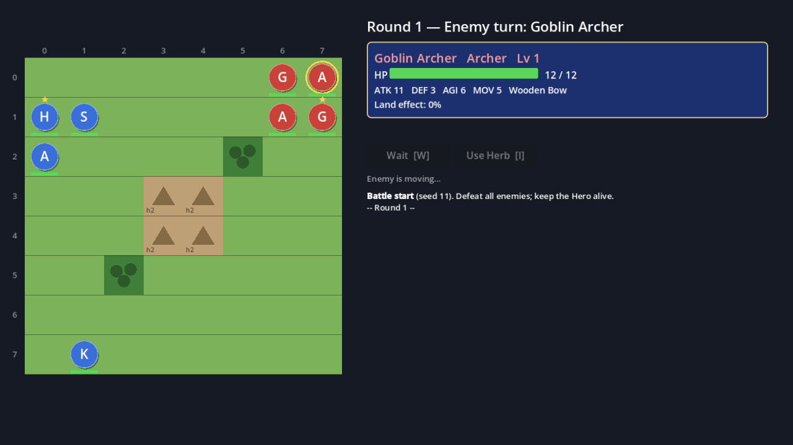

**Tasks**

- [x] `TextView.render(state)`: map with coordinates, terrain symbols, units (UPPER = yours, lower = enemy, `*` = acting), `+` on tiles the acting unit can reach, unit table (HP, position, weapon)
- [x] `TextView.describe(event)`: one readable line per event ("Goblin attacks Hero: hits / Hero takes 9 damage (HP 11)")
- [x] `TextView.parse(line)`: `m x y`, `a ID`, `i SLOT ID`, `e SLOT`, `w`, plus info commands `f ID` (forecast), `u ID` (unit details), `r`, `h`, `q`
- [x] `TerminalGame`: turn loop. You command your units; enemy turns run through `AutoPlay`; it shows events and the victory/defeat banner. Input/output are injected so tests can script it
- [x] `tools/play.gd` (`-- --seed=N`) and `tools/docker.sh play [seed]`
- [x] **2D battle screen** `view/battle2d/battle_screen.tscn` (main scene): colored terrain tiles (forest, hill, height), unit tokens with HP bars, a star on leaders, a ring on the acting unit, a blue move range, red outlines on attackable enemies, a hover outline, floating damage numbers, animated moves, a unit panel (name, class, level, HP bar, stats, land effect), an attack forecast on hover, Wait/Herb buttons (W/I), a battle log, a VICTORY/DEFEAT banner, and R for a new battle
- [x] Screenshot mode for checking visuals: `godot --path . -- --screenshot=out.png --demo-turns=3 --seed=11`
- [x] Renderer switched to `gl_compatibility`; window opens at 1280×720 (scaled from 1920×1080)

**Validation**

| Check | Pass when | Result |
| --- | --- | --- |
| No GPU | Runs headless on the Mac and in Docker | ✅ `godot --headless … tools/play.gd`; `tools/docker.sh play` |
| Renders | Map rows, units, enemy letters, hill, `+` move range on your turn | ✅ `test_render_shows_map_units_and_reach` |
| Commands | Every command parses; bad input gives a usage message | ✅ `test_parse_commands`, `test_parse_errors_and_info` |
| Every event readable | No raw dicts in the battle log for a full battle | ✅ `test_every_event_has_text` |
| Plays to the end | Scripted input: a whole battle finishes and shows the result | ✅ `test_game_loop_plays_to_the_end` |
| Robust | Garbage input, illegal moves and quit leave a valid state | ✅ `test_game_loop_survives_bad_input` |
| No logic in view | Layer check green; the view only calls `apply`, `legal`/`forecast`, `AutoPlay` | ✅ |
| 2D screen works | Starts on a player turn, click moves the unit, bad clicks do nothing, waiting plays to the end and shows the banner | ✅ `test_battle_screen.gd` (4 tests, headless) |
| 2D renders | Screenshot on a real GPU looks right | ✅ Apple M4, see image above |
| **Gate B review** | A teammate who didn't build it wins the fixture battle with no help in < 15 minutes and finds it fun (≥ 3.5/5) | ✅ signed off by the project owner after playing the 2D build, 2026-11-07 |

## Step 7 — Campaign, screen flow and saves

**Goal:** the whole app loop works end to end: Title → Camp → Battle → Results → Camp … → end.

**Tasks**

- [x] `Campaign`, `Party`, `Inventory` (`new_game`, `start_battle` copies units, `finish_battle` merges XP and items back, heals and revives everyone)
- [x] `BattleResult`; win = gold + next chapter; leader loss = retreat with XP kept, same chapter
- [x] `Game` autoload state machine (`new_game`, `continue_game`, `start_battle`, `finish_battle`, `after_results`, `quit_to_title`, play-time counter)
- [x] Screens built in code (`view/screens/`): **Title** (New Game / Continue with a slot list / Quit), **Camp** (deploy checkboxes, leader locked, Save 1–3, Start battle), **Results** (victory/retreat, gold, XP per unit, who fell, end-of-campaign message). The 2D battle screen plays the campaign battle, and a Continue button leads to Results
- [x] `SaveService`: `save_slot` (atomic temp + rename), `load_slot`, `slot_info`, `list_slots`, version field + `migrate()` (v0 → v1 example)
- [x] Autosave after each battle; 3 manual slots in camp
- [x] Demo campaign: 2 chapters (ch01 rout on the 8×8 map; ch02 defeat a level-3 boss on a new map), generated by `tools/make_fixtures.gd`. Real chapters come in step 11
- [x] `tools/screenshot.gd -- --screen=title|camp|battle|results`

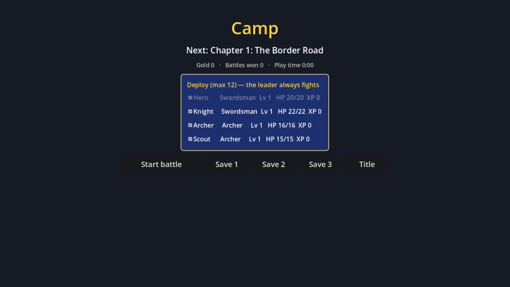 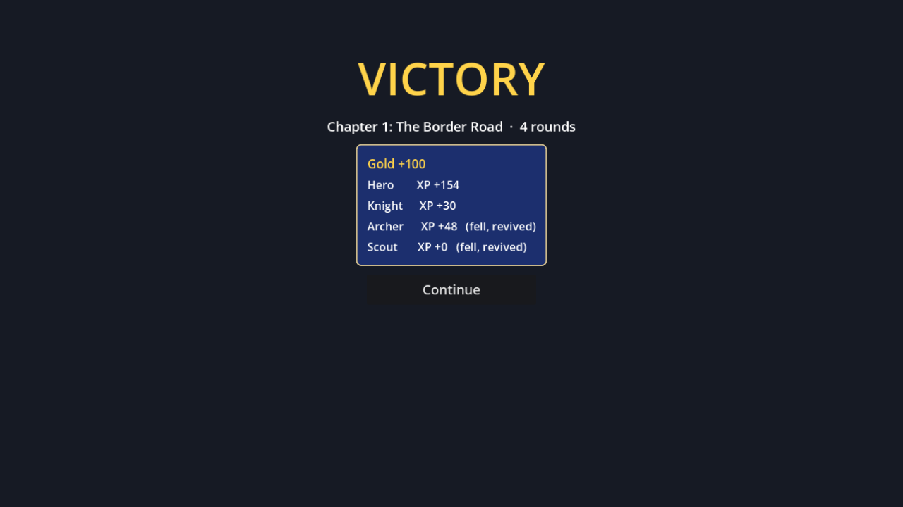

**Validation**

| Check | Pass when | Result |
| --- | --- | --- |
| E2E | New game → battle (AI) → results → autosave → save → load → identical campaign → next screen | ✅ `test_new_game_battle_results_save_load` |
| Whole campaign | Both demo chapters can be won in order; gold and wins add up | ✅ `test_whole_demo_campaign_completes` |
| Round-trip | `Campaign.from_dict(c.to_dict())` gives the same dict | ✅ `test_campaign_dict_round_trip` |
| Isolation | Changing or abandoning a battle leaves the roster unchanged | ✅ `test_battle_uses_copies` |
| Win / loss rules | Win: gold, XP, next chapter, full heal. Loss: same chapter, XP kept, leader listed as fallen | ✅ `test_win_gives_gold_xp_and_next_chapter`, `test_loss_keeps_xp_and_chapter` |
| Crash safety | A crash between writing and renaming leaves the previous save loadable | ✅ `test_crash_during_save_keeps_previous_save` |
| Corrupt file | A garbage `slot_2.json` shows as damaged; slots 1 and 3 still load | ✅ `test_damaged_slot_does_not_affect_others` |
| Migration | A hand-made v0 save loads after `v0 → v1`; a newer-version save is refused | ✅ `test_v0_save_migrates`, `test_newer_save_is_refused` |
| Screens | Title, Camp, Results build headless; screenshots on GPU look right | ✅ `test_screens_build_without_errors` + images above |
| Manual | Title → camp → battle → results → quit → relaunch → continue works | ⏳ human check: `godot --path .` |

## Step 8 — Progression: XP, promotion, bonds, items

**Goal:** units grow, and the party starts to feel like a story.

**Tasks**

- [x] XP → level every 100 XP; seeded growth rolls (`growth/10` + chance of 1 more); `leveled_up` event, "LEVEL UP" popup in 2D, level-ups listed on Results
- [x] Promotion (`Party.can_promote` / `promote`, level ≥ 20, `promotes_to`), with a Promote button in camp. Fixtures: swordsman → swordmaster, archer → sniper (MOV 6)
- [x] `Bonds` (simplified): allies standing next to a unit that lands a hit gain +4 points with it. Tiers at 0/40/120/260/500; the attacker's best adjacent tier gives +2% hit, +1% crit and +2% damage per tier. A fallen unit drops one tier with every partner. Bonds are saved in the campaign and copied into each battle
- [x] `CastCommand` + spells (heal allies / damage hostiles, area radius, MP cost). New Priest (cleric: Heal, Blaze) joins in chapter 2. Text: `c heal 1 x y`; 2D: Spell button (S) picks the most useful cast
- [x] Deferred from step 4: double attacks (6%) and weapon specials `EXTRA_HIT` and `DRAIN` (fixture: Steel Sword, 15% extra hit). `POISON`/`SLEEP` wait for a status system
- [x] Shop in camp, stocked per chapter (`ChapterData.shop`); purchases go to the first deployed unit with a free slot, else storage

**Validation**

| Check | Pass when | Result |
| --- | --- | --- |
| XP | Clamped to 1–49; kill > hit; 150 XP = level 2 with 50 left over | ✅ `test_xp_formula`, `test_level_up_every_100_xp` |
| Growth | Over 10,000 seeded level-ups, average gain is within 2% of growth | ✅ `test_growth_average_matches_class` |
| Promotion | Level resets to 1, stats kept, class changes; refused below 20 or to the wrong branch | ✅ `test_promotion_rules` |
| Bonds | Tier thresholds exact; adjacent ally earns points; bonus raises hit and damage; death drops a tier; saved and restored | ✅ `test_bond_tiers_and_death`, `test_adjacent_ally_earns_bond_points`, `test_bond_bonus_raises_hit_and_damage`, `test_campaign_keeps_bonds_and_applies_death_penalty` |
| Spells | Heal restores HP and costs MP; area Blaze hits everyone in radius; refused without MP, out of range, or for non-casters | ✅ `test_heal_spell_*`, `test_area_blaze_*`, `test_cannot_cast_*` |
| Double / specials | ≈6% double attacks and ≈15% extra hits over 400 seeded attacks | ✅ `test_double_attacks_and_specials_happen` |
| Shop | Buying spends gold and gives the item to a unit; refused when too poor | ✅ `test_shop_buy_goes_to_a_unit` |
| Balance sim | Player win rate 60–90% with AI on both sides *(tune)* | ⚠️ boss map 60%; 8×8 test map 44%. That map is a mirror-image 4v4 test map, so ~50% is expected. Real balancing happens on real maps in step 11 |

## Step 9 — Map scripting, dialogue and town

**Goal:** maps tell stories, and players can visit a town.

**Tasks**

- [x] `MapScript` + `TriggerData`/`TriggerAction`: conditions `ROUND_START`, `UNIT_ENTERS`, `UNIT_DIES`, `HP_BELOW`; actions `SPAWN`, `SAY`, `SET_FLAG`, `WIN`, `LOSE`. Runs after every command and at each round start, so it's deterministic. A trigger fires once; with `repeat`, at most once per round. (`SET_OBJECTIVE`/`RECRUIT` later)
- [x] Objectives `DEFEAT_BOSS`, `REACH_AREA`, `SURVIVE_ROUNDS` (plus `ROUT`)
- [x] `Dialogue` (`core/dialogue.gd`): lines by id from JSON. `said` events show as a speech box in 2D (and a log line), and as a quoted line in text mode
- [x] Demo boss map triggers: intro line on round 1; at < 50% HP the boss calls a guard (spawn + line); defeat line
- [x] **Town, simplified to a menu** (no walking yet): talk to townspeople, search hidden spots (each item found once, remembered in the save). Chapter 1 has "Riverside" (Elder, Smith, a herb and a Steel Sword hidden)
- [x] Suspend mid-battle (campaign + seed + commands) → Title shows "Resume battle" → the battle is rebuilt by replay

**Validation**

| Check | Pass when | Result |
| --- | --- | --- |
| Triggers | Round 1 intro line; boss under 50% says a line and spawns a guard exactly once; boss death line comes before victory | ✅ `test_round_one_intro_line`, `test_boss_below_half_calls_guard_once`, `test_boss_death_line_then_victory` |
| Objectives / actions | Reach area wins; survive 3 rounds wins at round 4; `SET_FLAG` + `LOSE` work | ✅ `test_reach_area_objective`, `test_survive_rounds_objective`, `test_flag_and_lose_actions` |
| Determinism | Battles with triggers replay to an identical snapshot | ✅ `test_triggers_replay_deterministically` (+ golden replays) |
| Content lint | Every line used by a trigger or a town exists | ✅ `test_every_dialogue_line_exists` |
| Suspend | Suspend at round 4 → load → identical `snapshot()` | ✅ `test_suspend_and_resume_is_identical` |
| Town | Search gives the item once, also after save/load; town screen builds | ✅ `test_town_search_gives_item_once`, `test_screens_build_without_errors` |
| Manual | Playtester visits the town, talks to everyone, finds both items without help | ⏳ human check |

## Step 10 — Hardening: settings, export and performance

**Goal:** builds that a stranger can install and run on ordinary hardware.

**Tasks**

- [x] Settings screen (Title → Settings): music/sound volume, fullscreen, animation speed (normal / fast / skip) → `user://settings.cfg` (`view/common/settings.gd`)
- [x] Input map in code: arrows/D-pad move a cursor, Space/A confirm, W/B wait, I/X item, S/Y spell, Enter/Start continue. Mouse still works
- [x] Animation speed applied to moves and pauses; "skip" turns animations off
- [x] Version on the title screen (`application/config/version` = 0.1.0)
- [x] Battle log: `user://logs/last_battle.json` (campaign + seed + commands) written after every battle and on suspend; `tools/replay_log.gd` rebuilds it exactly, for bug reports
- [x] FPS benchmark: `godot --path . -s res://tools/screenshot.gd -- --screen=battle --bench`
- [x] **Bug fixed:** "has the turn ended?" was decided by "did the acting unit change?", which is wrong when one unit acts last in a round and first in the next. Now decided by `turn_ended` events (`BattleEvent.turn_over`) in AutoPlay, the 2D screen and the text game. Regression test added
- [ ] macOS signing + notarization, Windows build: needs an Apple Developer certificate and a Windows machine (owner: you)

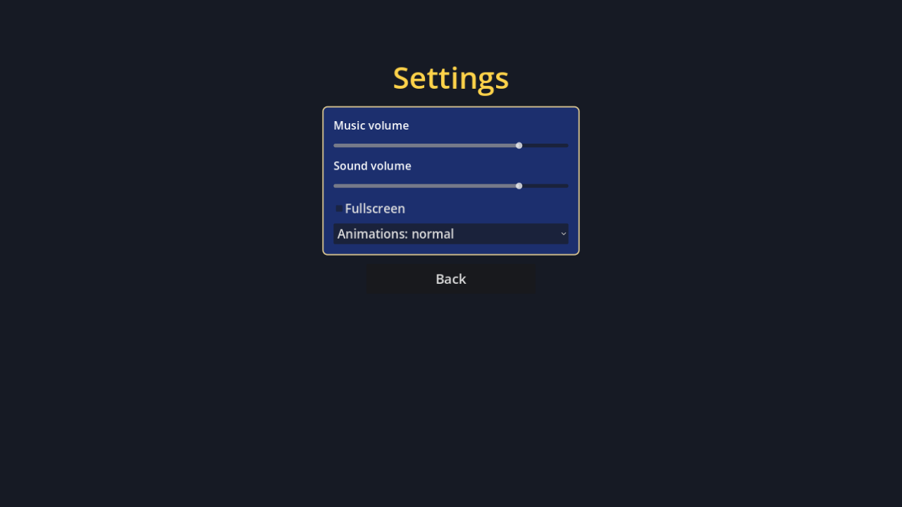

**Validation**

| Check | Pass when | Result |
| --- | --- | --- |
| Settings persist | Change settings → save → reload → still applied | ✅ `test_settings_persist` |
| Gamepad / keyboard | Every action has a key and a gamepad button; the cursor + confirm moves a unit | ✅ `test_input_map_has_keyboard_and_gamepad`, `test_cursor_and_confirm_move_a_unit` (a real gamepad playthrough is ⏳ manual) |
| Repro | A written battle log replays to the same state | ✅ `test_battle_log_replays_exactly` |
| Performance | 60 fps on the battle screen | ✅ 120 fps (vsync cap) on Apple M4 with the Compatibility renderer |
| Linux build | Exports and boots (title screen) in Docker | ✅ `tools/docker.sh export` → `export + smoke: OK` |
| Clean install | Fresh macOS and Windows machines: download → run → play → save | ⏳ needs signing (above) and a Windows machine |

## Step 11 — Vertical slice content

**Goal:** the real slice: **1 town, 1 camp, 3 battles, 8 units, 2 classes each**. **Gate C.**

All slice content lives in `res://data/` and is generated by `tools/make_content.gd`. Maps are ASCII grids in that file, so they're easy to read and change. The game no longer uses the test fixtures.

**Tasks**

- [x] **Engine features the maps needed:** `GIVE` (chests) and `SET_AI` (boss phases) trigger actions; `unless_flag` on triggers; computer-controlled allies on the player side (`MapData.allies`, `Unit.ai_controlled`); a `FLEE` AI profile; `REACH_AREA` limited to a tagged unit
- [x] **Design, 3 maps each with a twist:**
    1. *The Ruins Road*: loot race. Open 3 chests (Healing Seed, Power Ring, Steel Sword) before the raiders loot them at round 6
    2. *Wolves at Millford*: protect a villager who runs from enemies on its own. You lose if it dies; wolves arrive on round 3
    3. *The Chief's Camp*: the boss holds until below 50% HP, then charges and calls two guards; defeat him to win
- [x] **Cast:** 8 recruits (Aldric, Brina, Corin, Dara, Eamon, Fiora, Garret, Hale), 6 classes that each promote (swordsman → swordmaster, knight → paladin, archer → sniper, cleric → bishop, mage → wizard, warrior → berserker); enemies: goblin, goblin archer, wolf, bandit, goblin chief; 10 items, 4 spells
- [x] **Writing** (`data/dialogue/slice.json`): chapter intros and battle lines, a join line for every recruit (shown in camp), 12 camp chats (Talk button), townspeople in Riverside and Millford
- [x] **Audio, placeholder:** `tools/make_audio.py` synthesizes 3 chiptune loops (camp, battle, boss) and 9 sound effects (hit, crit, miss, heal, level up, chest, select, victory, defeat). The `Audio` autoload plays music per screen and sound effects per battle event; volumes come from Settings
- [x] **Art, placeholder upgrade:** a shared UI theme (blue panels, gold edges), textured tiles (grass, sand, water, bricks), chests drawn on the map, the battle map scales to any map size, and the camp layout fits 8 units
- [x] **Map authoring:** ASCII grids in `tools/make_content.gd` instead of an editor plugin (simpler, reviewable in diffs). Legend: `. f ^ H : ~ w #` terrain, `P` spawns, `$` chests, letters for enemies, `V` villager
- [x] **Balance with the battle sim** (`-- --chapter=N` simulates a chapter with its real party)
- [ ] Final art (character sprites, tilesets, UI), composed music: needs an artist and a composer (owner: you)
- [ ] Outside playtests: needs 5 outside testers (owner: you)

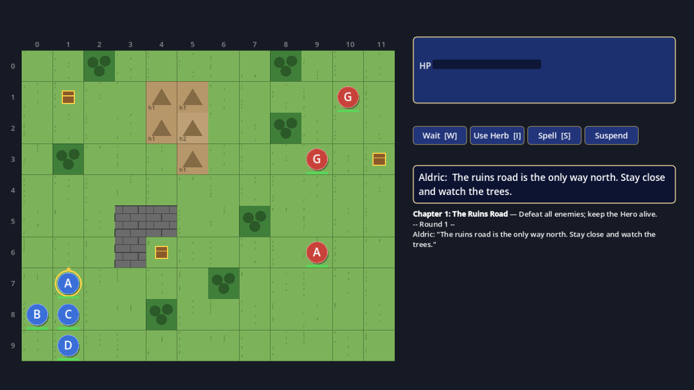 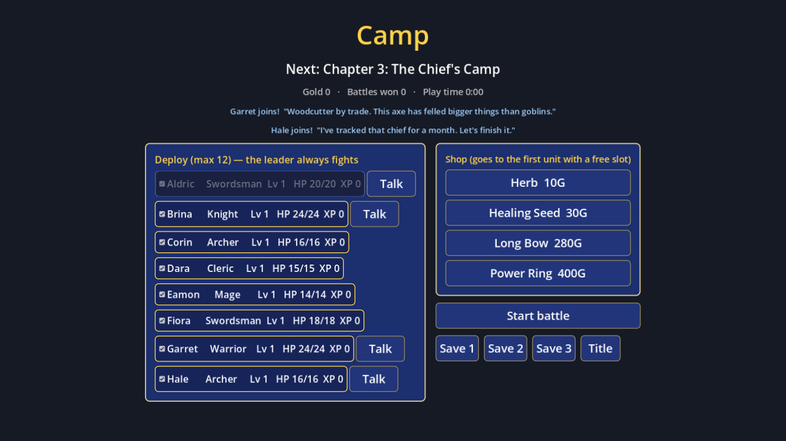

**Validation**

| Check | Pass when | Result |
| --- | --- | --- |
| Scope | 8 recruitable units with 2 classes each; a town; 3 battles | ✅ `test_slice_scope` |
| CI | All maps validate, all dialogue lines exist, AI-vs-AI soak finishes on every map | ✅ `test_every_data_map_is_valid_and_lines_exist`, `test_every_map_finishes_for_50_seeds` |
| Twists work | Chests give items until looted; villager death loses; chief charges and calls guards at < 50% | ✅ `test_chests_give_items_until_looted`, `test_villager_flees_and_its_death_loses`, `test_chief_charges_when_hurt` |
| Whole slice | Chapters 1→3 can be won in order; 8 units and 550 gold at the end | ✅ `test_whole_slice_campaign_completes` |
| Balance (sim) | AI-vs-AI player win rate 60–90% per map *(proxy for a 70–85% human clear rate)* | ✅ ch1 84%, ch2 89%, ch3 74% |
| Performance | 60 fps on the battle screen | ✅ 120 fps (vsync) on Apple M4 |
| Clear rate (human) | Internal testers: 70–85% first-try clear per map | ⏳ needs playtests |
| Length | Average battle 15–25 minutes | ⏳ needs playtests (AI-vs-AI battles last 2.4–5.3 rounds; human battles are longer) |
| **Gate C: slice playtest** | 5 outside testers finish all 3 battles and rate the battles ≥ 4/5 | ⏳ owner to run with outside testers |

## Step 12 — Design round 1: closer to the genre reference

**Goal:** make battles feel more like the genre reference ([04](04-research-and-references.md), second study pass in §2b): small, readable reasons to pick *who* attacks *whom*, and lasting consequences of a hit. Mechanics only, under the IP guardrails in [04 §4](04-research-and-references.md#4-ip-guardrails).

**Candidates** (planned by `game-manager`; each role skill named its top issues; score = impact × confidence ÷ effort, S=1 M=2 L=3)

| # | Candidate | Reference behavior | Raised by | Impact | Conf. | Effort | Score | Round |
| --- | --- | --- | --- | --- | --- | --- | --- | --- |
| 1 | Weapon matchups, "!" in the forecast | A "!" marks a target weak to the attacker; such hits crit and trigger specials more often | game-developer, game-ui-ux-designer | 4 | 4 | S | **16** | **this** |
| 2 | Status effects: poison and sleep, plus an Antidote | Poison hurts after the unit's turn; specials can inflict status | game-developer, game-qa (deferred since step 8) | 4 | 5 | M | **10** | **this** |
| 3 | Status shown on the map and unit panel | — (our readability pillar) | game-ui-ux-designer, game-art-design | 3 | 4 | S | **12** | **this** (with #2) |
| 4 | Regeneration ring | A ring that adds defense and heals a little each turn | game-developer | 2 | 5 | S | **10** | **this** |
| 5 | Focus-fire bonds: allies who hit the same enemy grow closer | Friendship grows between units that attack the same target | game-developer | 3 | 4 | S | 12 | next (changes bond balance; do it after a playtest of #1–#4) |
| 6 | Thieves carry looted chest items and drop them when defeated | Treasure takers must be beaten to recover the loot | game-artist, game-developer | 3 | 4 | M | 6 | next |
| 7 | Ambush spawns when the party gets close + capped respawn points | Surprise spawns on approach; replacements up to a limit | game-manager | 3 | 3 | M | 4.5 | next (triggers exist; mostly content) |
| 8 | Breakable obstacles (crates) that use a turn to destroy | Barrels block paths and can be broken in battle | game-artist | 3 | 3 | M | 4.5 | later |
| 9 | Weapon proficiency: specials get likelier with one weapon type | Sticking to one weapon type unlocks stronger specials | game-developer | 3 | 3 | L | 3 | later |
| 10 | Status and matchup icons (replace text glyphs) | — | game-2d-3d-artist | 2 | 4 | S | 8 | with final art ⏳ owner |

Designed against (from the reference's criticisms): no warp-back heal (we keep the free full heal), no permanent loss from a full inventory (loot goes to storage), keep ambushes fair (spawn on the far side of the trigger area, with a warning line).

**Tasks**

- [x] **Matchups** (`game-developer`): `Rules.matchup(a, t)` → +1 / 0 / −1. Sword > axe > spear > sword; spears and bows beat mounted units; bows beat flying units. Advantage: +10% hit, +8% crit, special chance ×2 *(tune)*. Disadvantage: −10% hit. `forecast()` returns `adv`; the 2D forecast shows "!" (advantage) or "▼" (disadvantage)
- [x] **Status** (`game-developer`): `Unit.status` (`poison`, `sleep` → turns left), saved in snapshots and suspends. `POISON` special: 3 turns, loses 10% max HP (min 1) at the end of each of its turns. `SLEEP` special: the unit skips up to 2 turns and wakes when damaged. Events `STATUS_ADDED`, `STATUS_ENDED`, `TURN_SKIPPED`. New Antidote item cures poison
- [x] **Regen ring** (`game-developer`): `ItemData.regen`; Vigor Band (+2 DEF, +2 HP at the end of each turn)
- [x] **Content** (`game-developer`): a new Goblin Stinger (archer with a Venom Bow, poison 20%) replaces one goblin archer in chapters 2 and 3; Antidote in the chapter 2 shop; Antidote, Lull Staff (sleep 20%) and Vigor Band in the chapter 3 shop (Power Ring left out so the camp screen fits; it's a chapter 1 chest)
- [x] **Readability** (`game-ui-ux-designer`, `game-art-design`): status letters on the map (green "P" poison, blue "Z" sleep, above the HP bar, top right of the token); unit panel lists status; forecast shows matchup
- [x] **Validate** (`game-qa`): tests below, golden replays, balance sim per chapter, screenshots. QA found 3 issues, all fixed: the chapter 3 shop (7 items) pushed the Save/Title buttons off screen (major); the new enemy shared the letter "V" with the villager (minor, renamed to Goblin Stinger "S"); status badges too small (minor)
- [x] `tools/screenshot.gd --demo-status` shows the status badges on the battle screen

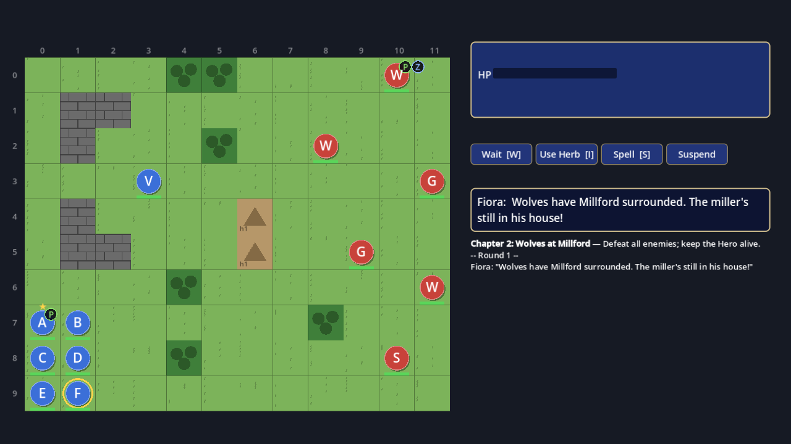 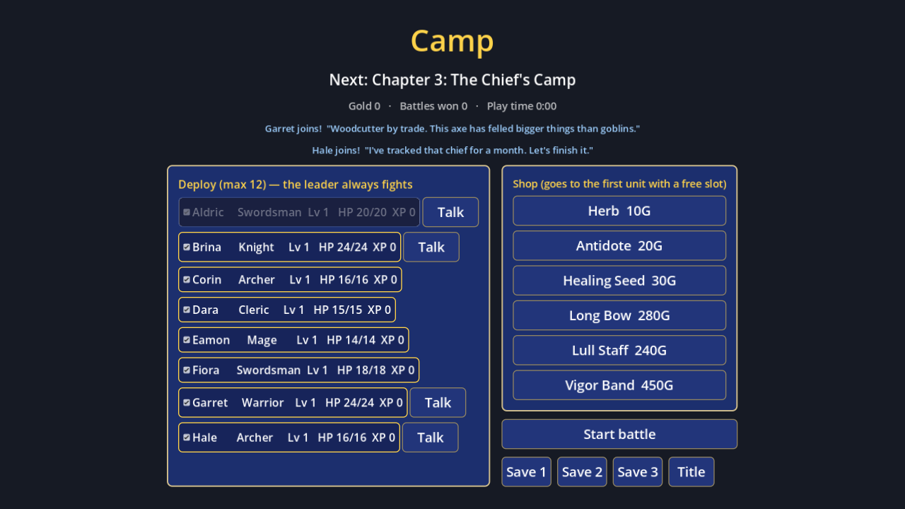

Known, not from this step: the unit panel is blank while the opening lines play (also in the step 11 screenshot) → next round, `game-ui-ux-designer`

**Validation**

| Check | Pass when | Result |
| --- | --- | --- |
| Matchups | Triangle and mounted/flying rules exact; advantage raises hit and crit; forecast reports it | ✅ `test_matchup_triangle_and_mounted`, `test_advantage_raises_hit_and_crit_and_shows_in_forecast` |
| Poison | Applied by a poison special; ticks after the unit's turn; ends after 3 turns; can kill; Antidote cures | ✅ `test_poison_special_poisons_on_hit`, `test_poison_ticks_after_turn_then_wears_off`, `test_poison_can_end_the_battle_once`, `test_antidote_cures_poison` |
| Sleep | Sleeping unit's turns are skipped (max 2); damage wakes it | ✅ `test_sleeping_unit_skips_two_turns_then_acts`, `test_damage_wakes_a_sleeper` |
| Regen ring | +2 HP at the end of the wearer's turn, capped at max HP | ✅ `test_regen_ring_heals_at_end_of_turn_capped` |
| Save / replay | Status survives suspend/resume and replays identically | ✅ `test_status_round_trips_through_unit_dict`, `test_status_battles_replay_identically` (suspend = replay) |
| Goldens | Fixture golden replays unchanged, or regenerated with a stated reason | ✅ unchanged (fixture weapons have no matchups or status specials); `tools/check_generated.sh` → `generated files: OK` |
| Balance (sim) | AI-vs-AI player win rate 60–90% on chapters 1–3 (baseline before this step: 86 / 89 / 77%) | ✅ 86 / 90 / 79%, 0 unfinished, `balance check: OK` ×3. ⚠️ Chapter 2 sits at the 90% ceiling: retune if playtests find it easy |
| Whole suite | `tools/test.sh` all green (baseline 123), `tools/check_layers.sh` OK | ✅ 135 passed, 0 failed; `layer check: OK`; `smoke play: OK` |
| Looks right | Battle screenshot: status letters and the "!" forecast are readable, nothing overlaps | ✅ screenshots above; 120 fps (vsync) on Apple M4. The hover forecast "!" is ⏳ manual (screenshots can't hover) |
| Fun (human) | Playtesters notice and use matchups; poison/sleep feel fair | ⏳ owner playtest |

## Presentation rounds (steps 13–17): characters, battle scenes, portraits

The owner asked for three things the reference genre does well (screenshots shared on 2026-11-07):

| # | Asked for | What it means for us | Step |
| --- | --- | --- | --- |
| A | Characters like *image 1*: small, big-headed sprite characters standing on a textured map, with icons above their heads | Pixel-art character sprites instead of circles; status/bond/matchup icons in a bubble above the head | 15 (2D map) → 17 (3D map) |
| B | A battle page like *image 2*: a close-up side view of attacker vs defender, with name / level / HP plates in the corners | A short **battle cut-in scene** played for each attack, spell and heal, driven by the events we already emit | 16 |
| C | Characters presented like *image 3*: a framed portrait next to a dialogue box | **Portrait dialogue** for battle lines, camp chats, town talk and chapter intros | 14 |

**Order.** `game-manager` scored these the usual way (impact × confidence ÷ effort). Portraits come first: they're cheap and show up on every screen. Map sprites come next, then the cut-in scene, and the 3D map last because it's the biggest. Step 13 sets the style and the asset pipeline everything else uses.

| Step | Feature | Impact | Conf. | Effort | Score |
| --- | --- | --- | --- | --- | --- |
| 13 | Art bible + asset pipeline + placeholder generators | 4 | 4 | M | 8 (prerequisite) |
| 14 | Portrait dialogue (C) | 4 | 5 | S | **20** |
| 15 | Sprites + head icons on the 2D map (A) | 5 | 4 | M | **10** |
| 16 | Battle cut-in scene (B) | 5 | 3 | L | 5 |
| 17 | 3D isometric map with sprite billboards (A, full) | 4 | 3 | L | 4 |

**IP rules for this work** ([04 §4](04-research-and-references.md#4-ip-guardrails)). The screenshots are references for **format and layout only**: a sprite on a map, a two-plate battle close-up, a portrait beside a text box. These are genre conventions. We don't copy the screenshots' characters, faces, hair or costumes, their UI frame shapes, palette, fonts or backgrounds, and we don't trace anything. The reference images are never committed to the repo. Every asset gets a line in `assets/CREDITS.md`. `game-art-design` reviews each step for "too close to the reference" before it's ticked.

**How art is produced.** Same pattern as the audio in step 11:
- Claude writes deterministic **placeholder generators** (`tools/make_art.py`; backdrops and battle poses come with step 16). They build original pixel art from layered shapes and a palette, so every screen works end to end now.
- **Final art** replaces the files one for one: same names, same sizes, no code change. That needs an artist (⏳ owner).

---

## Step 13 — Art direction and asset pipeline

**Goal:** one written, original style and a pipeline that loads sprites, portraits and backdrops by id, with a fallback to today's shapes.

**Tasks**

- [x] **Art bible** [`doc/05-art-direction.md`](05-art-direction.md) (`game-art-design`). Sections:
    - Style statement: "chunky pixel-art characters on clean, textured tiles; warm daylight palette; readable first"
    - Palette: hex values per role
    - Character proportions: about 2.5 heads tall, a silhouette per class (shield = knight, bow = archer, staff + hood = cleric/mage, big axe = warrior)
    - Faction read: a blue/red ring under the feet plus a team-colored trim, never color alone
    - Portrait framing and the cut-in layout
    - Do / Don't with the IP rules above
- [x] **Decision:** 2D sprite billboards on a 3D map (closes the open question in [01 §15](01-app-design.md#15-open-questions)). Owner chose it on 2026-11-07 because it is simpler: drawn frames instead of modelled, rigged and animated 3D characters, and the same sheets serve the 2D and 3D maps
- [x] **Asset specs** (`game-2d-3d-artist`, [05 §8](05-art-direction.md#8-asset-specs)). Map sprites use the Nearest filter; portraits use Linear, because they're ×4 pixel art shown smaller than 256 px. Ids match `data/`:

    | Asset | Size | Frames | Folder / name |
    | --- | --- | --- | --- |
    | Map sprite | 48×64 per frame | 4 directions × (idle 2, walk 4, attack 2, hurt 1) | `assets/textures/units/<unit_id>.png` (sheet) |
    | Head icons | 24×24 | status P/Z, bond ♥, matchup !, leader ★ | `assets/textures/icons/head_<name>.png` |
    | Portrait | 256×256 | neutral; optional happy / angry / hurt | `assets/textures/portraits/<unit_id>[_<mood>].png` |
    | Battle pose (cut-in) | 192×192 per frame | idle 2, attack 4, cast 3, hurt 1, dodge 1; facing right, mirrored for the other side | `assets/textures/battle/<class_id>.png`, palette-swapped per unit |
    | Cut-in backdrop | 1280×400, 3 parallax layers | — | `assets/textures/backdrops/<terrain_id>_<layer>.png` |
- [x] **Data hooks** (`game-developer`). *Changed from the plan:* art is found **by id** with `view/common/art.gd` (`Art.portrait(id, mood)`, `Art.sprite_sheet(id)`), not through new `UnitData` / `ClassData` fields. Townspeople aren't units, and this keeps `data/` and the `.tres` files unchanged
    - Missing file → `null` → the caller draws the old shape or a name-only box
    - `"speaker_id"` on every dialogue line, plus optional `"mood"` and `"side": "enemy"`. The display name stays for text-only views
- [x] **Placeholder generator** (`game-2d-3d-artist`): one script, [`tools/make_art.py`](../tools/make_art.py), because sprites and portraits share the character drawing. Supporting files: `tools/pixel.py` (canvas + PNG writer) and `tools/art_palette.py` (doc/05 palette, one look per character)
    - 15 sprite sheets (8 party, 6 enemy types, villager) and 21 portraits (15 speakers + 6 moods)
    - Deterministic and standard library only, like `make_audio.py`; covered by `tools/check_generated.sh`
    - *Moved to step 16:* backdrops and battle poses (only the cut-in scene uses them)
- [x] [`assets/CREDITS.md`](../assets/CREDITS.md) with author and license per file (`game-2d-3d-artist`)
- [x] `tools/screenshot.gd`: `--skip-anim` (whole dialogue lines), and an unknown `--screen` now quits with an error instead of leaving an empty window open

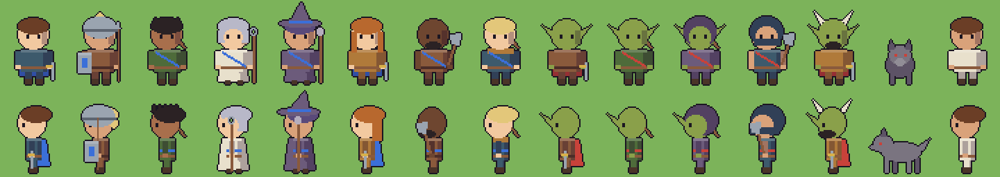
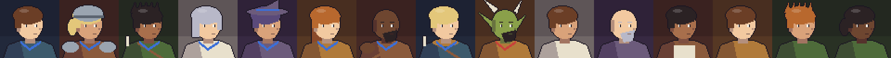

**Validation**

| Check | Pass when | Result |
| --- | --- | --- |
| Bible usable | Two people could make a new unit sprite that fits, using only doc/05 (art-design review) | ✅ every character comes from a doc/05 table row (class prop + look); adding one = one line in `art_palette.py`. A second person's try is ⏳ |
| Generators | Re-running them gives byte-identical files; `check_generated.sh` OK | ✅ same md5 over two runs; `generated files: OK` |
| Fallback | Deleting any asset file still runs every screen (shapes are drawn instead) | ✅ `test_missing_art_falls_back_to_null`, `test_free_text_without_a_portrait_hides_the_frame`. The map still draws shapes until step 15 |
| Size | All placeholder art < 5 MB | ✅ 340 KB (`assets/textures`, with `.import` files) |
| IP review | `game-art-design` confirms nothing resembles the reference screenshots' characters, frames or palette | ✅ characters come from our class props and looks; our flat navy/gold frame (step 11) has no bevels; no reference files in the repo. Owner re-checks at sign-off |
| Style sign-off | Owner approves doc/05 and one sample of each asset type | ⏳ owner |

## Step 14 — Portrait dialogue (image C)

**Goal:** every spoken line shows who is speaking. A framed portrait sits beside a text box with the speaker's name.

**Tasks**

- [x] **Dialogue box component** [`view/dialogue/dialogue_box.gd`](../view/dialogue/dialogue_box.gd) (`game-ui-ux-designer` + `game-developer`). Also shows a "▶ next" hint once the text is out, and `show_text()` for lines without an id (search results):
    - Portrait frame on the left for players and on the right for enemies
    - Name tab, text that types out (speed from `Settings.anim_speed()`; skip = instant)
    - Confirm finishes the text, a second confirm advances. Same on keyboard, gamepad and mouse
    - Falls back to a name-only box when there's no portrait
- [x] Use it everywhere a line is shown:
    - Battle `SAID` events (replaces `_speech`); chapter intros are round-1 `SAID` lines
    - Camp: join lines play in a row over the header (click the box for the next one); Talk buttons
    - Town: talk and search results, below "Back to camp" so nothing is pushed off screen
    - In camp and town only a click *on the box* advances it, so the rest of the screen stays usable; in battle Enter / A / any click advance it
- [x] **Battle pacing:** a line waits for input; *fast* mode waits at most 1.5 s, *skip* mode at most 0.6 s. *Changed:* normal mode also moves on by itself after 8 s, so a demo or an idle window never gets stuck. Never blocks AI-vs-AI or headless runs (`instant` when animations are off)
- [x] **Portraits** (`game-2d-3d-artist`): placeholders for the 8 recruits, the goblin chief, the villager and 5 townspeople, plus moods for Aldric (happy, angry), Brina (happy, angry) and the chief (angry, hurt). Final portraits ⏳ artist
- [x] **Writing pass** (`game-manager`): every line in `data/dialogue/slice.json` gets a `speaker_id`; 7 lines got a mood; the chief's 3 lines are `"side": "enemy"`. A lint test enforces it

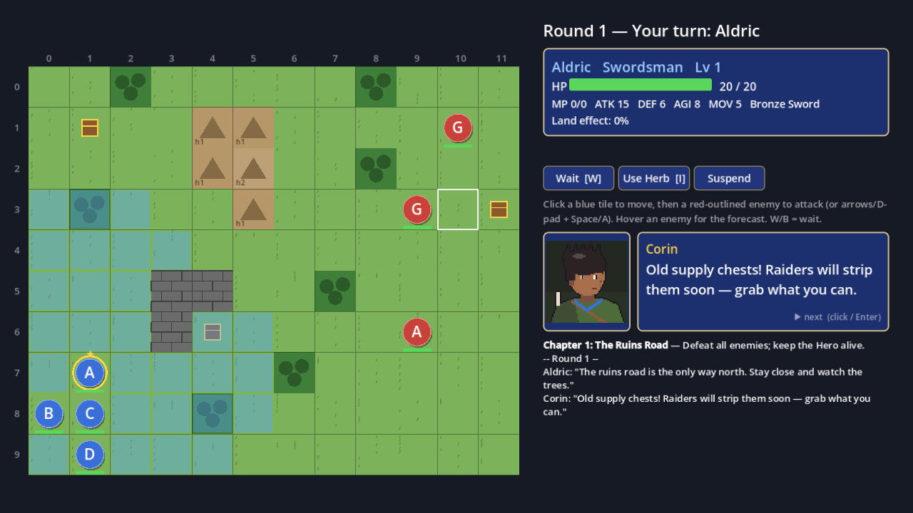 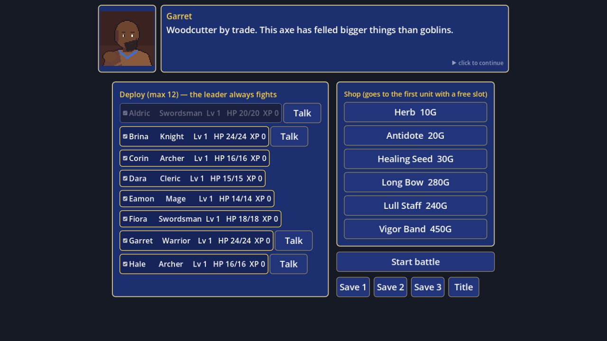

**Validation**

| Check | Pass when | Result |
| --- | --- | --- |
| Every line has a face | Lint: each line's `speaker_id` is a unit id or `narrator`; a portrait exists or the fallback is used | ✅ `test_every_line_has_a_speaker_with_a_portrait` (36 lines, 15 speakers, mood files exist) |
| Fits | Longest line fits the box at 1280×720 and 1920×1080 (screenshots of battle, camp, town) | ✅ screenshots above (window 1280×720, canvas 1920×1080; longest line 69 chars = 2 lines); `test_camp_and_town_dialogue_fit_on_screen`. QA found and fixed 2 issues: the camp header peeked out under the box, and town's Back to camp button was pushed off screen |
| Parity | Advance with Enter, A, and click; skip mode never waits for input | ✅ `test_confirm_finishes_typing_then_advances` (`confirm` / `continue` actions + click); skip = 0.6 s cap. Real gamepad press ⏳ manual |
| Headless | `tests/view` builds the box; the campaign e2e still finishes with no input | ✅ 9 tests in `tests/view/test_dialogue.gd`; full suite 144 passed, 0 failed; `smoke play: OK` |
| Feel (human) | Testers can say who spoke each line in chapter 1 | ⏳ owner |

## Step 15 — Character sprites and head icons on the 2D map (image A, first half)

**Goal:** the battle map shows characters, not circles, and stays readable at a glance.

**Tasks**

- [x] **Sprite drawing** (`game-2d-3d-artist` + `game-developer`). Sprites, bases, HP bars and icons draw on their own layer (`_units_layer`, Nearest filter for crisp pixels; text keeps smooth filtering). Cursor, coordinates and popups draw on an overlay above it:
    - The sheet frame for the unit's facing, on a faction base under the feet. Units draw back to front (by row)
    - The HP bar sits under the base; the acting unit gets a gold ring around its base
    - Idle animation runs at 2 fps and holds still when the animation setting is *skip* or animations are off
    - Facing: at the start, toward the other side's center; then the last move step; attacker and target turn to face each other
    - A unit without a sheet falls back to the old circle token
- [x] **Walk / attack / hurt frames**, played from `MOVED` / `ATTACKED` / `CAST` / `DAMAGED` events (hurt also tints red). No core change: `git diff main -- core data` is empty
- [x] **Head icon bubble** (`game-ui-ux-designer`): one bubble above the head, shown in priority order sleep > poison > matchup "!" (while hovering a target) > bond ♥ (adjacent bonded ally). Replaces the P/Z badges from step 12. Icons are 24×24 pixel art from `tools/make_art.py` (`assets/textures/icons/head_*.png`): a drop, a Z, a "!", a heart and a leader star. Each has its own shape, not just its own color; the star moved next to the HP bar
- [x] **Readability rules from doc/05** (`game-art-design`):
    - Sprites never cover the HP bar or the cursor: HP bars and icons draw in a second pass after every sprite, and the cursor is on the overlay
    - Units stay recognizable in grayscale. *Changed from the plan:* the notched enemy ring did **not** pass the grayscale test (both rings came out as grey blobs). Now players stand on a **light round ring** and enemies on a **dark diamond**: shape and brightness both differ. doc/05 §7 is updated
- [x] **Screenshots** of chapters 1–3 for doc/03; fps bench
- [x] Fixed the known issue from step 12 (`game-ui-ux-designer`): the unit panel was blank while the opening lines played. It now shows the first unit right away

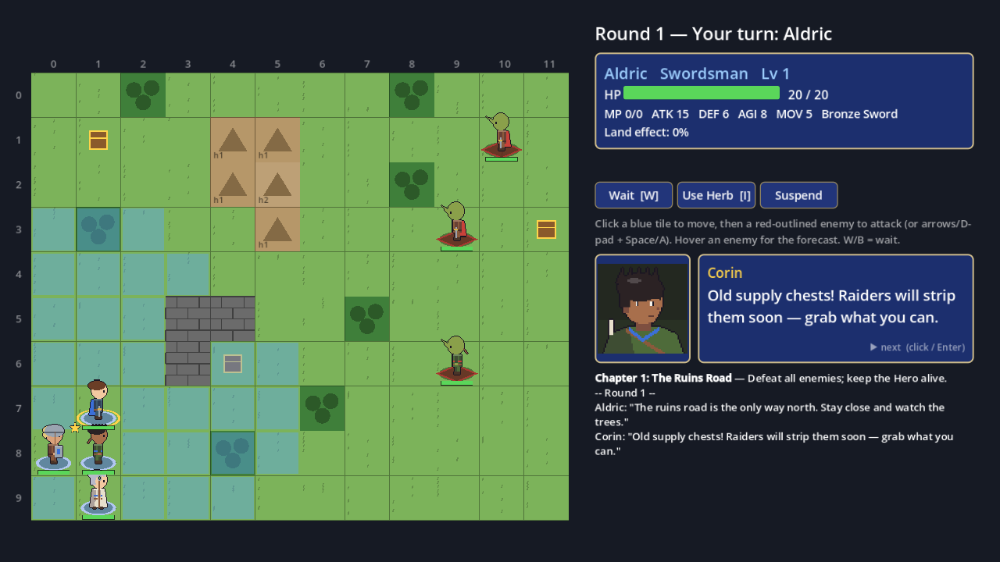 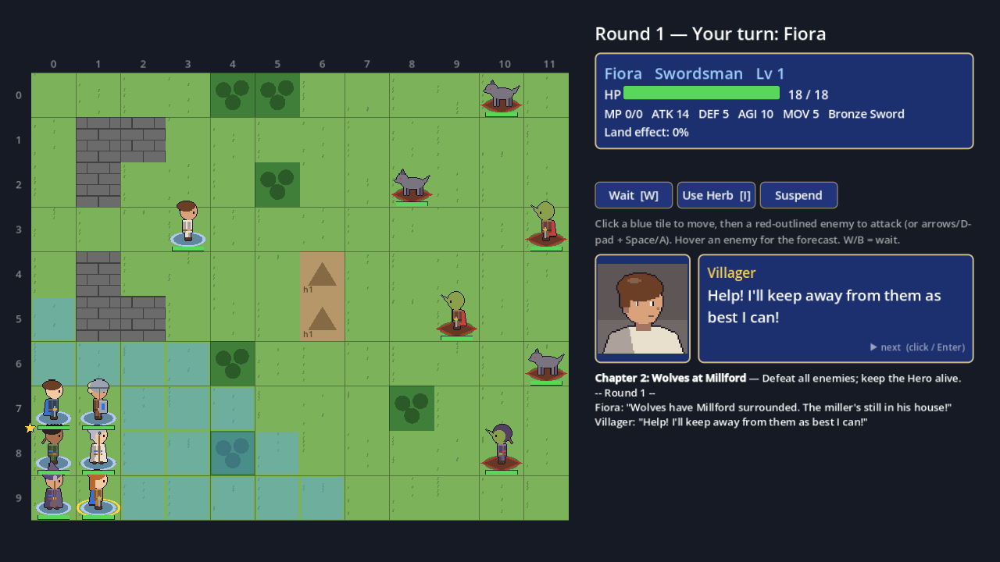
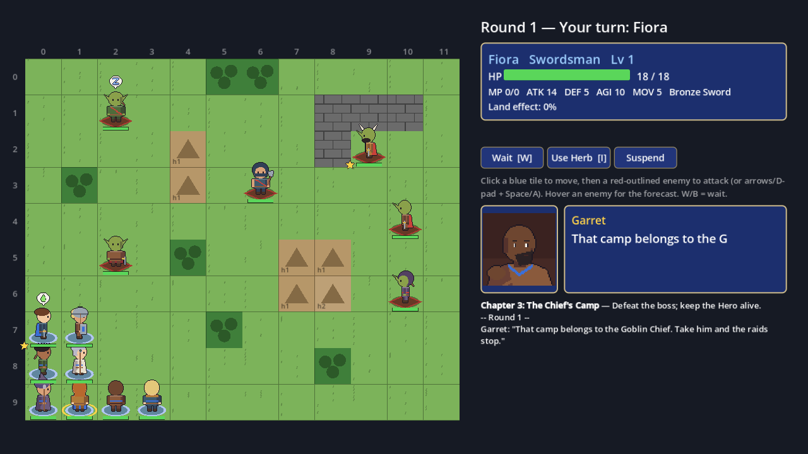 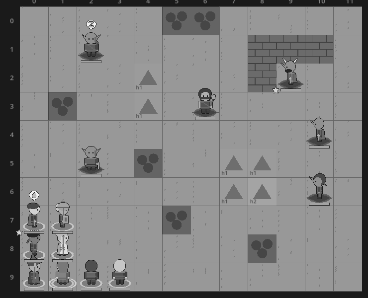

**Validation**

| Check | Pass when | Result |
| --- | --- | --- |
| Readable | In a 1-second glance test (5 screenshots, 3 people), faction, acting unit and low HP are named correctly ≥ 90% | ⏳ owner (needs 3 people) |
| Grayscale | Grayscale screenshot: player and enemy still distinguishable | ✅ after the round/diamond change (image above); the first version (notched ring) failed |
| Performance | ≥ 60 fps on the battle screen with 20 animated sprites (`--bench`) | ✅ 120 fps (vsync cap) on chapter 3, Apple M4: 15 animated sprites at the start, the most any slice map has. A 20-sprite map waits for new content |
| Tests | `tools/test.sh` + `check_layers.sh` green; nothing in `core/` changed | ✅ 151 passed, 0 failed (+7 in `tests/view/test_battle_sprites.gd`); `layer check: OK`; `smoke play: OK`; no diff in `core/` or `data/` |
| Look (human) | Owner compares to the step 12 screenshot and approves | ⏳ owner |

## Step 16 — Battle cut-in scene (image B)

**Goal:** each attack, spell or heal can play a 1.5–3 second close-up, as in the reference genre. It never slows the game down for players who don't want it.

**Tasks**

- [x] **Scene** [`view/battle_scene/battle_scene.gd`](../view/battle_scene/battle_scene.gd), a `BattleScene` built in code like the other screens, so there's no `.tscn` (`game-developer` + `game-ui-ux-designer`):
    - Side view: **player-side units always on the right** (facing left), enemies on the left (mirrored). That's the plan's "defender left, attacker right, flipped when the enemy attacks", worded by side
    - Backdrop chosen from the **defender's terrain** (`plain`, `forest`, `hill`, `sand`, `shallow`/`deep` → shallow, `wall` → ruins)
    - **Plates** (our flat navy + gold frame, a team-color stripe on the left): right fighter top right, left fighter bottom left. Name, level, HP bar and numbers; the bar drains in the map's HP colors when damage lands
    - A heal on an ally puts the caster right and the ally left; a lone caster stands alone
- [x] **Driven by events only.** `BattleScene.group_end()` cuts the combat events of one action out of `apply()`'s list (stopping at turn-end poison ticks and `TURN_ENDED`); `build_steps()` turns them into steps; `play()` shows them:
    - hit (slash or arrow + number), miss (dodge pose + "miss"), crit (white flash, gold number, "Critical!"), double attack ("Again!")
    - weapon special name ("Extra hit!", "Drain!", "Poison sting!", "Lullaby strike!"), then the counter-attack ("Counter!")
    - spells (cast poses, fire or heal sparkles), status ("X is poisoned!"), death fade, "+XP", "LEVEL UP!" at the end
    - No core change; the RNG is never touched. The battle screen still logs every event and tracks the HP the plates start from (`_hp_seen`)
- [x] **Settings → Battle scenes:** *On* / *Player only* / *Off* (saved in `settings.cfg`). Default: *On*. *Off* behaves exactly as before. Scenes never play with animations off or set to *skip*. Click / Space / Enter / Esc skips to the result in the same frame
- [x] **Assets** (`game-2d-3d-artist`), from `tools/make_art.py`:
    - *Changed:* battle poses **per unit** (15 sheets, 11 frames of 192×192), not per class with palette swaps. The generator already has every character's look, so this was simpler. Promoted classes get theirs when promotion art exists
    - 6 backdrops. *Changed:* one 1280×600 layer each, not 3 parallax layers; there's no camera pan yet that would need them
    - Effects: slash, arrow, spark, fire, heal sparkle, drawn in code (`game-artist`)
- [x] **Audio:** hit / crit / miss / heal / level-up sounds play from the scene when it's on
- [x] **Muted while debugging** (owner's request, 2026-11-07): `Audio` is silent in every debug run (from source, tools, tests); exported release builds play sound. `-- --sound` turns it on, `-- --mute` or `BANNER_MUTE=1` turns it off (`Audio.should_mute`)
- [x] `tools/screenshot.gd`:
    - `--screen=scene` (with `--crit`, `--miss`, `--at=<s>`, `--skip-after=<s>`, `--bench`)
    - `--screen=battle --auto-wait=<s>`: an end-to-end run with every animation and close-up on
    - `--fast-anim`
    - A 30 s watchdog, so a script error can't leave an empty window open

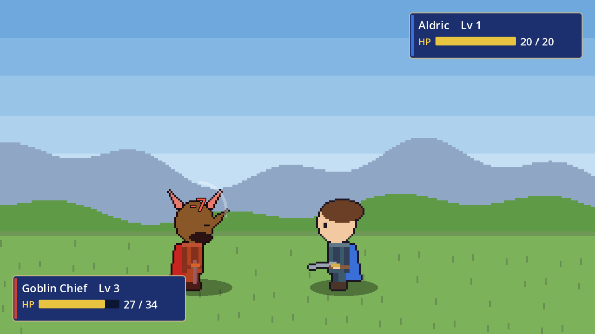 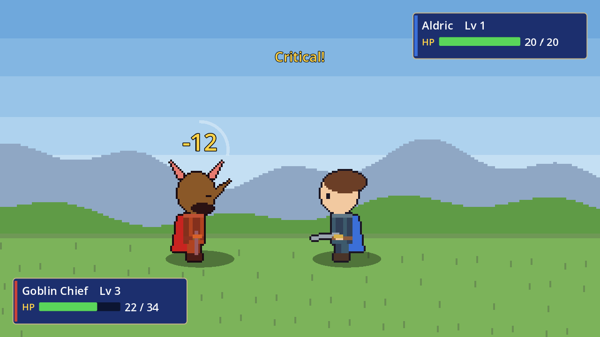
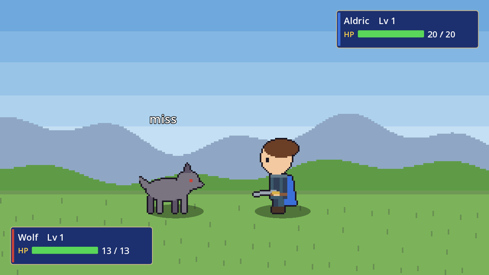

**Validation**

| Check | Pass when | Result |
| --- | --- | --- |
| Faithful | For 200 seeded attacks, the scene's shown outcome (hit/miss/crit/damage/counter/death) equals the events (headless test plays the scene with animations off) | ✅ `test_scene_matches_the_events_for_200_seeded_attacks`: every strike's attacker, target, hit, crit, counter and damage, every death, and both plates' final HP match. The 200 seeds include misses, crits, counters, doubles and deaths |
| Determinism | Golden replays and the balance sim unchanged with scenes on or off | ✅ no diff in `core/`, `data/` or `tests/golden/`; scenes only read events. Balance runs headless with animations off, so scenes never play there |
| Length | ≤ 3 s per normal attack at normal speed, ≤ 1 s at fast; skip works from the first frame | ✅ `test_length_per_attack`: 1.48 s normal, 0.74 s fast, attack + counter 2.38 s. `--skip-after=0.4` → `scene closed 0 ms (0 frames) after the press` |
| Battle length | A chapter 1 human playthrough stays within 15–25 min with scenes *On* | ⏳ owner playtest |
| Performance | ≥ 60 fps during the scene | ✅ `bench scene: 117 fps` (vsync 120) on Apple M4. End to end: `--auto-wait=24 --fast-anim` on chapter 2 played 4 close-ups with no script errors |
| Fun (human) | Testers keep scenes on, or switch to *Player only*, rather than *Off* | ⏳ owner playtest |

## Step 17 — 3D isometric battle map with sprite billboards (image A, full)

**Goal:** the "3D view" phase from *After the slice*, now with the step 15 sprites. A textured 3D map, height you can see, 4 camera angles. Same core and events as the 2D and text views.

**Tasks**

- [x] **[`view/battle3d/map3d.gd`](../view/battle3d/map3d.gd)** (`game-developer`). `Map3D` is a renderer only: the battle screen still owns input, HUD and event playback, and the 3D view reads the same positions, facings and poses it animates:
    - Map: one box per tile, with height you can see (hills 0.5 per level, walls 1.6, water a little low) and 32×32 pixel-art tops (`assets/textures/tiles/`, from `tools/make_art.py`, `game-artist`). A faint checker marks the grid; forests get small trees; chests are boxes
    - Units are `Sprite3D` billboards using the step 15 sheets. Facing is turned to match the camera (`screen_facing`)
    - Under each unit: a dark shadow disc plus the doc/05 faction base (light ring for players, dark diamond for enemies). The acting unit gets a gold ring. Move range, targets and the cursor are tinted tiles
    - HP bars, head icons, the leader star and popups are drawn over the 3D view at each unit's projected screen position (`_hud_anchor`, `_px_to_screen`)
- [x] **Camera:** orthographic, 35° down:
    - 4 rotations (Q/E, LB/RB)
    - 3 zoom levels (Z, mouse wheel, right-stick click). Zoom centers on the cursor
    - Wall fade: any tile between a unit and the camera turns see-through, checked from each unit's feet, middle and head
    - Top-down toggle (T, Back). It lines up with the grid like the 2D view, and sprites face the camera fully
    - The camera fits the whole map at every angle; arrow keys turn with the camera; mouse clicks pick the tile under the cursor
- [x] **HUD reuse:** unit panel, forecast, dialogue box (step 14) and cut-in scene (step 16) work unchanged on top of the 3D view. The help line adds the camera keys
- [x] **Settings → Battle view:** *3D* (default) / *2D*. The 2D view stays as a fallback for low-end machines and tests: headless runs always draw 2D unless a test forces 3D (`view_mode`)
- [x] `tools/screenshot.gd`: `--view=2d|3d`, `--yaw=0..3`, `--zoom=0..2`, `--top-down`, `--report-hidden`

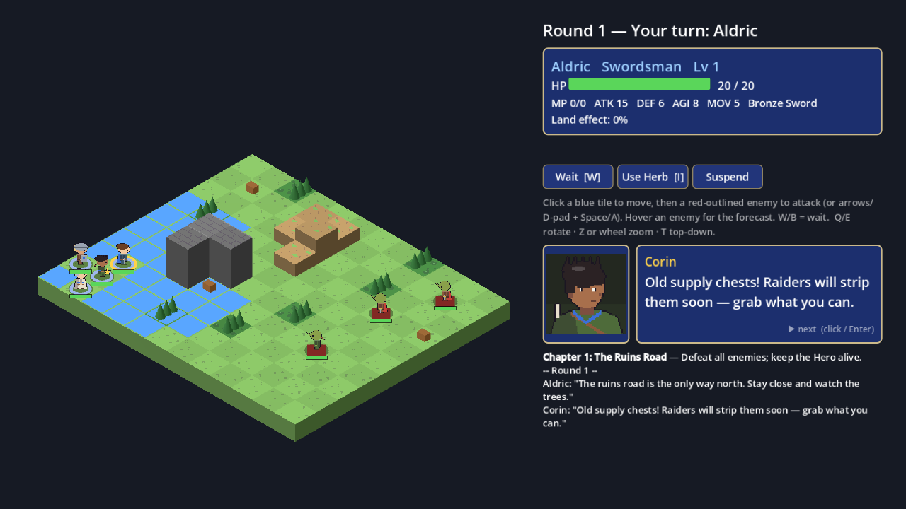 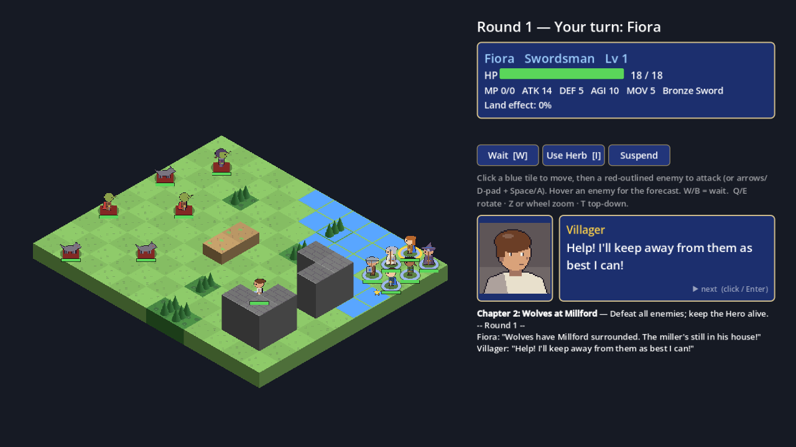
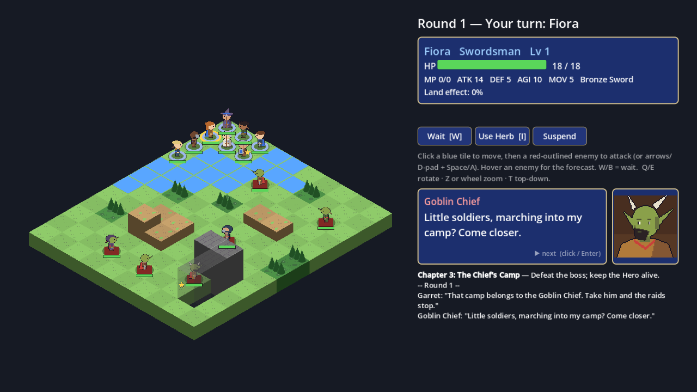 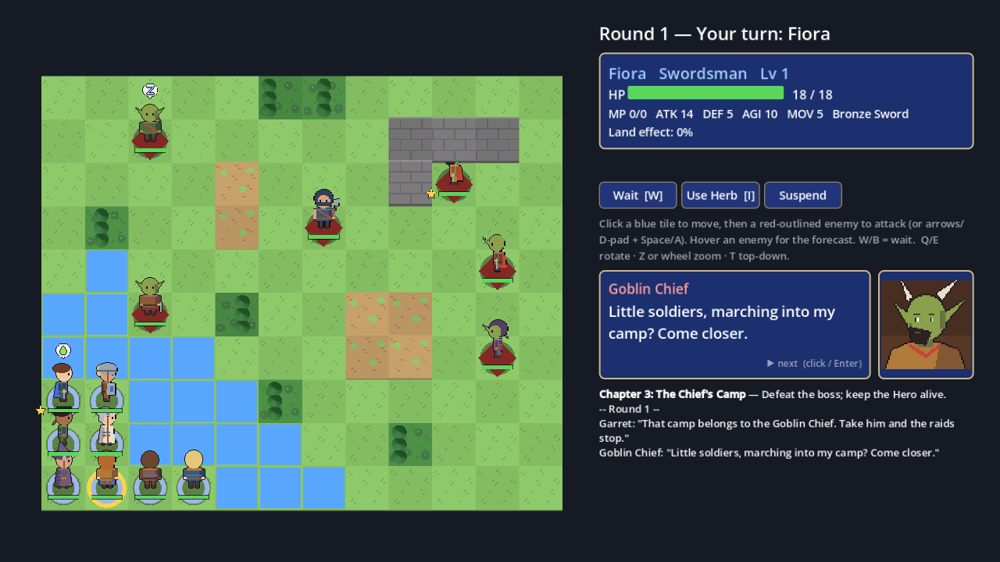

**Validation**

| Check | Pass when | Result |
| --- | --- | --- |
| Same battle | The same scripted battles play identically in 2D, 3D and text views (as planned in *After the slice*) | ✅ `test_same_battle_in_2d_3d_and_text`: on all 3 chapters, the same seed played through the 3D screen and the 2D screen gives identical commands and final snapshots, and the headless replay of those commands (the text view's engine) matches too |
| No hidden units | At all 4 angles, every unit is visible or outlined on all 3 maps (screenshots) | ✅ `test_no_unit_is_hidden_at_any_angle_on_any_map` (4 angles × angled/top-down × 3 maps) and the same check on the GPU: `--report-hidden` printed `hidden units: []` for all 12 map/angle pairs; chapter 3 fades 1–3 wall tiles at 3 of the 4 angles |
| Performance | ≥ 60 fps at 1080p on Apple M1 / Intel Iris Xe class, Compatibility renderer | ✅ 110 fps (vsync 120) on Apple M4, Compatibility renderer, 1920×1080 canvas in the 1280×720 window. ⏳ an M1 / Iris Xe machine and a full-screen 1080p run are still to do (owner) |
| Look (human) | Owner approves the 3D look against doc/05 | ⏳ owner |

## UI / design round (steps 18–22): fancier, production-ready

The owner asked (2026-11-07) for a UI and design pass that makes the game look finished, with character ("role") profiles presented like a shared reference image. That image is a portrait from the genre reference and is **not to be copied**. `game-manager` planned this round from a review of every screen as it is today:

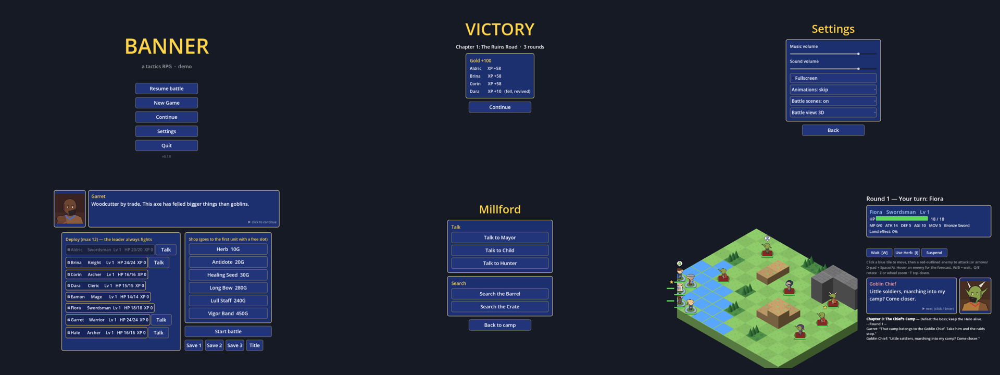

**What we take from the reference image (format only)** and what we don't:

| Take: genre conventions | Don't take: that image's expression |
| --- | --- |
| A large, **detailed bust portrait**: head and shoulders filling the frame, expressive eyes with a highlight, several shading steps, light catching the hair | That character: spiky brown hair with a white streak, green eyes, green scarf, its face and pose |
| A **layered frame**: an outer rim, a dark inner field, and depth (inner shadow), so the portrait reads as a framed card | Its frame: the bevelled dark-blue / silver border and its corner shape, colors and proportions |
| The portrait as the **center of a character's identity** (dialogue, profile, HUD) | Its UI layout, fonts and any pixels from it. The image is never committed or traced |

Our own direction (to be written into doc/05 in step 18): a **"Banner" frame**. A gold outer rim with a thin dark line inside it, a navy field, a soft inner shadow, and a small **pennant notch** at the top center as our motif (the game is called *Banner*). The team color shows as a ribbon on the frame, so every framed portrait says whose side it's on.

### Review: top issues by role

| Role | Top issues |
| --- | --- |
| `game-art-design` | Portraits are 64-px blocks with flat shading and dot eyes, not production quality. One flat frame style everywhere, with no depth or hierarchy. The title is plain text with no key art or wordmark. The engine's default font everywhere |
| `game-ui-ux-designer` | Camp is rows of text, with no faces and no **character profile** to open. Results is a small text box (no portraits, no level-up moments). Settings and town are bare button lists. The battle unit panel is text only, with no portrait, and its stat line is cramped at 1280×720. No screen transitions, no hover or press motion, and focus (gamepad) is only partly visible |
| `game-2d-3d-artist` | The portrait generator has reached its limit on a 64×64 grid (few colors, no hair strands or iris detail). "Production" portraits need either a higher-detail generator or a commissioned artist, with a brief that keeps them consistent |
| `game-developer` | Styling is scattered: each screen builds its own panels in code, and there's no shared `Theme` resource, so a restyle touches every file. No font files. Screens swap with no transition hook |
| `game-qa` | No UI scale or text-size setting, no colorblind check, 16:10 and ultrawide never tested, and gamepad focus navigation isn't tested on every screen. No visual regression check, so a restyle could break layouts silently |

### Scoring (impact × confidence ÷ effort; S=1, M=2, L=3)

| Step | Feature | Impact | Conf. | Effort | Score | Order |
| --- | --- | --- | --- | --- | --- | --- |
| 18 | UI kit: Banner frame, fonts, theme resource, motion, focus | 5 | 4 | M | **10** | 1st: everything else builds on it |
| 19 | Portraits v2 + character profile screen | 5 | 3 | L | 5 | 2nd: the owner's main ask |
| 20 | Screen redesigns: title, camp, results, town, settings | 4 | 4 | L | 5.3 | 3rd |
| 21 | Battle HUD polish: portrait unit card, forecast card, turn order bar, command menu | 4 | 4 | M | 8 | 4th: needs 18 + 19 |
| 22 | Production readiness: accessibility, resolutions, localization, credits, visual regression | 4 | 5 | M | 10 | Its visual-regression check lands *first*, inside 18. The rest runs last |

**Who makes the art:** the same pattern as steps 11–17. Claude builds the system and **upgraded placeholders** (generated, original, consistent), so every screen works end to end. Final production portraits, key art and logo come from a **human artist** working from the brief in step 19 (⏳ owner), or from licensed assets recorded in `assets/CREDITS.md`. The file names and sizes stay the same, so swapping art needs no code change. If AI-generated art is considered, that's an owner decision: it needs a license check and the doc/04 IP review first.

---

## Step 18 — UI kit: the Banner frame, fonts, theme, motion

**Goal:** one shared, good-looking UI kit that every screen uses. A restyle then happens in one place.

**Tasks**

- [x] **Art direction v2** (`game-art-design`): rewrite doc/05 §6 "UI frames" (target: the design example canvas *Banner UI Style Frames*):
    - The **Banner frame**: a 9-slice with a gold outer rim (2 px), a dark line, a navy field with a soft inner shadow, and a pennant notch at the top center
    - Three weights: **card** (portraits, plates), **panel** (menus, side panel) and **chip** (tags, buttons)
    - A team ribbon on cards
    - A sketch of each, with Do / Don't next to the reference (format only)
- [x] **Fonts** (`game-art-design` + `game-developer`). **Chosen: Cinzel (display) + Inter (body)**, the fonts of the design example; pixel display fonts were set aside so names read well next to the detailed portraits. Downloaded from Google's open font repository, OFL files bundled: a display font for titles and names, and a very readable body font. Both must be open-licensed (SIL OFL) and bundled in `assets/fonts/` with their license files. Pixel display + clean sans is recommended (candidates to evaluate: *Pixelify Sans* or *Silkscreen* for display, *Noto Sans* or *Inter* for body). Check legibility at 20 px / 1080p
- [x] **Theme resource** (`game-developer`). Built by `view/common/banner_theme.gd` (`BannerTheme.build()`); fonts are `FontVariation`s on the variable fonts. HP bars use `HpHigh/HpMid/HpLow` variations (`BannerTheme.hp_variation`):
    - `tools/make_theme.gd` generates `assets/ui/banner_theme.tres`: buttons (normal / hover / pressed / disabled / **focus**), panels, labels, progress bars, option buttons, sliders, check boxes, scrollbars
    - Frame textures for the 9-slices are generated by `tools/make_art.py`
    - `UI.panel/button/label` and every screen use the theme; local `StyleBoxFlat`s are removed
- [x] **Motion** (`game-ui-ux-designer`). `UI.animate` (lift 4% / squash 4%), `UI.ease_in`; off in headless runs (`UI.motion_ok`):
    - Screen transitions: a 0.25 s fade/slide through a `Transition` autoload hooked into `Game.goto`
    - Button hover lift and press bounce, and panels that ease in on open
    - All scaled by `Settings.anim_speed()`; *skip* means no motion
- [x] **Focus everywhere** (`game-ui-ux-designer`). Each screen exposes `default_focus` (title: first action; camp: Start battle; results: Continue; town: first person; settings: first slider). The battle buttons stay off the focus chain; the map cursor owns keys there: every screen has a default focused control and a visible focus ring (gold, 2 px), and is fully usable with arrows / D-pad + A / B
- [x] **UI sound pass** (placeholder, `game-developer`). `sfx_hover/confirm/cancel/open`: hover tick, confirm, cancel and open, generated by `make_audio.py`. Silent while debugging (step 16 rule)
- [x] **Visual regression check** (`game-qa`, pulled forward from step 22). Shots: title, settings, camp ch1 and ch3, town, results, battle 2D and 3D, the close-up (held on its final frame with `--still`). Repeatable: animations skipped, saves empty (`--clean-saves`). `tools/compare_images.gd` does the comparing (no extra libraries). *Changed:* one window size (1280×720), because the 1920×1080 canvas is scaled and layouts are identical at every size. QA fixes found by the snapshots: the pennant was added as a container child and got stretched across whole panels (now drawn on the frame); slider tracks had no height; the close-up shot was timing-dependent: `tools/ui_snapshots.sh` screenshots every screen at 1280×720 and 1920×1080 into `build/ui/` and compares them with approved images in `tests/ui_golden/` (≤ 1% of pixels changed, or the change gets reviewed). CI uploads the diffs

**Validation**

| Check | Pass when | Result |
| --- | --- | --- |
| One kit | `grep StyleBoxFlat view/screens view/battle2d view/dialogue view/battle_scene` finds none outside the theme generator | ✅ none; `test_one_kit_no_local_styleboxes` keeps it that way |
| Fonts | Both fonts bundled with OFL license files; body text ≥ 20 px at 1080p; contrast ≥ 4.5:1 | ✅ `test_fonts_ship_with_their_licenses`; body text `#f3ecd8` on navy `#1f3270` ≈ 11:1. Some HUD stat lines are 22 px; step 21 rebuilds them |
| Focus | A headless test tabs through every screen with `ui_focus_next` and finds a focused control each time | ✅ `test_every_screen_has_a_default_focus` (5 screens: a focusable, enabled default). *Changed:* it checks the default focus target rather than tabbing; the test runner has no running tree for real focus |
| Motion | Transitions ≤ 0.3 s; none when animations are *skip*; tests unaffected (`animate = false`) | ✅ 0.12 + 0.16 s; `test_motion_and_transitions_are_off_headless`; the live boot (`--quit-after 240`) shows no script errors |
| Snapshots | `ui_snapshots.sh` runs in CI; diffs uploaded as artifacts | ✅ local: 9/9 at 0.00% on a second run. CI: added to `env-macos` as advisory (golden images come from an M4; promote to blocking once they're regenerated on the runner) |

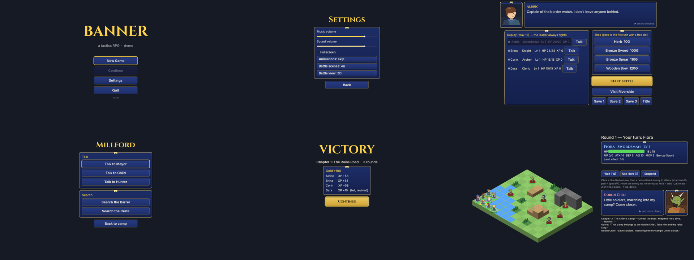
| Look (human) | Owner approves the frame and fonts on 3 sample screens | ⏳ owner |

## Step 19 — Portraits v2 and the character profile ("role profile")

**Goal:** characters feel like people. Detailed portraits in a framed card, and a profile screen for every recruit.

**Tasks**

- [x] **Portrait style v2** (`game-art-design`): update doc/05 §5. *Changed:* illustrated busts (the design example's style) instead of 128-grid pixel art:
    - A bust filling about 80% of the frame, eyes at about 40% height
    - Irises in 2 tones with a highlight; 3–4 shading steps on skin and hair; hair drawn as strands with one highlight band; a rim light from the top left
    - A background gradient band in the character's color
    - **Moods** (neutral, happy, angry, hurt, determined) change eyes, brows and mouth only
    - Original faces only. Each character gets a written one-line "look" (hair, eyes, outfit, one signature item) that's checked against the reference so none of them resembles it
- [x] **Generator upgrade** (`game-2d-3d-artist`). *Changed:* a new `tools/make_portraits.py` builds each portrait as **SVG** from parts:
    - Per character: background, hair (6 styles), class outfit (tunic + cape, plate, robe + mantle, bare + fur), team trim, face, ears, and extras (beard, scar, circlet, mage hat, horns, goblin ears, apron, scarf)
    - Per mood: eyes, brows and mouth (5 moods)
    - `tools/render_portraits.gd` rasterizes them with Godot's SVG renderer to the same 256×256 PNG names, so every screen updated by itself. Deterministic, standard library + Godot; both are in `check_generated.sh`
    - 75 portraits, 2.9 MB
- [x] Off-screen snapshots (follow-up from step 18): `tools/screenshot.gd --fixed-size` renders into a fixed 1280×720 viewport, so CI's small screen no longer changes the image size. The theme is now project-wide (`gui/theme/custom`), so it also applies inside that viewport. Same pixels as before (0.00% on all 9 old shots)

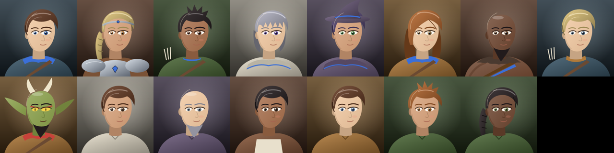
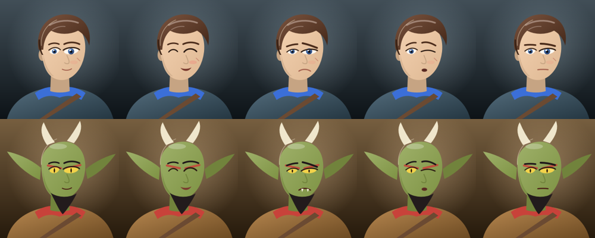
- [x] **Artist brief** (`game-2d-3d-artist`, for ⏳ owner to commission): [`doc/06-art-brief.md`](06-art-brief.md)
    - Per character: look line, class prop, palette swatches, 5 moods
    - Technical: 512×512 master, delivered 256×256, transparent-free, Nearest-safe edges
    - Frame-safe area; license terms (work-for-hire or exclusive license); file naming
    - Reference policy: **genre conventions only**, never another game's characters or art
- [x] **Character profile screen** (`game-ui-ux-designer` + `game-developer`): `view/screens/profile.gd`, `Game.Screen.PROFILE`. Camp → **Profile** button on each roster row (portrait cards come in step 20) → **Profile**. Hovering the portrait shows the happy mood; the look line is its tooltip. QA fix: the right column ran off screen (no width limit); now a fixed width, wrapping text and a wrapping bond row:
    - Large framed portrait (mood switches on hover), name, class and promotion path
    - Level and XP bar; stats as bars with growth hints
    - Equipment slots with item icons, bonds with every ally (tier hearts), and a one-line bio + the join quote
    - Next / previous with LB / RB (or Q / E)
- [x] **Item icons** (`game-2d-3d-artist`). 14 icons, `Art.item_icon(id)`: 24×24 pixel icons for every item (sword, spear, axe, bow, staff, herb, seed, antidote, rings) for the profile, shop and battle menus
- [x] **Data** (`game-developer`): `UnitData.bio` and `look` strings for the 8 recruits (original writing in `tools/make_content.gd`); shown in the profile and lint-checked (every recruit has both)

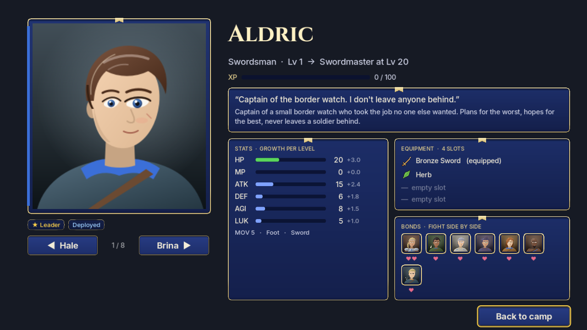

**Validation**

| Check | Pass when | Result |
| --- | --- | --- |
| Portrait v2 | All 15 speakers × 5 moods generated at 256×256, deterministic; the art-design review passes every one against doc/05 v2 | ✅ `test_every_speaker_has_five_moods_at_256`; `check_generated` OK; art-design review of the contact sheets above |
| Originality | A side-by-side review sheet (ours vs the genre reference, format only) shows no shared hair, eye, outfit or frame design | ✅ every look is written in the data and doc/06. None uses the reference character's hair and scarf combination, eye color, or frame. ⏳ owner confirms |
| Profile | Opens from camp for every recruit; all fields filled; fits at 1280×720 with the longest name and 4 items | ✅ `test_profile_opens_for_every_recruit_with_all_fields` (8 recruits); `profile` UI snapshot with 7 bonds |
| Parity | The profile can be opened, paged and closed with mouse, keyboard and gamepad | ✅ buttons, Q/E (LB/RB) and Esc; `test_q_and_e_page_through_the_roster` |
| Brief | `doc/06-art-brief.md` complete enough for an outside artist to quote on (owner check) | Written ✅; ⏳ owner check |
| Final portraits | Commissioned art replaces placeholders, same names and sizes | ⏳ owner + artist |

## Step 20 — Screen redesigns

**Goal:** each screen looks designed, not assembled. One primary action, faces everywhere, and clear structure.

**Tasks**

- [ ] **Title** (`game-artist` + `game-ui-ux-designer`):
    - Key-art backdrop (a placeholder generated from the battle backdrops plus a silhouette line-up of the party)
    - A **BANNER** wordmark with a pennant mark
    - A menu on a Banner panel; save slots shown as cards (chapter, play time, party leader's portrait)
- [ ] **Camp** (`game-ui-ux-designer`):
    - Roster as a grid of **portrait cards** (portrait, name, class, level, HP); toggling deploy shows a ribbon
    - Tabs: Party · Shop · Talk · Save. The shop shows item icons, prices and who can equip
    - **Start battle** as the one dominant button
- [ ] **Results** (`game-ui-ux-designer`):
    - A victory banner
    - Per-unit cards with portrait, XP bar filling, a "LEVEL UP" stamp with stat gains, and bond hearts gained
    - Loot with icons; Continue
- [ ] **Town** (`game-artist`): a backdrop of the place (from the backdrop generator, a town variant); townspeople as portrait cards; search spots as icon buttons
- [ ] **Settings** (`game-ui-ux-designer`): grouped into Audio · Display · Gameplay · Controls (rebinding list), with live previews (animation speed, battle view)
- [ ] **Credits / About** screen from `assets/CREDITS.md` + version

**Validation**

| Check | Pass when | Result |
| --- | --- | --- |
| Faces | Camp, results, town and the title's save slots all show portraits | |
| Fits | Every screen at 1280×720 and 1920×1080 with 8 recruits (chapter 3): nothing clipped or overlapping (UI snapshots) | |
| Clicks | Title → battle start in ≤ 4 clicks; camp → any profile in 1 | |
| Flow tests | `tests/e2e/test_campaign_flow.gd` and screen-build tests still pass | |
| Look (human) | Owner compares before/after sheets and approves | ⏳ owner |

## Step 21 — Battle HUD polish

**Goal:** the battle screen matches the new kit, and every decision is still readable at a glance.

**Tasks**

- [ ] **Unit card** (`game-ui-ux-designer`): a framed portrait thumbnail (mood: hurt below 25% HP), name, class, level, HP / MP bars, stat chips (ATK DEF AGI MOV), the weapon with its icon, the land effect and status icons
- [ ] **Forecast card**: attacker vs target side by side with portraits; hit %, damage range, crit % and counter; the "!" advantage chip. It appears on hover or with the cursor
- [ ] **Turn order bar**: the next 8 units as small portrait chips along the top, with team ribbons
- [ ] **Command menu**: after moving, a small Banner menu next to the unit (Attack · Magic · Item · Wait), keyboard / gamepad first. It replaces the button row; the buttons remain as a mouse fallback
- [ ] **Battle log** becomes a collapsible drawer; objective chip at the top ("Defeat the Goblin Chief")
- [ ] **Damage numbers and popups** use the display font with an outline; level-up uses a stamp

**Validation**

| Check | Pass when | Result |
| --- | --- | --- |
| Readable | 1-second glance test (5 screenshots, 3 people): actor, target hit %, and whose turn is next named correctly ≥ 90% | ⏳ owner |
| Parity | A whole battle is playable with the gamepad only through the command menu (scripted input test) | |
| Same battle | 2D/3D/text equivalence test still passes; no `core/` change | |
| Performance | ≥ 60 fps with the turn bar and cards on (bench) | |

## Step 22 — Production readiness

**Goal:** a build a stranger can install, read, play and trust.

**Tasks**

- [ ] **Accessibility** (`game-ui-ux-designer`):
    - UI scale (90 / 100 / 115 / 130%) and text size
    - A high-contrast option for the team colors; colorblind check (deuteranopia, protanopia, tritanopia) of the team, status and range colors, keeping shape cues (doc/05 §7)
    - Hold-to-skip for text; screen-shake off
- [ ] **Resolutions** (`game-qa`): 1280×720, 1920×1080, 2560×1440, 16:10 (2560×1600), ultrawide (3440×1440) and windowed resize. The safe area keeps the HUD in view; UI snapshots for each
- [ ] **Localization-ready** (`game-developer`): every UI string goes through `tr()` and a `.csv` translation table (English). A pseudo-locale (+30% length) proves nothing clips
- [ ] **Polish items:** app icon and splash; a pause menu in battle (resume / settings / suspend / quit); confirm dialogs for quit and overwrite save; tooltips on every stat
- [ ] **Release checks:** crash-free soak (100 auto-played battles in the 3D view); save compatibility test across this round; the doc/04 IP review of all new art and fonts

**Validation**

| Check | Pass when | Result |
| --- | --- | --- |
| Scale & text | Every screen readable at 130% UI scale on 1280×720 (snapshots) | |
| Colorblind | Team, status and range cues distinguishable in all 3 simulations (screenshots run through a simulator) | |
| Resolutions | UI snapshots at the 6 sizes show no clipping | |
| Localization | Pseudo-locale run: no missing `tr()` keys, no clipped text | |
| Stability | 100 auto-played 3D battles, 0 script errors | |
| IP & licenses | Every font and asset has a CREDITS line and license file; owner's IP review done | ⏳ owner |
| Gate | 5 outside testers rate "looks finished" ≥ 4/5 | ⏳ owner |

## After the slice

| Phase | Months | Engineering focus | Exit validation |
| --- | --- | --- | --- |
| 3D view | after the slice | Done in [step 17](#step-17--3d-isometric-battle-map-with-sprite-billboards-image-a-full) | ✅ Same scripted battles play identically in every view |
| Production | 9–18 | Content tools, hard mode, remaining spells/items/classes, localization pipeline | All 12 chapters playable start to finish in CI (campaign e2e over every chapter) |
| Alpha / beta | 19–22 | Bug fixing, performance, save migration tests for every released version | Crash-free ≥ 99.5%, 0 open save bugs |
| Launch | 23–24 | Store builds, day-1 patch pipeline | Signed builds pass store review |

---

## Tracking

Each step becomes a GitHub milestone. Each task is an issue labeled with its step (`step-4`) and layer (`core`, `view`, `data`, `tools`).

| Step | Owner | Start | Status |
| --- | --- | --- | --- |
| 0 Bootstrap | Claude | 2026-11-07 | ✅ Done |
| 1 Data schema | Claude | 2026-11-07 | ✅ Done |
| 2 Battle model | Claude | 2026-11-07 | ✅ Done |
| 3 Pathfinding | Claude | 2026-11-07 | ✅ Done |
| 4 Commands & rules | Claude | 2026-11-07 | ✅ Done |
| 5 AI + headless (Gate A) | Claude | 2026-11-07 | ✅ Done, Gate A signed off |
| 6 Playable battle (Gate B) | Claude | 2026-11-07 | ✅ Done, Gate B signed off |
| 7 Campaign & saves | Claude | 2026-11-07 | ✅ Done |
| 8 Progression | Claude | 2026-11-07 | ✅ Done (balance ⚠️, see step 8) |
| 9 Scripting & town | Claude | 2026-11-07 | ✅ Done |
| 10 Hardening | Claude | 2026-11-07 | ✅ Done (signing + Windows ⏳ owner) |
| 11 Slice content (Gate C) | Claude | 2026-11-07 | ✅ Engineering + placeholder content done; final art/audio and Gate C playtest ⏳ owner |
| 12 Design round 1 | Claude | 2026-11-07 | ✅ Done (playtest of matchups/status ⏳ owner) |
| 13 Art direction + pipeline | game-art-design, game-2d-3d-artist | 2026-11-07 | ✅ Done (style sign-off ⏳ owner) |
| 14 Portrait dialogue | game-ui-ux-designer, game-developer | 2026-11-07 | ✅ Done (playtest ⏳ owner) |
| 15 Map sprites + head icons | game-2d-3d-artist, game-developer | 2026-11-07 | ✅ Done (glance test + look ⏳ owner) |
| 16 Battle cut-in scene | game-developer, game-ui-ux-designer, game-artist | 2026-11-07 | ✅ Done (playtests ⏳ owner) |
| 17 3D isometric map | game-developer, game-artist | 2026-11-07 | ✅ Done (min-spec fps + look ⏳ owner; final art ⏳ artist) |
| 18 UI kit | game-art-design, game-developer, game-ui-ux-designer | 2026-11-07 | ✅ Done (kit sign-off ⏳ owner) |
| 19 Portraits v2 + profile | game-art-design, game-2d-3d-artist, game-ui-ux-designer | 2026-11-07 | ✅ Done (final portraits ⏳ owner + artist) |
| 20 Screen redesigns | game-ui-ux-designer, game-artist | — | ⬜ Next |
| 21 Battle HUD polish | game-ui-ux-designer, game-developer | — | ⬜ Planned |
| 22 Production readiness | game-qa, game-ui-ux-designer, game-developer | — | ⬜ Planned (Gate D ⏳ owner) |
