# 03 · Implementation Plan

We build the game in **12 steps**, from the inside out: rules first, then visuals, then content. Each step ends with something you can run and a validation checklist that must pass before the next step starts. Steps 0–6 reach a **first playable grey-box battle by the end of month 3**. Steps 7–11 reach the **vertical slice by month 8**.

| | |
| --- | --- |
| Audience | Engineers, leads |
| Based on | [02 Engineering Design](02-eng-design.md) (class and file names match it) |
| Team assumed | 2 gameplay engineers + 1 tools engineer from month 2; art and design work in parallel |

**Contents:** [Overview](#overview) · [Definition of done](#definition-of-done-every-step) · Steps [0](#step-0--project-bootstrap) · [1](#step-1--data-schema-and-fixtures) · [2](#step-2--battle-model) · [3](#step-3--pathfinding) · [4](#step-4--commands-events-and-combat-rules) · [5](#step-5--enemy-ai-and-headless-battles) · [6](#step-6--grey-box-battle-view) · [7](#step-7--campaign-screen-flow-and-saves) · [8](#step-8--progression-xp-promotion-bonds-items) · [9](#step-9--map-scripting-dialogue-and-town) · [10](#step-10--hardening-settings-export-and-performance) · [11](#step-11--vertical-slice-content) · [After the slice](#after-the-slice) · [Tracking](#tracking)

---

## Overview

```mermaid
flowchart LR
    subgraph M1["Month 1–3 · Pre-production"]
        S0["0 Bootstrap"] --> S1["1 Data schema"] --> S2["2 Battle model"] --> S3["3 Pathfinding"] --> S4["4 Commands & rules"] --> S5["5 AI + headless battles"] --> S6["6 Playable battle (text + 2D)"]
    end
    subgraph M2["Month 4–8 · Vertical slice"]
        S7["7 Campaign & saves"] --> S8["8 Progression"] --> S9["9 Scripting & town"] --> S10["10 Hardening"] --> S11["11 Slice content"]
    end
    S5 -. "Gate A: rules core done" .-> S6
    S6 -. "Gate B: first playable" .-> S7
    S11 -. "Gate C: slice playtest" .-> P["Production"]
```



| Step | Name | Weeks | Output you can run | Gate |
| --- | --- | --- | --- | --- |
| 0 | Project bootstrap | 1 | Empty project, CI green | |
| 1 | Data schema and fixtures | 1 | Resources open in the inspector | |
| 2 | Battle model | 1 | `BattleState` builds from a map | |
| 3 | Pathfinding | 1 | Ranges correct in tests | |
| 4 | Commands, events, rules | 2 | Scripted battle runs headless | |
| 5 | AI and headless battles | 2 | AI vs AI finishes every map in CI | **A: rules core done** |
| 6 | Playable battle: text + 2D views | 1 | Play a 4v4 battle with the mouse (2D) or in the terminal | **B: first playable** |
| 7 | Campaign, flow, saves | 2 | Title → camp → battle → results → save → load | |
| 8 | Progression | 3 | Level-ups, promotion, bonds, shop | |
| 9 | Scripting, dialogue, town | 3 | Reinforcements, boss lines, walkable town | |
| 10 | Hardening | 2 | Signed builds, settings, 60 fps | |
| 11 | Slice content | 8–10 | 1 town, 1 camp, 3 battles, 8 units | **C: slice playtest** |

---

## Definition of done (every step)

A step is done only when **all** of these are true:

- [ ] All planned tasks are merged to `main` through PRs
- [ ] CI is green: layer check, all tests, export, smoke
- [ ] The step's **validation** checklist passes, with evidence linked in the PR (test names, a screenshot or a short clip)
- [ ] New public interfaces match [02](02-eng-design.md), or 02 was updated in the same PR
- [ ] No `TODO` without an issue link; no debug prints left in `core/`
- [ ] A 2-minute demo is shown at the weekly review

---

## Step 0 — Project bootstrap

**Goal:** a clean Godot project where tests and builds run automatically on every push.

**Tasks**

- [x] Install Godot 4.x stable; write the exact version to `.godot-version` (`4.7.2-stable`)
- [x] Create `project.godot` (name "Banner", 1920×1080, `canvas_items` stretch, placeholder title scene)
- [x] Create the folder tree from [02 §3](02-eng-design.md#3-project-structure) with `.gitkeep` files
- [x] Set up Git LFS for `assets/**` (`.gitattributes`). **Later changed:** LFS is disabled on the GitHub repo, so binaries are stored directly (2.3 MB of audio)
- [x] Test runner + one sample test. **Changed:** a built-in runner (`tests/run_tests.gd` + `TestCase`, run via `tools/test.sh`) instead of gdUnit4. It has no dependency, works on Godot 4.7, and counts script errors as failures
- [x] Write `tools/check_layers.sh`, which fails if `core/` mentions Nodes, `get_tree`, `Input`, `view/`, or calls `randf`/`randi` outside `rng.gd`
- [x] Add `export_presets.cfg` for macOS, Windows and Linux
- [x] Add `.github/workflows/ci.yml`: layer check → tests → Linux export → smoke → upload artifact
- [x] Register the empty autoloads `Game`, `SaveService`, `Audio`
- [x] **Added:** `Dockerfile` + `tools/docker.sh` (`test` / `export` / `shell`) with Godot pinned from `.godot-version`. CI runs the same container

**Validation**

| Check | How | Pass when | Result |
| --- | --- | --- | --- |
| Project opens | `godot --headless --path . --import` | No errors | ✅ |
| Tests run | `tools/test.sh` | 1 test, 0 failures | ✅ `1 passed, 0 failed` |
| Runner catches failures | Temp test with a bad assert + a runtime error | Both reported as FAIL, exit 1 | ✅ |
| Layer check bites | Temp `extends Node` and `randf()` in `core/` | Exits non-zero; passes once removed | ✅ |
| Smoke (local) | `godot --headless --path . --quit-after 60` | Exit code 0 | ✅ |
| Docker tests | `tools/docker.sh test` | Same result as native | ✅ `8 passed, 0 failed` |
| Docker export | `tools/docker.sh export` | Linux app builds and boots | ✅ `export + smoke: OK` (73 MB) |
| CI | Push to `main` | Workflow green, Linux build artifact downloadable | ✅ |

---

## Step 1 — Data schema and fixtures

**Goal:** every content type exists as a typed Resource, with tiny fixture content for tests.

**Tasks**

- [x] `data/defs/`: `Enums`, `Stats`, `ClassData`, `UnitData`, `ItemData`, `SpecialData`, `SpellData`, `SpellLevel`, `TerrainData`, `MapData`, `EnemySpawn`, `TriggerData`, `TriggerAction`, `ChapterData` ([02 §5.1](02-eng-design.md#51-data-definitions-datadefs-extends-resource))
- [x] Terrain set in `data/terrain/`: plain, forest, hill, sand, shallow water, deep water, wall (costs from [02 §4.1](02-eng-design.md#41-grid-and-terrain--grid-terraindata))
- [x] Fixtures in `tests/fixtures/`: 2 classes (swordsman, archer), 6 units (4 heroes, 2 enemy types), 3 items (sword, bow, herb), one 8×8 map with a hill block and forest, 4 player + 4 enemy spawns. Generated by `tools/make_fixtures.gd`; loaded in tests through `Fixtures`
- [x] `MapData.validate() -> PackedStringArray`: sizes match, spawns in bounds, on passable tiles, not overlapping

Simplifications compared with doc 02 (kept simple to run first):
- `Variant` fields became typed ones: `objective_tag` / `objective_area` / `objective_rounds`, plus trigger fields `on_round` / `area` / `tag` / `hp_percent`
- `TerrainData.move_cost` is a `PackedInt32Array` indexed by `MoveType`
- Class growth is in tenths of a point (`atk 24` = +2.4 per level)

**Validation**

| Check | Pass when | Result |
| --- | --- | --- |
| Typed fields | Every fixture loads as its class (`UnitData`, `MapData`…) | ✅ `test_every_fixture_loads_with_its_type` |
| Round-trip | Load each fixture `.tres`, save it, reload it → fields equal | ✅ `test_fixture_round_trip_keeps_fields` |
| Map validation | `validate()` on the fixture map returns `[]`; on a broken copy it returns the expected errors | ✅ `test_fixture_map_is_valid`, `test_broken_map_reports_errors` |
| Content lint in CI | A test calls `validate()` on every map in `data/maps/` | ✅ `test_all_game_maps_validate` (no game maps yet) |
| Inspector | Fixtures open in the Godot editor inspector | ⏳ manual check, open in the editor |

---

## Step 2 — Battle model

**Goal:** the battle's data structures exist and can be built from a map, with no rules yet.

**Tasks**

- [x] `Rng` (seeded; `between`, `chance`, `roll`, `pick`)
- [x] `Unit` (stats with equipment, `copy`, `to_dict`/`from_dict`)
- [x] `Grid` (built from `MapData`; height, terrain, occupancy, neighbors)
- [x] `TurnQueue` (initiative = `agi × between(0.875, 1.125)`, tie rules, `peek`)
- [x] `BattleState._init`, `start()`, `units()`, `living()`, `unit(id)`, `current_actor()`, plus a `check_invariants()` helper
- [x] **Added:** `Content` registry (`core/content.gd`) that resolves ids to Resources, so `Unit.to_dict()` stores ids, not paths

**Validation**

| Check | Pass when | Result |
| --- | --- | --- |
| Determinism | Two `Rng(42)`s produce identical sequences of 1,000 values | ✅ `test_rng_same_seed_same_sequence` |
| Grid | Unit tests: bounds, height, terrain lookup, `unit_at` after `place`/`vacate` | ✅ `test_grid_lookups`, `_neighbors`, `_occupancy` |
| Turn order | Same seed → same order; a unit with higher AGI goes first in > 90% of 1,000 seeds; dead units are skipped | ✅ `test_turn_order_*` (4 tests) |
| Build | `BattleState.new(fixture_map, party, 1)` places 8 units on spawns; invariants hold | ✅ `test_battle_builds_from_map` |
| Serialization | `Unit.from_dict(u.to_dict())` equals `u` | ✅ `test_unit_dict_round_trip` |
| Isolation | A battle copies the party; the caller's units are unchanged | ✅ `test_battle_does_not_change_callers_party` |

---

## Step 3 — Pathfinding

**Goal:** correct move and attack ranges for every movement type.

**Tasks**

- [x] `Pathfinder.reachable` (bucket-queue Dijkstra, move cost, jump limit, allies passable, enemies blocking)
- [x] `Pathfinder.path_to` (rebuilds the path from `came_from`)
- [x] `Pathfinder.attack_tiles` (Manhattan ring `min..max`) + `distance`
- [x] Microbenchmark on a 32×32 map

**Validation**

| Check | Pass when | Result |
| --- | --- | --- |
| Terrain cost | Foot unit, MOV 5, all plains → exactly the 61 tiles within distance 5 (open map) | ✅ `test_open_map_diamond_of_61_tiles` |
| Forest | A forest tile costs 2 for foot and 1 for flying (test both) | ✅ `test_forest_costs_*` |
| Height | A height-3 step blocks a jump-2 unit; jump-3 passes | ✅ `test_height_limits_jump` |
| Blocking | Can pass through an ally but not stop on it; cannot pass an enemy; dead units don't block | ✅ `test_pass_through_ally_but_not_stop`, `test_enemy_blocks`, `test_dead_units_do_not_block`, `test_wall_is_impassable` |
| Path | `path_to` returns a contiguous path whose total cost equals `reachable[to]` | ✅ checked for every reachable tile on the fixture map |
| Bow ring | Range (2, 3) excludes adjacent tiles | ✅ `test_bow_ring_excludes_adjacent` |
| Speed | `reachable` < 2 ms on 32×32 (median of 100 runs) | ✅ 0.47 ms locally with MOV 6 (the CI machine is about 2× slower) |

---

## Step 4 — Commands, events and combat rules

**Goal:** a full battle can be played by code. This step creates the core contract.

**Tasks**

- [x] `Command` base + `MoveCommand`, `AttackCommand`, `EquipCommand`, `UseItemCommand`, `WaitCommand` (`Cast` comes in step 8), with `is_valid`, `execute`, `to_dict`/`from_dict`. One file each in `core/battle/commands/`
- [x] `BattleEvent` with `to_dict`. **Simplified:** one generic class (`type` + `data` dict, type constants such as `BattleEvent.DAMAGED`) instead of a class per event
- [x] `BattleState.apply`: validate → execute → record in `history` → outcome check → turn advance
- [x] `BattleState.legal_commands(u)`, `snapshot()`, `check_invariants()`
- [x] `Rules`: hit, damage, crit, counter, land effect, XP, heal, `forecast` (no RNG, returns a Dictionary), `check_outcome` (rout, defeat boss, leader dies). **Deferred to step 8:** double attacks and weapon specials
- [x] `BattleState.replay(map, party, seed, cmds)`

**Validation**

| Check | Pass when | Result |
| --- | --- | --- |
| Contract | Invalid command (wrong turn, out of range, ally, too far, bad slot, null) → `[]`, state unchanged (`snapshot()` before/after) | ✅ `test_invalid_commands_are_rejected_without_changes` |
| Turn shape | `Move` then `Attack` works; a second `Move` is rejected; `Wait` ends the turn; rounds advance | ✅ `test_turn_shape_move_then_act`, `test_wait_ends_turn`, `test_rounds_advance` |
| Formulas | Hit clamped to 10–99, damage range, minimum 1 damage, land effect lowers damage, XP clamped | ✅ `test_hit_chance_is_clamped`, `test_damage_range_and_minimum`, `test_land_effect_lowers_damage`, `test_xp_formula` |
| Forecast | `forecast().dmg` contains the damage actually dealt in 1,000 seeded attacks; forecast never uses the RNG | ✅ `test_forecast_contains_actual_damage`, `test_forecast_does_not_touch_rng` |
| Events | Killing blow emits `attacked → damaged → died → xp_gained` in that order | ✅ `test_killing_blow_event_order` |
| Items | Herb heals and is consumed; equip keeps the turn; class weapon rules hold | ✅ `test_use_item_heals_and_consumes`, `test_equip_does_not_end_turn` |
| Outcome | All enemies dead → WON; leader dead → LOST; no commands after the end | ✅ `test_win_when_all_enemies_die`, `test_lose_when_leader_dies` |
| Replay + invariants | 20 seeds × up to 60 random legal commands: invariants hold after every `apply`, and `replay()` from command dicts gives an identical `snapshot()` | ✅ `test_random_play_keeps_invariants_and_replays` |

---

## Step 5 — Enemy AI and headless battles

**Goal:** the computer can play either side, so whole battles run in CI. **Gate A.**

**Tasks**

- [x] `AiPlanner.choose`: **simple rules** (doc 02 §4.9). HOLD never moves; otherwise attack the lowest-HP hostile in reach (prefer not moving); otherwise step toward the nearest hostile; otherwise wait. (A first scoring version was replaced by these rules to keep it simple)
- [x] `AutoPlay.play_turn` / `play_to_end`: AI plays either side, always bounded (a turn that makes no progress is ended with Wait)
- [x] `tests/e2e/test_battle_runs.gd`: AI vs AI on every map (fixture + `data/maps/`), 50 seeds each
- [x] Property test: 500 seeds × 25 random legal commands; invariants after each `apply`
- [x] Golden replays (seeds 7, 21, 99) in `tests/golden/`, written by `tools/make_golden.gd`, compared as normalized JSON
- [x] `tools/battle_sim.gd`: `-- --runs=N [--map=res://…]` → win rate, unfinished, average rounds, deaths, max AI ms

**Validation**

| Check | Pass when | Result |
| --- | --- | --- |
| Finishes | Every map × 50 seeds ends (`outcome ≠ ONGOING`) in < 200 rounds with 0 errors | ✅ `test_every_map_finishes_for_50_seeds`; sim: 200/200 finished |
| Sensible | AI attacks a unit in range instead of waiting; moves in to attack; picks the lowest-HP target; `HOLD` never moves and only attacks in place | ✅ `test_ai.gd` (6 tests) |
| Deterministic | Same seed → same AI choices (compare `history`) | ✅ `test_ai_is_deterministic` |
| Fast | Max AI think time < 100 ms per unit | ✅ sim max 9.3 ms |
| Property | 500 seeds of random legal play keep every invariant | ✅ `test_random_play_invariants_500_seeds` |
| Golden | Golden replays pass; a deliberate formula change makes them fail | ✅ passes; changing `XP_HIT` or `BASE_HIT` fails it. (Crit 4%→5% did not, because no roll in these short battles landed in that window, so goldens catch most but not all changes) |
| **Gate A review** | Leads read the sim report and the test list, then sign off that the rules core is ready for visuals | ✅ signed off by the project owner, 2026-11-07 |

**Gate A sim report** (`tools/battle_sim.gd -- --runs=200`, fixture 8×8 map, AI vs AI):

```
player win rate: 44%      unfinished: 0
avg rounds:      3.4
max AI think:    9.3 ms
```

A 44% win rate is fine for now: both sides use the same rules on a tiny map with equal forces, and losing the hero (the leader) loses the battle. Step 8 tunes balance (target: 60–90% for a human player).

---

## Step 6 — Playable battle, no GPU (text mode)

**Goal:** a person can play a whole battle against the computer. **Gate B.**

**Changed from the original plan:** two views instead of the 3D grey-box, both normal View-layer clients of the core (nothing in `core/` changed):

1. **Text battle** (`view/terminal/`): ASCII map plus typed commands. Headless, no GPU, works in Docker and over SSH.
2. **2D top-down battle** (`view/battle2d/`, the main scene): tiles, units and UI drawn with simple shapes (no art yet). Uses Godot's lightweight Compatibility renderer, which runs on any built-in GPU (checked on an Apple M4).

The 3D isometric view moves to *after the slice*.


**Tasks**

- [x] `TextView.render(state)`: map with coordinates, terrain symbols, units (UPPER = yours, lower = enemy, `*` = acting), `+` on tiles the acting unit can reach, unit table (HP, position, weapon)
- [x] `TextView.describe(event)`: one readable line per event ("Goblin attacks Hero: hits / Hero takes 9 damage (HP 11)")
- [x] `TextView.parse(line)`: `m x y`, `a ID`, `i SLOT ID`, `e SLOT`, `w`, plus info commands `f ID` (forecast), `u ID` (unit details), `r`, `h`, `q`
- [x] `TerminalGame`: turn loop. You command your units; enemy turns run through `AutoPlay`; it shows events and the victory/defeat banner. Input/output are injected so tests can script it
- [x] `tools/play.gd` (`-- --seed=N`) and `tools/docker.sh play [seed]`
- [x] **2D battle screen** `view/battle2d/battle_screen.tscn` (main scene): colored terrain tiles (forest, hill, height), unit tokens with HP bars, a star on leaders, a ring on the acting unit, a blue move range, red outlines on attackable enemies, a hover outline, floating damage numbers, animated moves, a unit panel (name, class, level, HP bar, stats, land effect), an attack forecast on hover, Wait/Herb buttons (W/I), a battle log, a VICTORY/DEFEAT banner, and R for a new battle
- [x] Screenshot mode for checking visuals: `godot --path . -- --screenshot=out.png --demo-turns=3 --seed=11`
- [x] Renderer switched to `gl_compatibility`; window opens at 1280×720 (scaled from 1920×1080)

**Validation**

| Check | Pass when | Result |
| --- | --- | --- |
| No GPU | Runs headless on the Mac and in Docker | ✅ `godot --headless … tools/play.gd`; `tools/docker.sh play` |
| Renders | Map rows, units, enemy letters, hill, `+` move range on your turn | ✅ `test_render_shows_map_units_and_reach` |
| Commands | Every command parses; bad input gives a usage message | ✅ `test_parse_commands`, `test_parse_errors_and_info` |
| Every event readable | No raw dicts in the battle log for a full battle | ✅ `test_every_event_has_text` |
| Plays to the end | Scripted input: a whole battle finishes and shows the result | ✅ `test_game_loop_plays_to_the_end` |
| Robust | Garbage input, illegal moves and quit leave a valid state | ✅ `test_game_loop_survives_bad_input` |
| No logic in view | Layer check green; the view only calls `apply`, `legal`/`forecast`, `AutoPlay` | ✅ |
| 2D screen works | Starts on a player turn, click moves the unit, bad clicks do nothing, waiting plays to the end and shows the banner | ✅ `test_battle_screen.gd` (4 tests, headless) |
| 2D renders | Screenshot on a real GPU looks right | ✅ Apple M4, see image above |
| **Gate B review** | A teammate who didn't build it wins the fixture battle with no help in < 15 minutes and finds it fun (≥ 3.5/5) | ✅ signed off by the project owner after playing the 2D build, 2026-11-07 |

## Step 7 — Campaign, screen flow and saves

**Goal:** the whole app loop works end to end: Title → Camp → Battle → Results → Camp … → end.

**Tasks**

- [x] `Campaign`, `Party`, `Inventory` (`new_game`, `start_battle` copies units, `finish_battle` merges XP and items back, heals and revives everyone)
- [x] `BattleResult`; win = gold + next chapter; leader loss = retreat with XP kept, same chapter
- [x] `Game` autoload state machine (`new_game`, `continue_game`, `start_battle`, `finish_battle`, `after_results`, `quit_to_title`, play-time counter)
- [x] Screens built in code (`view/screens/`): **Title** (New Game / Continue with a slot list / Quit), **Camp** (deploy checkboxes, leader locked, Save 1–3, Start battle), **Results** (victory/retreat, gold, XP per unit, who fell, end-of-campaign message). The 2D battle screen plays the campaign battle, and a Continue button leads to Results
- [x] `SaveService`: `save_slot` (atomic temp + rename), `load_slot`, `slot_info`, `list_slots`, version field + `migrate()` (v0 → v1 example)
- [x] Autosave after each battle; 3 manual slots in camp
- [x] Demo campaign: 2 chapters (ch01 rout on the 8×8 map; ch02 defeat a level-3 boss on a new map), generated by `tools/make_fixtures.gd`. Real chapters come in step 11
- [x] `tools/screenshot.gd -- --screen=title|camp|battle|results`

 

**Validation**

| Check | Pass when | Result |
| --- | --- | --- |
| E2E | New game → battle (AI) → results → autosave → save → load → identical campaign → next screen | ✅ `test_new_game_battle_results_save_load` |
| Whole campaign | Both demo chapters can be won in order; gold and wins add up | ✅ `test_whole_demo_campaign_completes` |
| Round-trip | `Campaign.from_dict(c.to_dict())` gives the same dict | ✅ `test_campaign_dict_round_trip` |
| Isolation | Changing or abandoning a battle leaves the roster unchanged | ✅ `test_battle_uses_copies` |
| Win / loss rules | Win: gold, XP, next chapter, full heal. Loss: same chapter, XP kept, leader listed as fallen | ✅ `test_win_gives_gold_xp_and_next_chapter`, `test_loss_keeps_xp_and_chapter` |
| Crash safety | A crash between writing and renaming leaves the previous save loadable | ✅ `test_crash_during_save_keeps_previous_save` |
| Corrupt file | A garbage `slot_2.json` shows as damaged; slots 1 and 3 still load | ✅ `test_damaged_slot_does_not_affect_others` |
| Migration | A hand-made v0 save loads after `v0 → v1`; a newer-version save is refused | ✅ `test_v0_save_migrates`, `test_newer_save_is_refused` |
| Screens | Title, Camp, Results build headless; screenshots on GPU look right | ✅ `test_screens_build_without_errors` + images above |
| Manual | Title → camp → battle → results → quit → relaunch → continue works | ⏳ human check: `godot --path .` |

## Step 8 — Progression: XP, promotion, bonds, items

**Goal:** units grow, and the party starts to feel like a story.

**Tasks**

- [x] XP → level every 100 XP; seeded growth rolls (`growth/10` + chance of 1 more); `leveled_up` event, "LEVEL UP" popup in 2D, level-ups listed on Results
- [x] Promotion (`Party.can_promote` / `promote`, level ≥ 20, `promotes_to`), with a Promote button in camp. Fixtures: swordsman → swordmaster, archer → sniper (MOV 6)
- [x] `Bonds` (simplified): allies standing next to a unit that lands a hit gain +4 points with it. Tiers at 0/40/120/260/500; the attacker's best adjacent tier gives +2% hit, +1% crit and +2% damage per tier. A fallen unit drops one tier with every partner. Bonds are saved in the campaign and copied into each battle
- [x] `CastCommand` + spells (heal allies / damage hostiles, area radius, MP cost). New Priest (cleric: Heal, Blaze) joins in chapter 2. Text: `c heal 1 x y`; 2D: Spell button (S) picks the most useful cast
- [x] Deferred from step 4: double attacks (6%) and weapon specials `EXTRA_HIT` and `DRAIN` (fixture: Steel Sword, 15% extra hit). `POISON`/`SLEEP` wait for a status system
- [x] Shop in camp, stocked per chapter (`ChapterData.shop`); purchases go to the first deployed unit with a free slot, else storage

**Validation**

| Check | Pass when | Result |
| --- | --- | --- |
| XP | Clamped to 1–49; kill > hit; 150 XP = level 2 with 50 left over | ✅ `test_xp_formula`, `test_level_up_every_100_xp` |
| Growth | Over 10,000 seeded level-ups, average gain is within 2% of growth | ✅ `test_growth_average_matches_class` |
| Promotion | Level resets to 1, stats kept, class changes; refused below 20 or to the wrong branch | ✅ `test_promotion_rules` |
| Bonds | Tier thresholds exact; adjacent ally earns points; bonus raises hit and damage; death drops a tier; saved and restored | ✅ `test_bond_tiers_and_death`, `test_adjacent_ally_earns_bond_points`, `test_bond_bonus_raises_hit_and_damage`, `test_campaign_keeps_bonds_and_applies_death_penalty` |
| Spells | Heal restores HP and costs MP; area Blaze hits everyone in radius; refused without MP, out of range, or for non-casters | ✅ `test_heal_spell_*`, `test_area_blaze_*`, `test_cannot_cast_*` |
| Double / specials | ≈6% double attacks and ≈15% extra hits over 400 seeded attacks | ✅ `test_double_attacks_and_specials_happen` |
| Shop | Buying spends gold and gives the item to a unit; refused when too poor | ✅ `test_shop_buy_goes_to_a_unit` |
| Balance sim | Player win rate 60–90% with AI on both sides *(tune)* | ⚠️ boss map 60%; 8×8 test map 44%. That map is a mirror-image 4v4 test map, so ~50% is expected. Real balancing happens on real maps in step 11 |

## Step 9 — Map scripting, dialogue and town

**Goal:** maps tell stories, and players can visit a town.

**Tasks**

- [x] `MapScript` + `TriggerData`/`TriggerAction`: conditions `ROUND_START`, `UNIT_ENTERS`, `UNIT_DIES`, `HP_BELOW`; actions `SPAWN`, `SAY`, `SET_FLAG`, `WIN`, `LOSE`. Runs after every command and at each round start, so it's deterministic. A trigger fires once; with `repeat`, at most once per round. (`SET_OBJECTIVE`/`RECRUIT` later)
- [x] Objectives `DEFEAT_BOSS`, `REACH_AREA`, `SURVIVE_ROUNDS` (plus `ROUT`)
- [x] `Dialogue` (`core/dialogue.gd`): lines by id from JSON. `said` events show as a speech box in 2D (and a log line), and as a quoted line in text mode
- [x] Demo boss map triggers: intro line on round 1; at < 50% HP the boss calls a guard (spawn + line); defeat line
- [x] **Town, simplified to a menu** (no walking yet): talk to townspeople, search hidden spots (each item found once, remembered in the save). Chapter 1 has "Riverside" (Elder, Smith, a herb and a Steel Sword hidden)
- [x] Suspend mid-battle (campaign + seed + commands) → Title shows "Resume battle" → the battle is rebuilt by replay

**Validation**

| Check | Pass when | Result |
| --- | --- | --- |
| Triggers | Round 1 intro line; boss under 50% says a line and spawns a guard exactly once; boss death line comes before victory | ✅ `test_round_one_intro_line`, `test_boss_below_half_calls_guard_once`, `test_boss_death_line_then_victory` |
| Objectives / actions | Reach area wins; survive 3 rounds wins at round 4; `SET_FLAG` + `LOSE` work | ✅ `test_reach_area_objective`, `test_survive_rounds_objective`, `test_flag_and_lose_actions` |
| Determinism | Battles with triggers replay to an identical snapshot | ✅ `test_triggers_replay_deterministically` (+ golden replays) |
| Content lint | Every line used by a trigger or a town exists | ✅ `test_every_dialogue_line_exists` |
| Suspend | Suspend at round 4 → load → identical `snapshot()` | ✅ `test_suspend_and_resume_is_identical` |
| Town | Search gives the item once, also after save/load; town screen builds | ✅ `test_town_search_gives_item_once`, `test_screens_build_without_errors` |
| Manual | Playtester visits the town, talks to everyone, finds both items without help | ⏳ human check |

## Step 10 — Hardening: settings, export and performance

**Goal:** builds that a stranger can install and run on ordinary hardware.

**Tasks**

- [x] Settings screen (Title → Settings): music/sound volume, fullscreen, animation speed (normal / fast / skip) → `user://settings.cfg` (`view/common/settings.gd`)
- [x] Input map in code: arrows/D-pad move a cursor, Space/A confirm, W/B wait, I/X item, S/Y spell, Enter/Start continue. Mouse still works
- [x] Animation speed applied to moves and pauses; "skip" turns animations off
- [x] Version on the title screen (`application/config/version` = 0.1.0)
- [x] Battle log: `user://logs/last_battle.json` (campaign + seed + commands) written after every battle and on suspend; `tools/replay_log.gd` rebuilds it exactly, for bug reports
- [x] FPS benchmark: `godot --path . -s res://tools/screenshot.gd -- --screen=battle --bench`
- [x] **Bug fixed:** "has the turn ended?" was decided by "did the acting unit change?", which is wrong when one unit acts last in a round and first in the next. Now decided by `turn_ended` events (`BattleEvent.turn_over`) in AutoPlay, the 2D screen and the text game. Regression test added
- [ ] macOS signing + notarization, Windows build: needs an Apple Developer certificate and a Windows machine (owner: you)


**Validation**

| Check | Pass when | Result |
| --- | --- | --- |
| Settings persist | Change settings → save → reload → still applied | ✅ `test_settings_persist` |
| Gamepad / keyboard | Every action has a key and a gamepad button; the cursor + confirm moves a unit | ✅ `test_input_map_has_keyboard_and_gamepad`, `test_cursor_and_confirm_move_a_unit` (a real gamepad playthrough is ⏳ manual) |
| Repro | A written battle log replays to the same state | ✅ `test_battle_log_replays_exactly` |
| Performance | 60 fps on the battle screen | ✅ 120 fps (vsync cap) on Apple M4 with the Compatibility renderer |
| Linux build | Exports and boots (title screen) in Docker | ✅ `tools/docker.sh export` → `export + smoke: OK` |
| Clean install | Fresh macOS and Windows machines: download → run → play → save | ⏳ needs signing (above) and a Windows machine |

## Step 11 — Vertical slice content

**Goal:** the real slice: **1 town, 1 camp, 3 battles, 8 units, 2 classes each**. **Gate C.**

All slice content lives in `res://data/` and is generated by `tools/make_content.gd`. Maps are ASCII grids in that file, so they're easy to read and change. The game no longer uses the test fixtures.

**Tasks**

- [x] **Engine features the maps needed:** `GIVE` (chests) and `SET_AI` (boss phases) trigger actions; `unless_flag` on triggers; computer-controlled allies on the player side (`MapData.allies`, `Unit.ai_controlled`); a `FLEE` AI profile; `REACH_AREA` limited to a tagged unit
- [x] **Design, 3 maps each with a twist:**
    1. *The Ruins Road*: loot race. Open 3 chests (Healing Seed, Power Ring, Steel Sword) before the raiders loot them at round 6
    2. *Wolves at Millford*: protect a villager who runs from enemies on its own. You lose if it dies; wolves arrive on round 3
    3. *The Chief's Camp*: the boss holds until below 50% HP, then charges and calls two guards; defeat him to win
- [x] **Cast:** 8 recruits (Aldric, Brina, Corin, Dara, Eamon, Fiora, Garret, Hale), 6 classes that each promote (swordsman → swordmaster, knight → paladin, archer → sniper, cleric → bishop, mage → wizard, warrior → berserker); enemies: goblin, goblin archer, wolf, bandit, goblin chief; 10 items, 4 spells
- [x] **Writing** (`data/dialogue/slice.json`): chapter intros and battle lines, a join line for every recruit (shown in camp), 12 camp chats (Talk button), townspeople in Riverside and Millford
- [x] **Audio, placeholder:** `tools/make_audio.py` synthesizes 3 chiptune loops (camp, battle, boss) and 9 sound effects (hit, crit, miss, heal, level up, chest, select, victory, defeat). The `Audio` autoload plays music per screen and sound effects per battle event; volumes come from Settings
- [x] **Art, placeholder upgrade:** a shared UI theme (blue panels, gold edges), textured tiles (grass, sand, water, bricks), chests drawn on the map, the battle map scales to any map size, and the camp layout fits 8 units
- [x] **Map authoring:** ASCII grids in `tools/make_content.gd` instead of an editor plugin (simpler, reviewable in diffs). Legend: `. f ^ H : ~ w #` terrain, `P` spawns, `$` chests, letters for enemies, `V` villager
- [x] **Balance with the battle sim** (`-- --chapter=N` simulates a chapter with its real party)
- [ ] Final art (character sprites, tilesets, UI), composed music: needs an artist and a composer (owner: you)
- [ ] Outside playtests: needs 5 outside testers (owner: you)

 

**Validation**

| Check | Pass when | Result |
| --- | --- | --- |
| Scope | 8 recruitable units with 2 classes each; a town; 3 battles | ✅ `test_slice_scope` |
| CI | All maps validate, all dialogue lines exist, AI-vs-AI soak finishes on every map | ✅ `test_every_data_map_is_valid_and_lines_exist`, `test_every_map_finishes_for_50_seeds` |
| Twists work | Chests give items until looted; villager death loses; chief charges and calls guards at < 50% | ✅ `test_chests_give_items_until_looted`, `test_villager_flees_and_its_death_loses`, `test_chief_charges_when_hurt` |
| Whole slice | Chapters 1→3 can be won in order; 8 units and 550 gold at the end | ✅ `test_whole_slice_campaign_completes` |
| Balance (sim) | AI-vs-AI player win rate 60–90% per map *(proxy for a 70–85% human clear rate)* | ✅ ch1 84%, ch2 89%, ch3 74% |
| Performance | 60 fps on the battle screen | ✅ 120 fps (vsync) on Apple M4 |
| Clear rate (human) | Internal testers: 70–85% first-try clear per map | ⏳ needs playtests |
| Length | Average battle 15–25 minutes | ⏳ needs playtests (AI-vs-AI battles last 2.4–5.3 rounds; human battles are longer) |
| **Gate C: slice playtest** | 5 outside testers finish all 3 battles and rate the battles ≥ 4/5 | ⏳ owner to run with outside testers |

## After the slice

| Phase | Months | Engineering focus | Exit validation |
| --- | --- | --- | --- |
| 3D view | after the slice | 3D isometric battle view (height, rotating camera, sprites on the map), using the same core and events as the 2D/text views | Same scripted battles play identically in every view |
| Production | 9–18 | Content tools, hard mode, remaining spells/items/classes, localization pipeline | All 12 chapters playable start to finish in CI (campaign e2e over every chapter) |
| Alpha / beta | 19–22 | Bug fixing, performance, save migration tests for every released version | Crash-free ≥ 99.5%, 0 open save bugs |
| Launch | 23–24 | Store builds, day-1 patch pipeline | Signed builds pass store review |

---

## Tracking

Each step becomes a GitHub milestone. Each task is an issue labeled with its step (`step-4`) and layer (`core`, `view`, `data`, `tools`).

| Step | Owner | Start | Status |
| --- | --- | --- | --- |
| 0 Bootstrap | Claude | 2026-11-07 | ✅ Done |
| 1 Data schema | Claude | 2026-11-07 | ✅ Done |
| 2 Battle model | Claude | 2026-11-07 | ✅ Done |
| 3 Pathfinding | Claude | 2026-11-07 | ✅ Done |
| 4 Commands & rules | Claude | 2026-11-07 | ✅ Done |
| 5 AI + headless (Gate A) | Claude | 2026-11-07 | ✅ Done, Gate A signed off |
| 6 Playable battle (Gate B) | Claude | 2026-11-07 | ✅ Done, Gate B signed off |
| 7 Campaign & saves | Claude | 2026-11-07 | ✅ Done |
| 8 Progression | Claude | 2026-11-07 | ✅ Done (balance ⚠️, see step 8) |
| 9 Scripting & town | Claude | 2026-11-07 | ✅ Done |
| 10 Hardening | Claude | 2026-11-07 | ✅ Done (signing + Windows ⏳ owner) |
| 11 Slice content (Gate C) | Claude | 2026-11-07 | ✅ Engineering + placeholder content done; final art/audio and Gate C playtest ⏳ owner |
