# 03 · Implementation Plan

We build the game in **12 steps**, from the inside out: rules first, then visuals, then content. Each step ends with something you can run and a validation checklist that must pass before the next step starts. Steps 0–6 reach a **first playable grey-box battle by the end of month 3**. Steps 7–11 reach the **vertical slice by month 8**.

| | |
| --- | --- |
| Audience | Engineers, leads |
| Based on | [02 Engineering Design](02-eng-design.md) (class and file names match it) |
| Team assumed | 2 gameplay engineers + 1 tools engineer from month 2; art and design work in parallel |

**Contents:** [Overview](#overview) · [Definition of done](#definition-of-done-every-step) · Steps [0](#step-0--project-bootstrap) · [1](#step-1--data-schema-and-fixtures) · [2](#step-2--battle-model) · [3](#step-3--pathfinding) · [4](#step-4--commands-events-and-combat-rules) · [5](#step-5--enemy-ai-and-headless-battles) · [6](#step-6--grey-box-battle-view) · [7](#step-7--campaign-screen-flow-and-saves) · [8](#step-8--progression-xp-promotion-bonds-items) · [9](#step-9--map-scripting-dialogue-and-town) · [10](#step-10--hardening-settings-export-and-performance) · [11](#step-11--vertical-slice-content) · [After the slice](#after-the-slice) · [Tracking](#tracking)

---

## Overview

```mermaid
flowchart LR
    subgraph M1["Month 1–3 · Pre-production"]
        S0["0 Bootstrap"] --> S1["1 Data schema"] --> S2["2 Battle model"] --> S3["3 Pathfinding"] --> S4["4 Commands & rules"] --> S5["5 AI + headless battles"] --> S6["6 Playable battle (text + 2D)"]
    end
    subgraph M2["Month 4–8 · Vertical slice"]
        S7["7 Campaign & saves"] --> S8["8 Progression"] --> S9["9 Scripting & town"] --> S10["10 Hardening"] --> S11["11 Slice content"]
    end
    S5 -. "Gate A: rules core done" .-> S6
    S6 -. "Gate B: first playable" .-> S7
    S11 -. "Gate C: slice playtest" .-> P["Production"]
```



| Step | Name | Weeks | Output you can run | Gate |
| --- | --- | --- | --- | --- |
| 0 | Project bootstrap | 1 | Empty project, CI green | |
| 1 | Data schema and fixtures | 1 | Resources open in the inspector | |
| 2 | Battle model | 1 | `BattleState` builds from a map | |
| 3 | Pathfinding | 1 | Ranges correct in tests | |
| 4 | Commands, events, rules | 2 | Scripted battle runs headless | |
| 5 | AI and headless battles | 2 | AI vs AI finishes every map in CI | **A: rules core done** |
| 6 | Playable battle: text + 2D views | 1 | Play a 4v4 battle with the mouse (2D) or in the terminal | **B: first playable** |
| 7 | Campaign, flow, saves | 2 | Title → camp → battle → results → save → load | |
| 8 | Progression | 3 | Level-ups, promotion, bonds, shop | |
| 9 | Scripting, dialogue, town | 3 | Reinforcements, boss lines, walkable town | |
| 10 | Hardening | 2 | Signed builds, settings, 60 fps | |
| 11 | Slice content | 8–10 | 1 town, 1 camp, 3 battles, 8 units | **C: slice playtest** |

---

## Definition of done (every step)

A step is done only when **all** of these are true:

- [ ] All planned tasks are merged to `main` through PRs
- [ ] CI is green: layer check, all tests, export, smoke
- [ ] The step's **validation** checklist passes, with evidence linked in the PR (test names, a screenshot or a short clip)
- [ ] New public interfaces match [02](02-eng-design.md), or 02 was updated in the same PR
- [ ] No `TODO` without an issue link; no debug prints left in `core/`
- [ ] A 2-minute demo is shown at the weekly review

---

## Step 0 — Project bootstrap

**Goal:** a clean Godot project where tests and builds run automatically on every push.

**Tasks**

- [x] Install Godot 4.x stable; write the exact version to `.godot-version` (`4.7.2-stable`)
- [x] Create `project.godot` (name "Banner", 1920×1080, `canvas_items` stretch, placeholder title scene)
- [x] Create the folder tree from [02 §3](02-eng-design.md#3-project-structure) with `.gitkeep` files
- [x] Set up Git LFS for `assets/**` (`.gitattributes`)
- [x] Test runner + one sample test. **Changed:** a built-in runner (`tests/run_tests.gd` + `TestCase`, run via `tools/test.sh`) instead of gdUnit4. It has no dependency, works on Godot 4.7, and counts script errors as failures
- [x] Write `tools/check_layers.sh`, which fails if `core/` mentions Nodes, `get_tree`, `Input`, `view/`, or calls `randf`/`randi` outside `rng.gd`
- [x] Add `export_presets.cfg` for macOS, Windows and Linux
- [x] Add `.github/workflows/ci.yml`: layer check → tests → Linux export → smoke → upload artifact
- [x] Register the empty autoloads `Game`, `SaveService`, `Audio`
- [x] **Added:** `Dockerfile` + `tools/docker.sh` (`test` / `export` / `shell`) with Godot pinned from `.godot-version`. CI runs the same container

**Validation**

| Check | How | Pass when | Result |
| --- | --- | --- | --- |
| Project opens | `godot --headless --path . --import` | No errors | ✅ |
| Tests run | `tools/test.sh` | 1 test, 0 failures | ✅ `1 passed, 0 failed` |
| Runner catches failures | Temp test with a bad assert + a runtime error | Both reported as FAIL, exit 1 | ✅ |
| Layer check bites | Temp `extends Node` and `randf()` in `core/` | Exits non-zero; passes once removed | ✅ |
| Smoke (local) | `godot --headless --path . --quit-after 60` | Exit code 0 | ✅ |
| Docker tests | `tools/docker.sh test` | Same result as native | ✅ `8 passed, 0 failed` |
| Docker export | `tools/docker.sh export` | Linux app builds and boots | ✅ `export + smoke: OK` (73 MB) |
| CI | Push to `main` | Workflow green, Linux build artifact downloadable | ✅ |

---

## Step 1 — Data schema and fixtures

**Goal:** every content type exists as a typed Resource, with tiny fixture content for tests.

**Tasks**

- [x] `data/defs/`: `Enums`, `Stats`, `ClassData`, `UnitData`, `ItemData`, `SpecialData`, `SpellData`, `SpellLevel`, `TerrainData`, `MapData`, `EnemySpawn`, `TriggerData`, `TriggerAction`, `ChapterData` ([02 §5.1](02-eng-design.md#51-data-definitions-datadefs-extends-resource))
- [x] Terrain set in `data/terrain/`: plain, forest, hill, sand, shallow water, deep water, wall (costs from [02 §4.1](02-eng-design.md#41-grid-and-terrain--grid-terraindata))
- [x] Fixtures in `tests/fixtures/`: 2 classes (swordsman, archer), 6 units (4 heroes, 2 enemy types), 3 items (sword, bow, herb), one 8×8 map with a hill block and forest, 4 player + 4 enemy spawns. Generated by `tools/make_fixtures.gd`; loaded in tests through `Fixtures`
- [x] `MapData.validate() -> PackedStringArray`: sizes match, spawns in bounds, on passable tiles, not overlapping

Simplifications compared with doc 02 (kept simple to run first):
- `Variant` fields became typed ones: `objective_tag` / `objective_area` / `objective_rounds`, plus trigger fields `on_round` / `area` / `tag` / `hp_percent`
- `TerrainData.move_cost` is a `PackedInt32Array` indexed by `MoveType`
- Class growth is in tenths of a point (`atk 24` = +2.4 per level)

**Validation**

| Check | Pass when | Result |
| --- | --- | --- |
| Typed fields | Every fixture loads as its class (`UnitData`, `MapData`…) | ✅ `test_every_fixture_loads_with_its_type` |
| Round-trip | Load each fixture `.tres`, save it, reload it → fields equal | ✅ `test_fixture_round_trip_keeps_fields` |
| Map validation | `validate()` on the fixture map returns `[]`; on a broken copy it returns the expected errors | ✅ `test_fixture_map_is_valid`, `test_broken_map_reports_errors` |
| Content lint in CI | A test calls `validate()` on every map in `data/maps/` | ✅ `test_all_game_maps_validate` (no game maps yet) |
| Inspector | Fixtures open in the Godot editor inspector | ⏳ manual check, open in the editor |

---

## Step 2 — Battle model

**Goal:** the battle's data structures exist and can be built from a map, with no rules yet.

**Tasks**

- [x] `Rng` (seeded; `between`, `chance`, `roll`, `pick`)
- [x] `Unit` (stats with equipment, `copy`, `to_dict`/`from_dict`)
- [x] `Grid` (built from `MapData`; height, terrain, occupancy, neighbors)
- [x] `TurnQueue` (initiative = `agi × between(0.875, 1.125)`, tie rules, `peek`)
- [x] `BattleState._init`, `start()`, `units()`, `living()`, `unit(id)`, `current_actor()`, plus a `check_invariants()` helper
- [x] **Added:** `Content` registry (`core/content.gd`) that resolves ids to Resources, so `Unit.to_dict()` stores ids, not paths

**Validation**

| Check | Pass when | Result |
| --- | --- | --- |
| Determinism | Two `Rng(42)`s produce identical sequences of 1,000 values | ✅ `test_rng_same_seed_same_sequence` |
| Grid | Unit tests: bounds, height, terrain lookup, `unit_at` after `place`/`vacate` | ✅ `test_grid_lookups`, `_neighbors`, `_occupancy` |
| Turn order | Same seed → same order; a unit with higher AGI goes first in > 90% of 1,000 seeds; dead units are skipped | ✅ `test_turn_order_*` (4 tests) |
| Build | `BattleState.new(fixture_map, party, 1)` places 8 units on spawns; invariants hold | ✅ `test_battle_builds_from_map` |
| Serialization | `Unit.from_dict(u.to_dict())` equals `u` | ✅ `test_unit_dict_round_trip` |
| Isolation | A battle copies the party; the caller's units are unchanged | ✅ `test_battle_does_not_change_callers_party` |

---

## Step 3 — Pathfinding

**Goal:** correct move and attack ranges for every movement type.

**Tasks**

- [x] `Pathfinder.reachable` (bucket-queue Dijkstra, move cost, jump limit, allies passable, enemies blocking)
- [x] `Pathfinder.path_to` (rebuilds the path from `came_from`)
- [x] `Pathfinder.attack_tiles` (Manhattan ring `min..max`) + `distance`
- [x] Microbenchmark on a 32×32 map

**Validation**

| Check | Pass when | Result |
| --- | --- | --- |
| Terrain cost | Foot unit, MOV 5, all plains → exactly the 61 tiles within distance 5 (open map) | ✅ `test_open_map_diamond_of_61_tiles` |
| Forest | A forest tile costs 2 for foot and 1 for flying (test both) | ✅ `test_forest_costs_*` |
| Height | A height-3 step blocks a jump-2 unit; jump-3 passes | ✅ `test_height_limits_jump` |
| Blocking | Can pass through an ally but not stop on it; cannot pass an enemy; dead units don't block | ✅ `test_pass_through_ally_but_not_stop`, `test_enemy_blocks`, `test_dead_units_do_not_block`, `test_wall_is_impassable` |
| Path | `path_to` returns a contiguous path whose total cost equals `reachable[to]` | ✅ checked for every reachable tile on the fixture map |
| Bow ring | Range (2, 3) excludes adjacent tiles | ✅ `test_bow_ring_excludes_adjacent` |
| Speed | `reachable` < 2 ms on 32×32 (median of 100 runs) | ✅ 0.47 ms locally with MOV 6 (the CI machine is about 2× slower) |

---

## Step 4 — Commands, events and combat rules

**Goal:** a full battle can be played by code. This step creates the core contract.

**Tasks**

- [x] `Command` base + `MoveCommand`, `AttackCommand`, `EquipCommand`, `UseItemCommand`, `WaitCommand` (`Cast` comes in step 8), with `is_valid`, `execute`, `to_dict`/`from_dict`. One file each in `core/battle/commands/`
- [x] `BattleEvent` with `to_dict`. **Simplified:** one generic class (`type` + `data` dict, type constants such as `BattleEvent.DAMAGED`) instead of a class per event
- [x] `BattleState.apply`: validate → execute → record in `history` → outcome check → turn advance
- [x] `BattleState.legal_commands(u)`, `snapshot()`, `check_invariants()`
- [x] `Rules`: hit, damage, crit, counter, land effect, XP, heal, `forecast` (no RNG, returns a Dictionary), `check_outcome` (rout, defeat boss, leader dies). **Deferred to step 8:** double attacks and weapon specials
- [x] `BattleState.replay(map, party, seed, cmds)`

**Validation**

| Check | Pass when | Result |
| --- | --- | --- |
| Contract | Invalid command (wrong turn, out of range, ally, too far, bad slot, null) → `[]`, state unchanged (`snapshot()` before/after) | ✅ `test_invalid_commands_are_rejected_without_changes` |
| Turn shape | `Move` then `Attack` works; a second `Move` is rejected; `Wait` ends the turn; rounds advance | ✅ `test_turn_shape_move_then_act`, `test_wait_ends_turn`, `test_rounds_advance` |
| Formulas | Hit clamped to 10–99, damage range, minimum 1 damage, land effect lowers damage, XP clamped | ✅ `test_hit_chance_is_clamped`, `test_damage_range_and_minimum`, `test_land_effect_lowers_damage`, `test_xp_formula` |
| Forecast | `forecast().dmg` contains the damage actually dealt in 1,000 seeded attacks; forecast never uses the RNG | ✅ `test_forecast_contains_actual_damage`, `test_forecast_does_not_touch_rng` |
| Events | Killing blow emits `attacked → damaged → died → xp_gained` in that order | ✅ `test_killing_blow_event_order` |
| Items | Herb heals and is consumed; equip keeps the turn; class weapon rules hold | ✅ `test_use_item_heals_and_consumes`, `test_equip_does_not_end_turn` |
| Outcome | All enemies dead → WON; leader dead → LOST; no commands after the end | ✅ `test_win_when_all_enemies_die`, `test_lose_when_leader_dies` |
| Replay + invariants | 20 seeds × up to 60 random legal commands: invariants hold after every `apply`, and `replay()` from command dicts gives an identical `snapshot()` | ✅ `test_random_play_keeps_invariants_and_replays` |

---

## Step 5 — Enemy AI and headless battles

**Goal:** the computer can play either side, so whole battles run in CI. **Gate A.**

**Tasks**

- [x] `AiPlanner.choose`: **simple rules** (doc 02 §4.9). HOLD never moves; otherwise attack the lowest-HP hostile in reach (prefer not moving); otherwise step toward the nearest hostile; otherwise wait. (A first scoring version was replaced by these rules to keep it simple)
- [x] `AutoPlay.play_turn` / `play_to_end`: AI plays either side, always bounded (a turn that makes no progress is ended with Wait)
- [x] `tests/e2e/test_battle_runs.gd`: AI vs AI on every map (fixture + `data/maps/`), 50 seeds each
- [x] Property test: 500 seeds × 25 random legal commands; invariants after each `apply`
- [x] Golden replays (seeds 7, 21, 99) in `tests/golden/`, written by `tools/make_golden.gd`, compared as normalized JSON
- [x] `tools/battle_sim.gd`: `-- --runs=N [--map=res://…]` → win rate, unfinished, average rounds, deaths, max AI ms

**Validation**

| Check | Pass when | Result |
| --- | --- | --- |
| Finishes | Every map × 50 seeds ends (`outcome ≠ ONGOING`) in < 200 rounds with 0 errors | ✅ `test_every_map_finishes_for_50_seeds`; sim: 200/200 finished |
| Sensible | AI attacks a unit in range instead of waiting; moves in to attack; picks the lowest-HP target; `HOLD` never moves and only attacks in place | ✅ `test_ai.gd` (6 tests) |
| Deterministic | Same seed → same AI choices (compare `history`) | ✅ `test_ai_is_deterministic` |
| Fast | Max AI think time < 100 ms per unit | ✅ sim max 9.3 ms |
| Property | 500 seeds of random legal play keep every invariant | ✅ `test_random_play_invariants_500_seeds` |
| Golden | Golden replays pass; a deliberate formula change makes them fail | ✅ passes; changing `XP_HIT` or `BASE_HIT` fails it. (Crit 4%→5% did not, because no roll in these short battles landed in that window, so goldens catch most but not all changes) |
| **Gate A review** | Leads read the sim report and the test list, then sign off that the rules core is ready for visuals | ⏳ awaiting sign-off (see report below) |

**Gate A sim report** (`tools/battle_sim.gd -- --runs=200`, fixture 8×8 map, AI vs AI):

```
player win rate: 44%      unfinished: 0
avg rounds:      3.4
max AI think:    9.3 ms
```

A 44% win rate is fine for now: both sides use the same rules on a tiny map with equal forces, and losing the hero (the leader) loses the battle. Step 8 tunes balance (target: 60–90% for a human player).

---

## Step 6 — Playable battle, no GPU (text mode)

**Goal:** a person can play a whole battle against the computer. **Gate B.**

**Changed from the original plan:** two views instead of the 3D grey-box, both normal View-layer clients of the core (nothing in `core/` changed):

1. **Text battle** (`view/terminal/`): ASCII map plus typed commands. Headless, no GPU, works in Docker and over SSH.
2. **2D top-down battle** (`view/battle2d/`, the main scene): tiles, units and UI drawn with simple shapes (no art yet). Uses Godot's lightweight Compatibility renderer, which runs on any built-in GPU (checked on an Apple M4).

The 3D isometric view moves to *after the slice*.


**Tasks**

- [x] `TextView.render(state)`: map with coordinates, terrain symbols, units (UPPER = yours, lower = enemy, `*` = acting), `+` on tiles the acting unit can reach, unit table (HP, position, weapon)
- [x] `TextView.describe(event)`: one readable line per event ("Goblin attacks Hero: hits / Hero takes 9 damage (HP 11)")
- [x] `TextView.parse(line)`: `m x y`, `a ID`, `i SLOT ID`, `e SLOT`, `w`, plus info commands `f ID` (forecast), `u ID` (unit details), `r`, `h`, `q`
- [x] `TerminalGame`: turn loop. You command your units; enemy turns run through `AutoPlay`; it shows events and the victory/defeat banner. Input/output are injected so tests can script it
- [x] `tools/play.gd` (`-- --seed=N`) and `tools/docker.sh play [seed]`
- [x] **2D battle screen** `view/battle2d/battle_screen.tscn` (main scene): colored terrain tiles (forest, hill, height), unit tokens with HP bars, a star on leaders, a ring on the acting unit, a blue move range, red outlines on attackable enemies, a hover outline, floating damage numbers, animated moves, a unit panel (name, class, level, HP bar, stats, land effect), an attack forecast on hover, Wait/Herb buttons (W/I), a battle log, a VICTORY/DEFEAT banner, and R for a new battle
- [x] Screenshot mode for checking visuals: `godot --path . -- --screenshot=out.png --demo-turns=3 --seed=11`
- [x] Renderer switched to `gl_compatibility`; window opens at 1280×720 (scaled from 1920×1080)

**Validation**

| Check | Pass when | Result |
| --- | --- | --- |
| No GPU | Runs headless on the Mac and in Docker | ✅ `godot --headless … tools/play.gd`; `tools/docker.sh play` |
| Renders | Map rows, units, enemy letters, hill, `+` move range on your turn | ✅ `test_render_shows_map_units_and_reach` |
| Commands | Every command parses; bad input gives a usage message | ✅ `test_parse_commands`, `test_parse_errors_and_info` |
| Every event readable | No raw dicts in the battle log for a full battle | ✅ `test_every_event_has_text` |
| Plays to the end | Scripted input: a whole battle finishes and shows the result | ✅ `test_game_loop_plays_to_the_end` |
| Robust | Garbage input, illegal moves and quit leave a valid state | ✅ `test_game_loop_survives_bad_input` |
| No logic in view | Layer check green; the view only calls `apply`, `legal`/`forecast`, `AutoPlay` | ✅ |
| 2D screen works | Starts on a player turn, click moves the unit, bad clicks do nothing, waiting plays to the end and shows the banner | ✅ `test_battle_screen.gd` (4 tests, headless) |
| 2D renders | Screenshot on a real GPU looks right | ✅ Apple M4, see image above |
| **Gate B review** | A teammate who didn't build it wins the fixture battle with no help in < 15 minutes and finds it fun (≥ 3.5/5) | ⏳ needs a human playtest: `godot --path .` (2D) or `tools/docker.sh play` (text) |

## Step 7 — Campaign, screen flow and saves

**Goal:** the whole app loop works end to end with placeholder screens.

**Tasks**

- [ ] `Campaign`, `Party`, `Inventory` (`new_game`, `start_battle` copies units, `finish_battle` merges results)
- [ ] `BattleResult`; leader loss → retreat with XP kept
- [ ] `Game.goto` state machine; screens `title`, `camp` (deploy list), `results`
- [ ] `SaveService`: `save_slot` (atomic temp + rename), `load_slot`, `list_slots`, version + migrations table
- [ ] Autosave after each battle; 3 manual slots on the title and camp screens
- [ ] `tests/e2e/test_campaign_flow.gd`: new game → battle (AI vs AI) → results → save → load → compare

**Validation**

| Check | Pass when |
| --- | --- |
| E2E | Campaign flow test passes headless |
| Round-trip | `Campaign.from_dict(c.to_dict()).to_dict() == c.to_dict()` |
| Isolation | Quitting a battle midway leaves the roster unchanged |
| Crash safety | Kill the process during a save (test hook) → the previous save still loads |
| Corrupt file | A garbage `slot_2.json` shows as "Damaged"; slots 1 and 3 still load |
| Migration | A hand-made `v0` fixture save loads after a `v0 → v1` migration |
| Manual | Title → camp → battle → results → quit → relaunch → continue works |

---

## Step 8 — Progression: XP, promotion, bonds, items

**Goal:** units grow, and the party starts to feel like a story.

**Tasks**

- [ ] XP formula, level-ups with seeded growth rolls, `LeveledUp` panel
- [ ] Promotion at camp (level ≥ 20, `promotes_to`)
- [ ] `Bonds`: points, tiers, combat bonuses, drop on death, bond viewer in camp
- [ ] `Cast` command + spells (damage, heal, area); MP
- [ ] Equipment rules, weapon specials, 4 item slots, camp storage
- [ ] Shop UI (buy/sell) backed by `Inventory`

**Validation**

| Check | Pass when |
| --- | --- |
| XP | Table tests: XP clamped to 1–49; kill > hit; higher-level enemy gives more |
| Growth | Over 10,000 seeded level-ups, average gain is within 2% of `growth` |
| Promotion | Level resets to 1, stats are kept, class and growth change; not allowed below level 20 |
| Bonds | Shared target adds points; tier thresholds exact; death drops one tier but keeps points |
| Spells | Area spell hits every unit in its radius; MP deducted; not castable with too little MP |
| Balance sim | Battle sim on fixture maps: player win rate 60–90% with AI on both sides *(tune)* |

---

## Step 9 — Map scripting, dialogue and town

**Goal:** maps tell stories, and players can walk around a town.

**Tasks**

- [ ] `MapScript` hooks + `TriggerData`/`TriggerAction` (spawn, say, flag, objective, recruit, win, lose)
- [ ] Objectives: `DEFEAT_BOSS`, `REACH_AREA`, `SURVIVE_ROUNDS`
- [ ] `DialogueBox` (portrait, text, advance on input); `Said` events pause the battle loop
- [ ] Dialogue JSON loader + a check that every `line_id` used by a trigger exists
- [ ] `town.tscn`: walk with a simple character controller, talk to NPCs, shop, search spots (flags)
- [ ] Suspend save mid-battle (seed + commands) and resume from the title screen

**Validation**

| Check | Pass when |
| --- | --- |
| Triggers | Fixture map: round 3 spawns 2 enemies; boss under 50% says a line; `repeat=false` fires once |
| Determinism | A battle with triggers still passes golden replay |
| Content lint | CI fails if a trigger references a missing `line_id`, unit tag or flag |
| Suspend | Suspend at round 4 → quit → resume: identical state (`to_dict`) |
| Town | Playtester buys an item, talks to all NPCs and finds 2 search spots without help |

---

## Step 10 — Hardening: settings, export and performance

**Goal:** builds that a stranger can install and run on min-spec hardware.

**Tasks**

- [ ] Settings screen: music/SFX volume, window mode, key rebinding → `settings.cfg`
- [ ] Gamepad input map
- [ ] Animation speed (1×/2×/skip)
- [ ] macOS signing + notarization, Windows build; version string from the git tag
- [ ] Profiling pass: draw calls, shadows, AI time on the largest map
- [ ] Crash log: `last_battle.json` written on error, so a bug report includes a replay

**Validation**

| Check | Pass when |
| --- | --- |
| Clean install | Fresh macOS and Windows machines: download from CI → run → play → save, no warnings beyond the OS defaults |
| Settings persist | Change all settings → relaunch → still applied |
| Gamepad | A full battle is playable on a gamepad only |
| Performance | 60 fps on min spec on the largest slice map; map load < 2 s |
| Repro | A `last_battle.json` from a test crash replays to the same state |

---

## Step 11 — Vertical slice content

**Goal:** the real slice: **1 town, 1 camp, 3 battles, 8 units, 2 classes each**, in final-quality style. **Gate C.**

**Tasks**

- [ ] Art: chosen character style (3D or billboard), 2 tilesets, UI theme
- [ ] Design: 3 maps, each with a twist (escort, loot race, boss with phases)
- [ ] Writing: chapter 1–2 dialogue, 8 character intros, camp chats
- [ ] Audio: 3 music tracks, core SFX
- [ ] Map painter editor plugin (tools engineer) to speed up map building
- [ ] Balance with the battle sim + 2 internal playtest rounds

**Validation**

| Check | Pass when |
| --- | --- |
| CI | All maps pass AI-vs-AI soak and content lint |
| Clear rate | Internal testers: 70–85% first-try clear per map |
| Length | Average battle 15–25 minutes (from replay logs) |
| Performance | 60 fps on min spec throughout |
| **Gate C: slice playtest** | 5 outside testers finish all 3 battles and rate the battles ≥ 4/5. If it fails: up to 2 months iterating, then rescope ([01 §13](01-app-design.md#13-roadmap-and-team)) |

---

## After the slice

| Phase | Months | Engineering focus | Exit validation |
| --- | --- | --- | --- |
| 3D view | after the slice | 3D isometric battle view (height, rotating camera, sprites on the map), using the same core and events as the 2D/text views | Same scripted battles play identically in every view |
| Production | 9–18 | Content tools, hard mode, remaining spells/items/classes, localization pipeline | All 12 chapters playable start to finish in CI (campaign e2e over every chapter) |
| Alpha / beta | 19–22 | Bug fixing, performance, save migration tests for every released version | Crash-free ≥ 99.5%, 0 open save bugs |
| Launch | 23–24 | Store builds, day-1 patch pipeline | Signed builds pass store review |

---

## Tracking

Each step becomes a GitHub milestone. Each task is an issue labeled with its step (`step-4`) and layer (`core`, `view`, `data`, `tools`).

| Step | Owner | Start | Status |
| --- | --- | --- | --- |
| 0 Bootstrap | Claude | 2026-11-07 | ✅ Done |
| 1 Data schema | Claude | 2026-11-07 | ✅ Done |
| 2 Battle model | Claude | 2026-11-07 | ✅ Done |
| 3 Pathfinding | Claude | 2026-11-07 | ✅ Done |
| 4 Commands & rules | Claude | 2026-11-07 | ✅ Done |
| 5 AI + headless (Gate A) | Claude | 2026-11-07 | ✅ Done, Gate A awaiting sign-off |
| 6 Playable battle (Gate B) | Claude | 2026-11-07 | ✅ Done, Gate B needs a human playtest |
| 7 Campaign & saves | | | Not started |
| 8 Progression | | | Not started |
| 9 Scripting & town | | | Not started |
| 10 Hardening | | | Not started |
| 11 Slice content (Gate C) | | | Not started |
