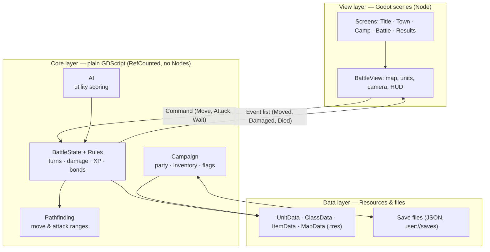
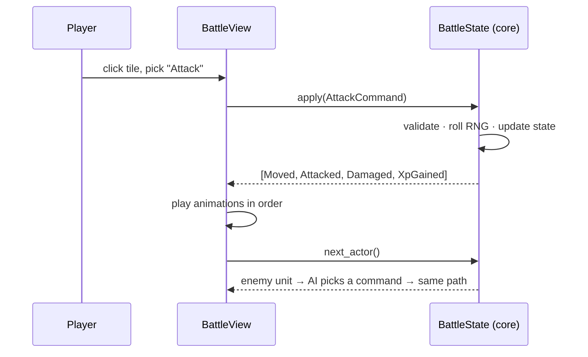
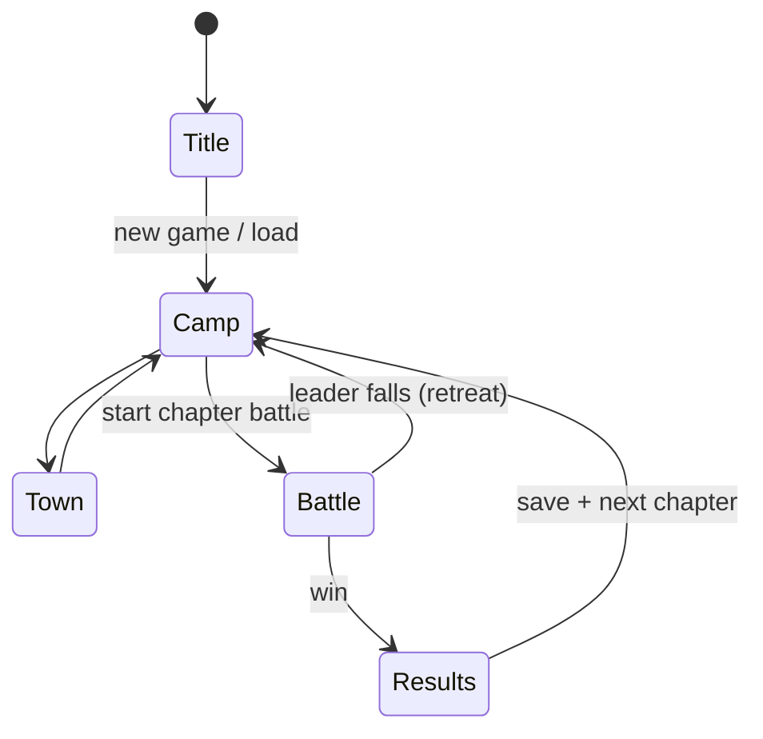

# Software Architecture: How We Build and Run the Game

**In short:** a single-player desktop app built with **Godot 4** and written in **typed GDScript**. It runs offline on macOS, Windows and Linux, with no server, account or network code. Game rules live in plain scripts that we can test. Godot scenes only draw the game and read input.

Companion to [tactical-rpg-design-guide.md](tactical-rpg-design-guide.md).

---

## 1. Tech stack

| Concern | Choice | Why |
| --- | --- | --- |
| Engine | Godot 4.x (latest stable, version pinned in the repo) | Free (MIT license), open source, one small download. 3D, UI, audio, input and export are all built in |
| Language | GDScript with static types (`var hp: int`) | Built for Godot, quick to write, typed enough to catch bugs. No build step |
| Content data | Godot Resources (`.tres`) | Typed, editable in the Godot inspector, readable diffs in git |
| Save files | JSON in `user://saves/` | Readable, easy to version and migrate |
| Tests | gdUnit4 (headless) | Runs the rules core without a window, both locally and in CI |
| Art / audio | Blender → `.glb`, Aseprite → `.png`, `.ogg` | Godot imports all of these natively |
| Repo | Git + Git LFS for binaries | Keeps the repo fast as art and audio pile up |
| CI | GitHub Actions: tests + desktop export | Every push gets a build anyone can play |

Left out on purpose: server, database, networking, C#, an ECS framework, a custom engine. One player on one machine needs none of them.

---

## 2. Architecture

The app has three layers, and dependencies point down only.



**Rules that keep it simple**

1. **The core never touches a Node.** It takes a command and returns events. That means it can run headless in tests and in AI simulations.
2. **The view never changes game state.** It sends commands and animates the events it gets back.
3. **One seeded RNG per battle** lives in the core. With the same seed and the same commands, a battle plays out the same way, so replays and bug reports can be reproduced.
4. **Three autoloads (global singletons) at most:** `Game` (screen flow), `SaveService`, `Audio`. Anything else that seems global gets passed in as a parameter.

### One turn, end to end



### Screen flow



`Game` (autoload) owns this state machine and swaps the current screen scene with `change_scene_to_packed`.

---

## 3. Project layout

```
project.godot
core/                 # pure logic, no Nodes — fully unit-tested
  battle/  battle_state.gd  commands.gd  events.gd  rules.gd  rng.gd
  path/    pathfinder.gd
  ai/      ai_planner.gd
  campaign/ party.gd  inventory.gd  flags.gd
data/                 # content as Resources
  defs/    unit_data.gd  class_data.gd  item_data.gd  map_data.gd   # Resource classes
  units/   *.tres
  classes/ *.tres
  items/   *.tres
  maps/    *.tres + *.tscn
view/                 # scenes + scripts that draw and take input
  screens/ title.tscn  town.tscn  camp.tscn  battle.tscn  results.tscn
  battle/  battle_view.gd  unit_view.tscn  camera_rig.tscn  hud.tscn
autoload/ game.gd  save_service.gd  audio.gd
assets/   models/  textures/  audio/  fonts/       # Git LFS
tests/    core/ ...                                # gdUnit4
```

---

## 4. Core in code (the whole idea in ~30 lines)

```gdscript
# core/battle/battle_state.gd
class_name BattleState extends RefCounted

var units: Array[Unit] = []
var grid: Grid
var rng := RandomNumberGenerator.new()

func _init(map: MapData, party: Array[Unit], seed: int) -> void:
    rng.seed = seed
    grid = Grid.from_map(map)
    units = party + map.spawn_enemies()

## The only way to change a battle. Returns what happened, in order.
func apply(cmd: Command) -> Array[BattleEvent]:
    var events: Array[BattleEvent] = []
    if not cmd.is_valid(self):
        return events
    cmd.execute(self, events)       # mutates state, appends events
    Rules.check_victory(self, events)
    return events
```

```gdscript
# view/battle/battle_view.gd
func _on_player_chose(cmd: Command) -> void:
    var events := state.apply(cmd)
    for e in events:
        await play(e)               # each event knows its animation
    _advance_turn()
```

---

## 5. How to run the game

**Prerequisites:** Godot 4.x. Use the version written in `.godot-version`, or install with `brew install --cask godot`. Also install Git LFS.

```bash
git clone git@github.com-yennanliu:yennanliu/ShiningForceTest.git
cd ShiningForceTest
git lfs pull

# Play from the editor
godot --editor --path .          # then press F5

# Or run the game directly
godot --path .

# Run the core tests headless
godot --headless --path . -s addons/gdUnit4/bin/GdUnitCmdTool.gd -a res://tests

# Build a desktop app (presets live in export_presets.cfg)
godot --headless --path . --export-release "macOS"   build/Banner.app
godot --headless --path . --export-release "Windows" build/Banner.exe
godot --headless --path . --export-release "Linux"   build/Banner.x86_64
```

Players get a single app or executable. Saves and settings go to the OS user data folder that Godot manages as `user://`. For example, macOS uses `~/Library/Application Support/Godot/app_userdata/Banner/`.

---

## 6. Saves

- One JSON file per slot: `slot_1.json`, `slot_2.json`, `slot_3.json`, `auto.json`, `suspend.json`.
- Each file starts with `"version": N`. `SaveService.load()` runs migrations `v1 → v2 → … → current` before handing data to the core.
- A save stores only campaign state: party, inventory, bonds, flags, chapter. A mid-battle suspend also stores the battle seed and the command list, and replays them to rebuild the battle exactly.

---

## 7. Build order

1. Core: grid, units, `apply(cmd)`, pathfinding, with tests. No graphics yet.
2. A grey-box battle scene: cubes for units, a rotating camera, a click-to-move HUD.
3. AI and victory rules, then a full 4 vs 4 battle playable from start to finish.
4. Campaign, save/load, and the screen flow (title → camp → battle → results).
5. Real art, audio and content, all added as data. The architecture should not need to change.
