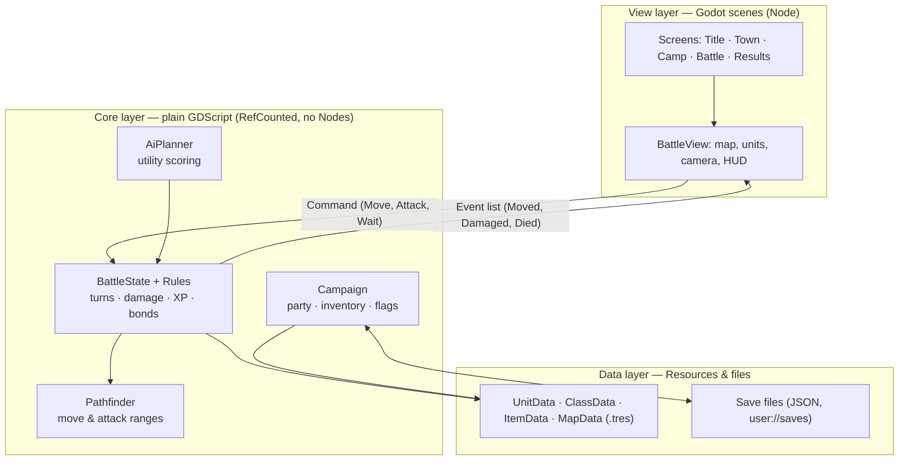
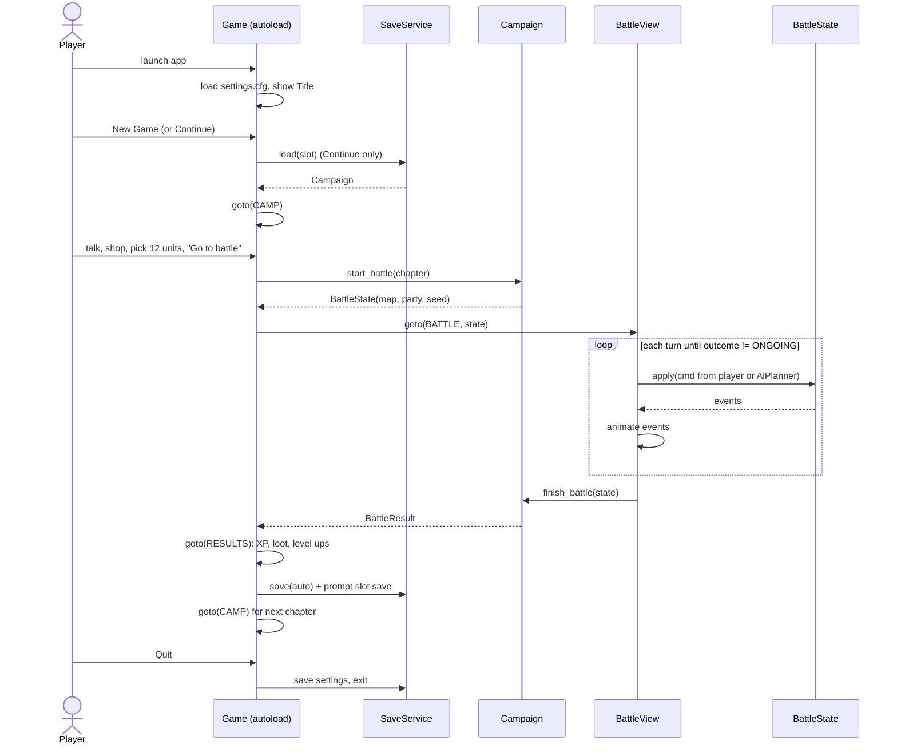

# Software Architecture: How We Build and Run the Game

**In short:** a single-player desktop app built with **Godot 4** and written in **typed GDScript**. It runs offline on macOS, Windows and Linux, with no server, account or network code. Game rules live in plain scripts that we can test. Godot scenes only draw the game and read input.

Companion to [tactical-rpg-design-guide.md](tactical-rpg-design-guide.md).

Contents: [1. Tech stack](#1-tech-stack) · [2. Architecture](#2-architecture) · [3. Project structure](#3-project-structure) · [4. Interfaces and I/O](#4-interfaces-and-io) · [5. End-to-end run](#5-end-to-end-run) · [6. Commands](#6-commands) · [7. Build order](#7-build-order)

---

## 1. Tech stack

| Concern | Choice | Why |
| --- | --- | --- |
| Engine | Godot 4.x (latest stable, version pinned in `.godot-version`) | Free (MIT license), open source, one small download. 3D, UI, audio, input and export are all built in |
| Language | GDScript with static types (`var hp: int`) | Built for Godot, quick to write, typed enough to catch bugs. No build step |
| Content data | Godot Resources (`.tres`) | Typed, editable in the Godot inspector, readable diffs in git |
| Save files | JSON in `user://saves/` | Readable, easy to version and migrate |
| Tests | gdUnit4 (headless) | Runs the rules core without a window, both locally and in CI |
| Art / audio | Blender → `.glb`, Aseprite → `.png`, `.ogg` | Godot imports all of these natively |
| Repo | Git + Git LFS for binaries | Keeps the repo fast as art and audio pile up |
| CI | GitHub Actions: tests + desktop export | Every push gets a build anyone can play |

Left out on purpose: server, database, networking, C#, an ECS framework, a custom engine. One player on one machine needs none of them.

---

## 2. Architecture

The app has three layers, and dependencies point down only.



**Rules that keep it simple**

1. **The core never touches a Node.** It takes a command and returns events. That means it can run headless in tests and in AI simulations.
2. **The view never changes game state.** It sends commands and animates the events it gets back.
3. **One seeded RNG per battle** lives in the core. With the same seed and the same commands, a battle plays out the same way, so replays and bug reports can be reproduced.
4. **Three autoloads (global singletons) at most:** `Game` (screen flow), `SaveService`, `Audio`. Anything else that seems global gets passed in as a parameter.

---

## 3. Project structure

```
ShiningForceTest/
├── project.godot              # Godot project config: name, window size, autoloads, input map
├── .godot-version             # exact engine version everyone uses, e.g. 4.x.y-stable
├── export_presets.cfg         # build targets: macOS, Windows, Linux
├── .gitattributes             # Git LFS rules for assets/**
│
├── core/                      # GAME RULES — plain GDScript, no Nodes, 100% testable
│   ├── battle/
│   │   ├── battle_state.gd    # the battle: units, grid, turn queue, RNG; apply(cmd) -> events
│   │   ├── unit.gd            # runtime unit: stats, hp/mp, position, equipment, status
│   │   ├── grid.gd            # tiles: height, terrain, occupancy; built from MapData
│   │   ├── turn_queue.gd      # initiative order (AGI x jitter), next_actor()
│   │   ├── commands.gd        # Command base + Move/Attack/Cast/UseItem/Wait
│   │   ├── events.gd          # BattleEvent base + Moved/Attacked/Damaged/Died/...
│   │   ├── rules.gd           # formulas: hit, damage, crit, counter, XP, victory check
│   │   ├── map_script.gd      # map triggers: "on turn 5 spawn X", "on unit dies say Y"
│   │   └── rng.gd             # seeded RNG wrapper, the only randomness in battle
│   ├── path/
│   │   └── pathfinder.gd      # Dijkstra over move cost; reachable tiles, path, attack range
│   ├── ai/
│   │   └── ai_planner.gd      # scores every (move, action) for an enemy, returns best Command
│   └── campaign/
│       ├── campaign.gd        # whole-game state: party, inventory, gold, flags, chapter
│       ├── party.gd           # roster, deployed list, promotion
│       ├── inventory.gd       # items, storage, equip rules
│       └── bonds.gd           # pair bond points and tiers
│
├── data/                      # CONTENT — designers edit here, no code changes needed
│   ├── defs/                  # Resource class definitions (the schema)
│   │   ├── unit_data.gd       # name, portrait, class, base stats, growth
│   │   ├── class_data.gd      # move type, MOV, jump, weapon types, promotes_to
│   │   ├── item_data.gd       # type, stats, range, special, price
│   │   ├── spell_data.gd      # levels, area, power, MP cost, element
│   │   ├── map_data.gd        # tile grid, spawns, triggers, objective, scene path
│   │   └── chapter_data.gd    # chapter order: scenes, town, battle, rewards
│   ├── units/  *.tres         # one file per character
│   ├── classes/ *.tres
│   ├── items/  *.tres
│   ├── spells/ *.tres
│   ├── maps/   *.tres + *.tscn  # rules data + the 3D scene that draws it
│   ├── chapters/ *.tres
│   └── dialogue/ *.json       # lines keyed by id: speaker, text, portrait
│
├── view/                      # PRESENTATION — scenes that draw and take input
│   ├── screens/
│   │   ├── title.tscn         # new game / continue / settings / quit
│   │   ├── camp.tscn          # party, storage, bonds, talk, "go to battle"
│   │   ├── town.tscn          # walkable town: shops, NPCs, search spots
│   │   ├── battle.tscn        # hosts BattleView for one map
│   │   └── results.tscn       # XP, level ups, loot, then save
│   ├── battle/
│   │   ├── battle_view.gd     # owns a BattleState; sends commands, plays events
│   │   ├── unit_view.tscn     # one unit's model + animations
│   │   ├── tile_highlight.gd  # draws move/attack ranges
│   │   ├── camera_rig.tscn    # 90° rotate, zoom, follow active unit
│   │   └── hud/               # action menu, unit panel, forecast, turn order bar
│   ├── dialogue/
│   │   └── dialogue_box.tscn  # portrait + text, advance on input
│   └── common/                # buttons, fonts, theme.tres
│
├── autoload/                  # the only globals
│   ├── game.gd                # screen state machine; holds the current Campaign
│   ├── save_service.gd        # read/write/migrate save JSON
│   └── audio.gd               # music + SFX buses
│
├── assets/                    # binaries in Git LFS: models/, textures/, audio/, fonts/
├── tests/
│   ├── core/                  # unit tests per core file
│   ├── e2e/                   # scripted full-battle and full-chapter runs (section 5)
│   └── fixtures/              # tiny test maps and units
├── tools/                     # editor plugins: map painter, battle sim CLI
├── .github/workflows/ci.yml   # test + export on every push
└── doc/                       # these docs
```

**Ownership rule:** `core/` imports only `core/` and `data/defs/`. `view/` may import anything. `data/` holds no logic. CI fails if a file in `core/` references `Node`, `get_tree()` or `view/` (checked with a simple grep).

---

## 4. Interfaces and I/O

### 4.1 What goes in and out of the app

| Direction | What | Where / format |
| --- | --- | --- |
| In | Player input | Keyboard + mouse, or gamepad, mapped to actions in `project.godot` (`confirm`, `cancel`, `rotate_left`, `rotate_right`, `menu`, `cursor_*`) |
| In | Game content | `res://data/**/*.tres`, `res://data/dialogue/*.json`, packed into the app at export |
| In | Assets | `res://assets/**` (`.glb`, `.png`, `.ogg`), packed into the app |
| In / out | Save games | `user://saves/slot_{1..3}.json`, `auto.json`, `suspend.json` |
| In / out | Settings | `user://settings.cfg` (volume, window mode, key bindings) |
| Out | Picture and sound | A 1920×1080 window that scales to other sizes, plus stereo audio |
| Out | Logs | `user://logs/godot.log`, plus a battle replay log `user://logs/last_battle.json` (seed + commands) for bug reports |

There are no network calls. The app only writes inside `user://`.

### 4.2 Module interfaces (inputs → outputs)

| Module | Function | Input | Output |
| --- | --- | --- | --- |
| `BattleState` | `new(map, party, seed)` | `MapData`, `Array[Unit]`, `int` | a ready battle |
| | `apply(cmd)` | `Command` | `Array[BattleEvent]`, in order (empty if the command is invalid) |
| | `current_actor()` | — | `Unit` |
| | `outcome()` | — | `ONGOING`, `WON` or `LOST` |
| | `legal_commands(unit)` | `Unit` | `Array[Command]`, which the HUD and AI use |
| `Pathfinder` | `reachable(grid, unit)` | `Grid`, `Unit` | `Dictionary[Vector2i, int]` (tile → cost) |
| | `path_to(grid, unit, tile)` | `Grid`, `Unit`, `Vector2i` | `Array[Vector2i]` |
| | `attack_tiles(grid, from, range)` | `Grid`, `Vector2i`, `Vector2i(min, max)` | `Array[Vector2i]` |
| `AiPlanner` | `choose(state, unit)` | `BattleState`, `Unit` | `Command` |
| `Rules` | `forecast(state, attacker, target)` | 2 units | `{hit: float, dmg: Vector2i, crit: float, counter: bool}` for the HUD |
| `Campaign` | `start_battle(chapter)` | `ChapterData` | `BattleState` |
| | `finish_battle(state)` | finished `BattleState` | `BattleResult` (XP, loot, deaths, bond changes) |
| | `to_dict()` / `from_dict(d)` | — / `Dictionary` | `Dictionary` / `Campaign` |
| `SaveService` | `save(slot, campaign)` | `String`, `Campaign` | `Error` |
| | `load(slot)` | `String` | `Campaign` or `null` (migrated to the current version) |
| | `list_slots()` | — | `Array[SlotInfo]` (chapter, play time, date) |
| `Game` | `goto(screen, args)` | `Screen` enum, `Dictionary` | swaps the scene; emits `screen_changed` |

```gdscript
# core/battle/battle_state.gd — the heart of the game
class_name BattleState extends RefCounted

enum Outcome { ONGOING, WON, LOST }

func _init(map: MapData, party: Array[Unit], seed: int) -> void: ...
func current_actor() -> Unit: ...
func legal_commands(unit: Unit) -> Array[Command]: ...
func apply(cmd: Command) -> Array[BattleEvent]: ...   # the ONLY way state changes
func outcome() -> Outcome: ...
```

```gdscript
# view/battle/battle_view.gd — the view loop
func _on_player_chose(cmd: Command) -> void:
    for e in state.apply(cmd):
        await play(e)                       # each event knows its animation
    await _run_enemy_turns()                # AiPlanner.choose -> apply -> play
    if state.outcome() != BattleState.Outcome.ONGOING:
        Game.goto(Game.Screen.RESULTS, {"result": campaign.finish_battle(state)})
```

### 4.3 Data contracts

**Commands (view/AI → core)**

| Command | Fields |
| --- | --- |
| `Move` | `unit_id`, `to: Vector2i` |
| `Attack` | `unit_id`, `target_id` |
| `Cast` | `unit_id`, `spell_id`, `level`, `at: Vector2i` |
| `UseItem` | `unit_id`, `item_slot`, `target_id` |
| `Wait` | `unit_id`, `facing` |

**Events (core → view)**

| Event | Fields | View plays |
| --- | --- | --- |
| `TurnStarted` | `unit_id` | camera pans to the unit |
| `Moved` | `unit_id`, `path` | walk along the path |
| `Attacked` | `attacker_id`, `target_id`, `hit`, `crit` | attack animation |
| `Damaged` / `Healed` | `unit_id`, `amount`, `hp_after` | number pop + HP bar |
| `Died` | `unit_id` | fade out |
| `XpGained` / `LeveledUp` | `unit_id`, `amount` / `stat_gains` | XP bar / level-up panel |
| `BondChanged` | `a_id`, `b_id`, `tier` | small heart icon |
| `Spawned` / `Said` | `unit_id` / `speaker`, `line_id` | reinforcement / dialogue box |
| `BattleEnded` | `outcome` | victory / defeat banner |

**Save file (`user://saves/slot_1.json`)**

```json
{
  "version": 1,
  "saved_at": "2026-11-07T10:30:00Z",
  "play_seconds": 5420,
  "chapter": "ch02",
  "gold": 1200,
  "party": [
    { "id": "hero", "class": "swordsman", "level": 7, "xp": 40,
      "hp": 28, "mp": 0, "items": ["bronze_sword", "herb"] }
  ],
  "storage": ["healing_seed"],
  "bonds": { "hero|archer": 85 },
  "flags": { "saved_villager": true },
  "suspend": null
}
```

The `suspend` field is null in a normal save. In a mid-battle save it holds `{ "map": "m03", "seed": 9182, "commands": [...] }`, and loading replays those commands to rebuild the battle exactly. `SaveService` runs the migrations `v1 → v2 → …` before passing the data to `Campaign.from_dict`.

---

## 5. End-to-end run

### 5.1 What happens when a player plays



Step by step:

1. **Boot.** Godot starts and loads the `Game`, `SaveService` and `Audio` autoloads. `Game` reads `settings.cfg` and opens `title.tscn`.
2. **Title.** New Game builds a `Campaign` from `data/chapters/ch01.tres`. Continue calls `SaveService.load(slot)`. If a suspend save exists, the game goes straight back into that battle.
3. **Camp / Town.** These screens read and change `Campaign` directly: party order, equipment, shop purchases and talk flags. No battle code runs here.
4. **Battle start.** `Campaign.start_battle()` creates a `BattleState` from the chapter's `MapData`, the deployed units and a new seed. `battle.tscn` loads the map's 3D scene and puts a `UnitView` on each unit.
5. **Turn loop.** `current_actor()` decides who moves next. A player unit opens the HUD, which uses `legal_commands` and `Pathfinder` to show ranges and `Rules.forecast` to preview damage. An enemy unit asks `AiPlanner.choose()`. Either way, the result goes through `apply()`, and the view plays the returned events. Map triggers run inside `apply` and produce `Spawned` and `Said` events.
6. **Battle end.** `outcome()` becomes `WON` or `LOST`. `Campaign.finish_battle()` applies XP, loot, revivals and bond changes and returns a `BattleResult`.
7. **Results and save.** The results screen shows the rewards. `SaveService` writes `auto.json` and asks which slot to save to. The flow then returns to Camp for the next chapter.
8. **Quit.** Settings are saved and the app exits. The player's progress is entirely in `user://saves/`.

### 5.2 How we test it end to end

| Level | What it runs | How | When |
| --- | --- | --- | --- |
| Unit | Each `core/` file | gdUnit4, headless, < 5 s | Every save in the editor + CI |
| Battle E2E | A full battle with no window: AI plays both sides until `outcome()` | `tests/e2e/test_battle_runs.gd` loops `apply(AiPlanner.choose())` on every map; asserts it ends in < 200 turns with no errors | CI, every push |
| Golden replay | A recorded battle (seed + commands) replayed | Compare the final unit HP/positions/XP with a stored snapshot; any rules change that alters it must update the snapshot on purpose | CI, every push |
| Campaign E2E | New game → chapter 1 battle → results → save → load → compare | Headless script that drives `Game` + `Campaign` + `SaveService`, auto-winning each battle by AI vs AI | CI, every push |
| Smoke on build | The exported app actually starts | `build/Banner --headless --quit-after 300` (300 frames) exits with code 0 | CI, after export |
| Manual | A person plays the latest CI build | Download the artifact from GitHub Actions | Weekly playtest |

Because the core is pure and seeded, the first four levels need no window, mouse or GPU. They run on a plain CI machine in about a minute.

---

## 6. Commands

**Prerequisites:** Godot 4.x. Use the version written in `.godot-version`, or install with `brew install --cask godot`. Also install Git LFS.

```bash
git clone git@github.com-yennanliu:yennanliu/ShiningForceTest.git
cd ShiningForceTest
git lfs pull

# Play from the editor
godot --editor --path .          # then press F5

# Or run the game directly
godot --path .

# Run all tests headless (unit + e2e)
godot --headless --path . -s addons/gdUnit4/bin/GdUnitCmdTool.gd -a res://tests

# Build a desktop app (presets live in export_presets.cfg)
godot --headless --path . --export-release "macOS"   build/Banner.app
godot --headless --path . --export-release "Windows" build/Banner.exe
godot --headless --path . --export-release "Linux"   build/Banner.x86_64
```

Players get a single app or executable. Saves and settings go to the OS user data folder that Godot manages as `user://`. For example, macOS uses `~/Library/Application Support/Godot/app_userdata/Banner/`.

---

## 7. Build order

1. Core: grid, units, `apply(cmd)`, pathfinding, with unit tests. No graphics yet.
2. Battle E2E test: AI vs AI on a 4 vs 4 fixture map runs to the end headless.
3. A grey-box battle scene: cubes for units, a rotating camera, a click-to-move HUD.
4. Campaign, save/load, and the screen flow (title → camp → battle → results), plus the campaign E2E test.
5. Real art, audio and content, all added as data. The architecture and interfaces should not need to change.
