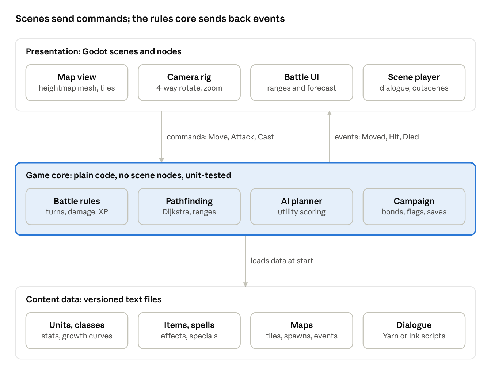
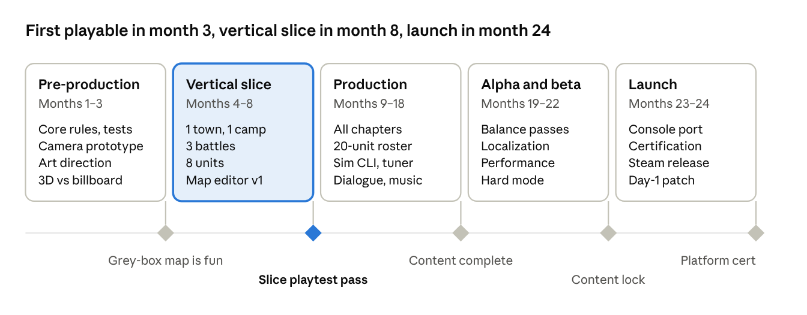

# Building a Saturn-Era Tactical RPG: Design & Engineering Guide

Nov 7, 2026 · [Live doc](https://claude.ai/artifact/U5A1m36vpVYHFnDZbV7vfs)

## Scope: an original game, built on the same genre DNA

We will build an **original** isometric tactical RPG that uses the same kind of systems as Shining Force III Scenario 1 (Sega Saturn, 1997): grid battles in 3D, a large recruitable party, class promotion, and a story told from one side of a war. We study the reference game for its mechanics, pacing and feel. We do not reuse its name, story, characters, maps, art, music, text or code.

That line matters for two reasons. Sega owns the IP, so a remake or ROM-derived asset rip cannot ship. And a clean original lets us own every design call instead of chasing a 1997 build.

Working title in this doc: **Project Banner** (placeholder). Target: PC (Steam) first, then Switch-class consoles, built by a team of 6–10 over about 24 months.

## What the reference game gets right

The reference works because battles are short, readable and full of small decisions. Its party also feels alive between fights. Camelot Software Planning developed it and Sega published it on Saturn (Japan 1997, West mid-1998). It was the first of three linked scenarios, each played from a different army's view ([Sega-16 review](https://www.sega-16.com/2025/01/shining-force-iii-scenario-i/)).

| Feature | How it works in the reference | Lesson for us |
| --- | --- | --- |
| 3D grid battles | Turn-based fights on 3D maps; the player can rotate the camera at any time | Readable height and occlusion matter more than polygon count |
| Short battles | Reviewers found fights shorter and snappier than Tactics Ogre or FF Tactics | Aim for 15–25 minute maps, with fast animations that can be skipped |
| Friendship system | 5 bond levels (Ally to Soul Mate) grant bonuses to 9 stats, such as attack, evade and counter, when bonded units fight side by side | A light, emergent bond system rewards formation play without grinding |
| Soft death | Fallen units are not lost for good, but each bond drops a level | Make losses cost something without forcing a reset |
| Special attacks | A weapon-dependent special can trigger on an attack | Adds variety to each hit and makes gear choice matter |
| Visible enemy MP | Players can see an enemy caster's MP running out | Show enemy resources so players can plan |
| Timed reinforcements | Reinforcements arrive mid-battle at a distance | Plan dramatic beats but keep them fair |
| Ruins maps | Loot-race maps with carry limits | Vary map objectives beyond "defeat all" |
| Home base | Storage, party swap, objective reminder, characters chat | One hub screen handles prep and party mood |
| Linear towns, no world map | Search spots in towns hide items | Keep momentum; explore in small, dense places |
| Linked scenarios | Choices and survivors carry into the next scenario through the save file | Design save data so it can carry into a sequel or DLC from day one |

Criticisms to design against: weak enemy AI makes battles easy once players master bonds. The silent hero's "……" lines grate. Warping back to heal breaks the flow. Tactical depth falls short of Fire Emblem ([Sega-16](https://www.sega-16.com/2025/01/shining-force-iii-scenario-i/), [Kimimi](https://kimimithegameeatingshemonster.com/2024/09/30/shining-force-iii-scenario-1-colossus-of-the-capital-a-shining-start-pt1/)).

## Design pillars and core loop

Four pillars decide every feature call. If a feature serves none of them, we cut it.

1. **Every turn is a readable decision.** Before the player commits, they see the move range, attack range, land effect, hit chance and damage.
2. **Short, varied battles.** A map takes 15–25 minutes. Each map adds one twist: an escort, a loot race, a timed bridge, or a boss with phases.
3. **The party is the story.** Bonds, camp chatter and promotions make 20+ units feel like people, not stat blocks.
4. **Momentum.** No world-map wandering. Towns are small and dense. A free full heal after each battle replaces any "warp back to heal" loop.

**Core loop** (one chapter is about 60–90 minutes):

1. Story scene sets the stakes
2. Town or camp: shop, talk, recruit, rearrange the party
3. Battle: deploy, fight, recruit mid-map, finish the objective
4. Rewards: XP, gold, items, bond growth, promotions
5. Branch flags saved for later chapters (who lived, who was recruited, choices made)

**Vertical slice target:** 1 town, 1 camp, 3 battles, 8 playable units, 2 classes per unit.

## Battle system spec

Battles use a square grid on a 3D heightmap. Each unit acts on its own turn, in an order set by its speed. Each turn is move, then one action. The numbers below are starting values to tune in playtests. They are not taken from the reference game.

**Grid and terrain**

- Tiles are 1×1 with an integer height (0–8). A unit can climb up to its `jump` stat in height per step.
- Each terrain type sets a move cost per movement class and a land effect (a defense bonus of 0%, 15% or 30%).
- Movement classes: foot, armored (slow on rough ground), mounted (fast on flat ground, slow in forest), flying (ignores terrain), aquatic.
- Pathfinding uses Dijkstra over move cost, limited by the unit's MOV stat. Enemy zones of control are optional, set per map.

**Turn order**

- At the start of each round, every unit draws an initiative of `AGI × rand(0.875, 1.125)`, highest first. The jitter keeps turn order from being solved in advance.
- The upcoming turn order shows in a timeline bar at the top of the screen.

**Actions:** Attack, Magic (spell level 1–4 picks area and power), Item, Equip, Swap item with an adjacent ally, Search, Stay.

**Combat formulas** (first pass):

```latex
\text{dmg} = \max\left(1,\ (\text{ATK} - \text{DEF}\times(1+\text{land})) \times \text{rand}(0.9, 1.1) \times \text{crit} \times \text{bond}_{\text{atk}}\right)
```

- Hit chance = `clamp(90 + (attacker LUK − target AGI/2) − target evade bonus, 10, 99)`.
- Crit: base 4% + bond bonus, ×1.5 damage.
- Counter: the defender strikes back if in range. Base 8% + bond bonus.
- Double attack: base 6%, higher for fast classes.
- Weapon special: each weapon has a special with a 5–15% trigger chance (multi-hit, status effect, or drain).
- Magic ignores DEF and uses the target's resistance to that element.

**Experience and levels**

- XP per action = `clamp(round(base × (1 + (enemyLv − myLv) × 0.15)), 1, 49)`, where base is 10 for a hit, 48 for a kill and 10–25 for a heal. Every 100 XP is a level.
- Stat growth per level comes from a per-class growth curve plus small random variation.

**Promotion:** At level 20 or higher, a unit can promote at a church. Level resets to 1 and stats stay. Some units have a second branch unlocked by a rare item.

**Defeat:** If the leader falls, the party retreats to the last town with XP and items kept. Other fallen units revive after the battle for a gold fee. Each fallen unit loses one bond level with every ally (see next section).

**AI:** A per-unit utility score (damage dealt, kill chance, threat to the leader, self-preservation, terrain value) chooses the move and target. Each map can set behavior presets: hold, guard, advance, hunt the leader, or flee. Better AI than the reference is a stated goal, so AI work is scheduled in every milestone.

## Progression and meta systems

The party, not the hero, is the unit of progression. Each system below feeds the bond and choice data that carries between chapters.

| System | Rule | Data it writes |
| --- | --- | --- |
| Roster | Up to 30 recruits, 12 deployed per battle. Some recruits are hidden behind talks, searches or keeping a guest NPC alive | `roster[]`, `recruitFlags` |
| Bonds | Each pair of units earns bond points when they hit the same target in one round, heal each other, or stand next to each other for a hit. 5 tiers (0, 40, 120, 260, 500 pts); each tier adds +2% to +10% to one or two stats chosen per pair | `bonds[unitA][unitB]` |
| Bond loss | A fallen unit drops one tier with every partner but keeps its points, so it can regain the tier quickly | same |
| Equipment | 1 weapon + 1 ring/accessory + 3 item slots per unit. Weapons have a special and a range type (melee, 1–2, bow 2–3) | `inventory` |
| Crafting | Rare ore from searches and ruins maps is forged by a smith into one of 3 weapons, picked at random from a weighted pool | `forgeLog` |
| Shops | Each town has a stock list. A deals shop rotates surplus items | `shopState` |
| Camp hub | Party swap, storage, bond viewer, objective reminder, short unit chats that change by chapter and bond tier | `campVisited` |
| Save | 3 manual slots + 1 auto save before each battle + 1 suspend save mid-battle | `SaveGame v{n}` |
| Carryover | Scenario 2 reads a Scenario 1 save: who survived, bond tiers, key choices, 1 heirloom item | `carryover.json` |

The save format gets a version field and a migration function from day one. Carryover only works if older saves still load after patches.

## Technical architecture

We build on **Godot 4.x with GDScript** and keep a pure-code rules core under the scenes. Godot is MIT-licensed with no royalties, handles stylized 3D well, exports to PC and consoles through porting partners, and lets designers edit maps in the editor. Use C# for the core only if profiling shows the AI search is too slow in GDScript. Unity is the fallback if console porting turns out to be the deciding factor.



The core never calls a node. The battle UI sends a command, the core checks it, changes the state, and returns a list of events that the scenes animate. This split gives us three things: unit tests for every formula, AI that runs thousands of simulated turns without rendering, and full replays from a seed plus a command log.

**Key decisions**

- **Determinism:** one seeded RNG per battle that lives in the core. Its seed goes into the suspend save, so reloading cannot reroll a missed attack. That rule is a design choice we can revisit.
- **Maps:** build them in Godot's GridMap or as a custom tile mesh. Store each map as a tile-data resource with height, terrain, spawns and trigger zones, so the core can read a map without loading a scene.
- **Camera:** an orbit rig that turns in 90° steps and has 3 zoom levels. Walls and roofs between the camera and the active unit fade out.
- **Units:** 3D models with simple rigs, or 2D billboards on the 3D map. The art lead decides this in the first month, since it sets art cost for the whole project.
- **Scripting:** map events (reinforcements, talk triggers, objective changes) are data rows, `on: turn 5 / unit enters zone / unit dies → do: spawn / say / set flag`. No per-map code.
- **Testing:** GUT or gdUnit4 for core tests, plus a headless "AI vs AI" soak test on every map in CI.

## Content pipeline and tools

Designers should be able to add a unit, item or map without an engineer. All content lives as text in git, and CI validates it.

| Content | Authored in | Stored as | Validation in CI |
| --- | --- | --- | --- |
| Units, classes, growth | Spreadsheet, exported by script | JSON / `.tres` | Stat ranges, every class has a promotion path |
| Items, spells | Spreadsheet | JSON | Every effect ID exists, prices > 0 |
| Maps | Godot editor plugin: paint height, terrain, spawns, triggers | `.tres` + scene | Every spawn can reach the player, objective reachable, AI soak test passes |
| Dialogue | Yarn Spinner or Ink | `.yarn` / `.ink` | No missing speaker, every line has a loc key |
| Art | Blender (low-poly, 128–512 px textures), Aseprite for portraits | `.glb`, `.png` | Polygon and texture budgets |
| Audio | DAW of the composer's choice | `.ogg` | Loudness −16 LUFS |
| Localization | Translators fill a CSV | `.csv` | Every key present in each language |

**In-house tools to build** (about 8 engineer-weeks):

- Map editor plugin with a live move-range preview and a one-click "play from here"
- Battle simulator CLI: runs a map 1,000 times with AI on both sides and reports win rate, turns and unit deaths
- Bond and XP curve tuner: a chart of party level against the map's enemy level across the campaign

**Reference tools from the community** (for study only; nothing ships from them):

| Tool | What it is | How we use it |
| --- | --- | --- |
| [Ymir](https://github.com/ymir-emu/Ymir) | GPL-3.0 C++ Sega Saturn emulator with a debugger and frame stepping | Play our own legally owned copy and step frame by frame to study pacing, animation timing and camera behavior |
| [sf3tools](https://github.com/Synival/sf3tools) | Community editors and libraries for SF3 data: map (MPD), portrait, sprite and compression formats | Learn how a 1997 team structured map, unit and event data, as input to our own schemas |
| [SFR-Godot](https://github.com/ShiningForceRemade/SFR-Godot) | Early-stage Godot fan project (4 commits) with battle and movement scenes | A sample of one Godot project layout; too early to adopt as a base |

Rule: no files extracted from the original game enter our repo. That includes maps, textures, sprites, text and audio. GPL code (Ymir) is not linked into our build.

## Team and roadmap

The plan has five phases over 24 months. The vertical-slice gate in month 8 is the go/no-go point for full production.



The slice gate passes when 5 outside playtesters finish all 3 battles, rate the battles 4/5 or higher, and the build holds 60 fps on min-spec PC. If it fails, we spend up to 2 months iterating, then rescope.

| Role | Headcount | Joins | Owns |
| --- | --- | --- | --- |
| Game director / designer | 1 | Month 1 | Pillars, battle rules, balance |
| Gameplay engineer | 2 | Month 1 | Rules core, AI, pathfinding, saves |
| Tools / engine engineer | 1 | Month 2 | Map editor, sim CLI, CI, ports |
| Level designer | 1–2 | Month 4 | Maps, events, encounter tuning |
| Writer | 1 | Month 3 | Setting, cast, dialogue |
| 3D / character artist | 2 | Month 2 | Units, tilesets, effects |
| UI/UX designer | 1 | Month 3 | Battle HUD, menus, readability |
| Composer / sound (contract) | 1 | Month 6 | Score, SFX |
| QA (contract) | 1–3 | Month 12 | Test passes, cert checklists |

**First 4 weeks for engineering:**

- [ ] Godot 4 project, CI, gdUnit4 set up
- [ ] Core: grid, units, initiative queue, move/attack commands, event list
- [ ] Dijkstra move range + attack range, with tests on height and terrain
- [ ] Grey-box map with a 4-way rotating camera, 4 vs 4 units, basic AI
- [ ] Seeded RNG and command log replay

## Risks and IP guardrails

The biggest risks are scope (30 units × promotions × maps) and drifting into a recreation of the reference.

| Risk | Likelihood | Mitigation |
| --- | --- | --- |
| Content scope blows the budget | High | Lock the roster at 20 for v1. Every map reuses one of 6 tilesets. Cut in the order: side maps, then recruits, then cutscenes |
| Battles are too easy (the reference's main flaw) | High | AI soak tests, a hard mode with smarter target selection, and a playtest each milestone with a clear-rate target of 70–85% on the first try |
| 3D camera hides units | Medium | Wall and roof fade, a top-down toggle, and outlines on units hidden behind objects |
| Art cost of 3D characters | Medium | Decide 3D models vs. billboards in month 1. Prototype both on one map |
| Save carryover breaks after patches | Medium | Versioned save schema, migration tests that load every past version |
| IP: names, characters, maps, music or art too close to the reference | Medium | Legal review at each milestone. Original setting brief. No assets from ROMs, emulators or extraction tools in the repo |
| GPL contamination | Low | Ymir and any GPL tools stay outside the build; record this in the license audit |

**Guardrails for the team**

- Do not use the reference's name, logo, character names, place names, story beats or map layouts.
- Mechanics such as grid tactics, initiative, bonds and promotion are fine to use. Specific expression such as text, art, music and level design is not.
- Do not download or share ROMs. Anyone who studies the original uses a copy they own.

**Sources**

- [Sega-16 review of Scenario I (Jan 2025)](https://www.sega-16.com/2025/01/shining-force-iii-scenario-i/)
- [Kimimi playthrough, part 1 (Sep 2024)](https://kimimithegameeatingshemonster.com/2024/09/30/shining-force-iii-scenario-1-colossus-of-the-capital-a-shining-start-pt1/)
- [Shining Wiki entry](https://shining.fandom.com/wiki/Shining_Force_III_Scenario_1:_God_Warrior_of_the_Kingdom) (would not load when this doc was written)
- [Ymir](https://github.com/ymir-emu/Ymir), [sf3tools](https://github.com/Synival/sf3tools), [SFR-Godot](https://github.com/ShiningForceRemade/SFR-Godot)
- We left out the ROM download site from the original reference list on purpose.
